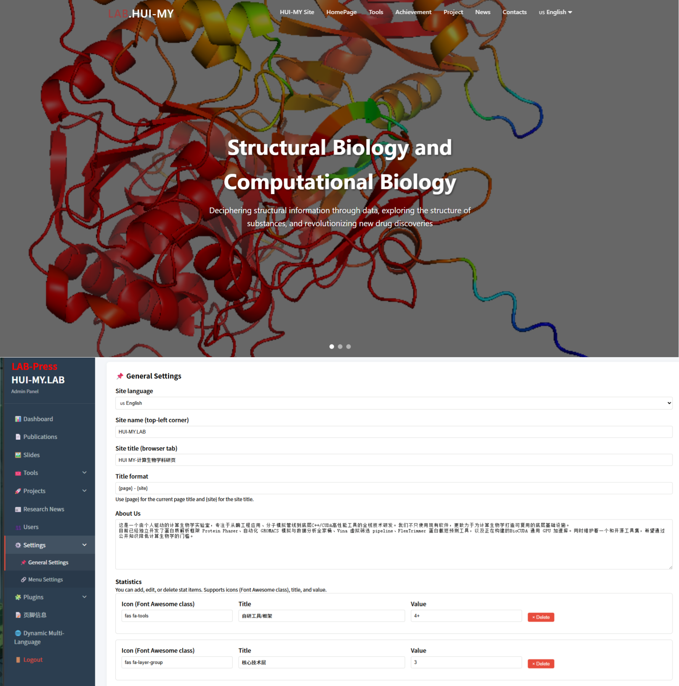

<p align="center">
  <a href="https://github.com/GuiHui-huimy/LabPress" target="_blank">
    
  </a>
</p>

<p align="center">
  <strong>
    An Open-Source Academic CMS Tailored for Research Labs
  </strong>
</p>

<p align="center">
  <a href="https://lab.huimy.top" target="_blank"></a>
<a href="https://comm.huimy.top" target="_blank">
  
</a>
  
  
  
</p>

<p align="center">
  Built with pure PHP &amp; MySQL, LabPress features a powerful hook-driven plugin system and comprehensive internationalization (i18n). It enables research laboratories to set up a professional multilingual academic website within minutes.
</p>

<p align="center">
  <a href="https://lab.huimy.top" target="_blank">
    
  </a>
</p>

<p align="center">
  <em>
    Check out the online demo –
    <a href="https://lab.huimy.top" target="_blank">lab.huimy.top</a>.
  </em>
</p>

<h2></h2>

## Core Features

### Specialized Academic Modules

Built-in publications, project showcases, research news, and research-tool/project management with version tracking. Ready to use out of the box for any research domain.

### Hook-Driven Plugin System

Fully compatible with WordPress-like Hook/Filter mechanisms. Extend functionality purely through Actions and Filters without touching core files.

### Comprehensive I18n

Frontend and backend locales are completely decoupled. Core language packs cover all static texts, while the Dynamic Multi-Language plugin handles every piece of user-generated content in the database.

### Dynamic Content Management

Edit "About Us", "Research Directions", stats, and navigation menus directly from the backend. Supports HTML and Markdown.

### Markdown Editor

Write news and project details with Markdown. Integrated EasyMDE provides a toolbar, live preview, and split-screen editing.

### Lightweight & Performant

Hand-written PHP, no framework overhead. Language packs and plugins are loaded on demand. Suitable for shared hosting, VPS, or cloud servers.

<h2></h2>

## Tech Stack & Requirements

| Dependency     | Version              | Notes                                                  |
| -------------- | -------------------- | ------------------------------------------------------ |
| **PHP**        | 8.1 or higher        | Requires PDO, pdo_mysql, json, mbstring, session, zip  |
| **MySQL**      | 5.7+ / MariaDB 10.3+ | Used for all content storage                           |
| **Web Server** | Apache / Nginx       | URL rewriting recommended (optional)                   |

> LabPress does not depend on Composer or any external PHP libraries. All core functionalities are hand-written in PHP.

<h2></h2>

## Quick Start

### 1. Get the Code

```bash
git clone https://github.com/GuiHui-huimy/LabPress.git
```

Or download the ZIP package and extract it to your web root directory.

### 2. Create an Empty Database (Recommended)

Create a MySQL/MariaDB database with `utf8mb4`, or let the installer create it if the database user has `CREATE DATABASE` permission. An empty database is expected; do not import old SQL dumps into a fresh install.

### 3. Open the Installer

Visit:

```text
https://your-domain/install.php
```

Fill in the database host, port, database name, user, password, site URL and administrator account. The installer will:

1. check the PHP extensions and `storage/` permissions;
2. connect to MySQL and create the database if permitted;
3. create all core tables and run the bundled migrations;
4. create the administrator and write `storage/config/site.php`;
5. optionally install a newly written demo lab site;
6. write `storage/install.lock` so the installer cannot run twice.

After success, log in at `/admin/login.php`.

### 4. CLI Installation (Optional)

For CI or automated deployments:

```bash
php bin/install.php \
  --db-host=127.0.0.1 \
  --db-name=labpress \
  --db-user=labpress \
  --db-pass='your-password' \
  --site-url=https://example.com \
  --site-name='Your Lab' \
  --admin-username=admin \
  --admin-password='change-me-now' \
  --demo
```

Use `--no-demo` to skip demo content.

### 5. Set Permissions (Linux/macOS)

```bash
chmod -R 755 uploads/
chmod -R 755 plugins/
mkdir -p storage/logs
chmod -R 775 storage storage/logs
chmod 640 storage/config/site.php storage/install.lock
```

The web server user needs write access to `storage/`, `uploads/`, and `plugins/`. `storage/config/site.php` contains database credentials and must not be committed.

### 6. Access the Site

- **Frontend:** Visit your domain directly
- **Backend:** `https://your-domain/admin/login.php`

The administrator account is the one you created in the installer; there is no built-in default password.

> **Upgrading an existing site?** Do not run the installer. Use `php bin/migrate.php up` and follow the [v1.2.0 upgrade guide](docs/getting-started/upgrade-v1.2.0.md).

## Project Structure

```
LabPress/
├── admin/ # Backend management panel
│ ├── index.php # Admin entry point (dashboard loader)
│ ├── login.php # Admin login page
│ ├── logout.php # Logout handler
│ ├── includes/
│ │ ├── admin-header.php # Admin sidebar + top bar
│ │ └── admin-footer.php # Admin footer (JS includes)
│ ├── views/ # Individual management views
│ │ ├── dashboard.php # System overview & stats
│ │ ├── publications.php # Publications CRUD
│ │ ├── slides.php # Slides management
│ │ ├── tool-list.php # Tool list management
│ │ ├── tool-detail.php # Tool detail editor
│ │ ├── tool-versions.php # Version history manager
│ │ ├── project-categories.php # Project categories CRUD
│ │ ├── projects.php # Projects management
│ │ ├── news.php # Research news management
│ │ ├── users.php # User management
│ │ ├── site-config.php # General site settings
│ │ ├── nav-menus.php # Navigation menu manager
│ │ ├── plugins.php # Installed plugins list
│ │ ├── plugins-install.php # Plugin installer (ZIP upload)
│ │ └── plugins-market.php # Plugin marketplace (placeholder)
│ └── assets/
│ ├── css/
│ │ └── admin.css # Backend global styles
│ └── js/
│ ├── admin.js # Sidebar & common admin scripts
│ ├── plugins-manage.js # Plugin activation/deactivation
│ ├── plugins-install.js # Plugin installation logic
│ ├── plugins-market.js # Plugin market interactions
│ ├── publications.js # Publications CRUD logic
│ ├── slides.js # Slides CRUD + image upload
│ ├── tool-list.js # Tool list CRUD
│ ├── tool-detail.js # Tool detail loading
│ ├── tool-versions.js # Version management logic
│ ├── project-categories.js # Category CRUD
│ ├── project-manage.js # Projects CRUD + EasyMDE
│ ├── news-manage.js # News CRUD + EasyMDE
│ ├── users.js # User management logic
│ ├── site-config.js # Site settings dynamic forms
│ └── nav-menus.js # Menu CRUD logic
│
├── api/ # RESTful data endpoints
│ ├── data.php # Unified data reader (type-based)
│ ├── save.php # Unified data saver (type-based)
│ ├── upload.php # Image upload handler
│ ├── users.php # User CRUD API
│ ├── auth.php # Authentication API (check/login/logout)
│ ├── plugin-install.php # Plugin ZIP installation endpoint
│ ├── plugin-install-from-url.php # Remote plugin installation
│ └── plugin-uninstall.php # Plugin removal endpoint
│
├── assets/ # Frontend global static resources
│ ├── css/
│ │ ├── index.css # Homepage styles
│ │ ├── header.css # Navigation bar styles
│ │ ├── tools.css # Tools list page styles
│ │ ├── tool_detail.css # Tool detail page styles
│ │ ├── news.css # News list & detail styles
│ │ ├── news-detail.css # News detail specific styles
│ │ ├── projects.css # Project list page styles
│ │ └── project-detail.css # Project detail page styles
│ ├── js/
│ │ ├── index.js # Homepage carousel & publications loader
│ │ ├── project.js # Project list interactions (Isotope)
│ │ └── isotope.pkgd.min.js # Isotope filtering library
│ └── libs/ # Third-party frontend libraries
│ ├── easymde.min.css # EasyMDE editor styles
│ └── easymde.min.js # EasyMDE Markdown editor
│
├── includes/ # Core library & configuration
│ ├── config.php # Legacy DB_* fallback; requires bootstrap
│ ├── bootstrap.php # Autoload, config, session, PDO, errors, assets
│ ├── functions.php # Core functions (data access, helpers, i18n)
│ ├── hooks.php # Backward-compatible LabPress_Hooks wrapper
│ ├── header.php # Frontend header + navigation
│ ├── footer.php # Frontend footer
│ └── labpress.php # LabPress core utility class (config, pages, etc.)
│
├── core/ # kernel classes (Config, Hooks, Guard, Assets, Plugin, Migration, I18n)
├── migrations/ # schema_version migrations
├── bin/migrate.php # CLI migration runner
├── storage/ # Deployment config, logs, writable runtime state
│ ├── config/site.php # ignored, deployment credentials
│ └── logs/ # app/audit logs
├── tests/smoke.php # smoke tests
│
├── languages/ # Core language packs
│ ├── zh_CN/
│ │ ├── lang.config # Language metadata (flag, name)
│ │ ├── common.php # Shared UI strings (nav, footer, buttons)
│ │ ├── index.php # Homepage strings
│ │ ├── news.php # News module strings
│ │ ├── projects.php # Projects module strings
│ │ ├── tools.php # Tools module strings
│ │ └── publications.php # Publications module strings
│ ├── en_US/
│ │ ├── lang.config
│ │ ├── common.php
│ │ ├── index.php
│ │ ├── news.php
│ │ ├── projects.php
│ │ ├── tools.php
│ │ └── publications.php
│ └── ja_JP/
│ └── locale.json # Metadata; falls back to en_US until a full pack lands
│
├── core/I18n/ # Translator, entity registry, translation repository
│
├── plugins/ # Plugin directory
│ ├── footer-info/ # Footer Info 3.0 (Settings API)
│ │ ├── plugin.json
│ │ ├── plugin.php
│ │ └── languages/{locale}/plugin.php
│ └── dynamic-multilang/ # Dynamic Multi-Language 3.0
│ ├── plugin.json
│ ├── plugin.php # Hooks, filters and entity registration
│ ├── admin-page.php # Translation workbench
│ ├── languages/{locale}/plugin.php
│ └── assets/
│ ├── dm-admin.css # Admin panel styles
│ └── dm-admin.js # Admin panel interactions
│
├── tools/i18n-check.php # CI translation coverage
├── tools/lint-plugin.php # Plugin manifest/header lint
│
├── uploads/ # User uploaded files (images, etc.)
│
├── install/ # Browser / CLI installer
│ ├── Installer.php # Connection, schema, config and lock flow
│ ├── Schema.php # Fresh-install table definitions
│ ├── DemoData.php # Demo content for fresh installs
│ └── views/ # Installer form, success and installed pages
│
├── storage/ # Deployment config, install lock and logs
│ ├── config/
│ │ ├── site.example.php # Configuration template
│ │ └── site.php # Generated by installer (git-ignored)
│ └── install.lock # Generated after a successful install
│
├── bin/
│ ├── install.php # CLI installer for CI / automation
│ └── migrate.php # Migration status / up / down
│
├── migrations/ # Versioned schema migrations
│
├── ReadImg/ # Repository images (logo, screenshots)
│ ├── labpress-logo.png
│ └── screenshot-home.png
│
├── index.php # Frontend homepage (dynamic content)
├── install.php # Initial installation entry
├── tools.php # Tools list page
├── tool-detail.php # Tool detail page
├── projects.php # Projects list page (with category filter)
├── project-detail.php # Project detail page
├── news.php # News list page
├── news-detail.php # News detail page
├── publications.php # Publications list page
├── category.php # Category filtered project list
│
├── .gitignore # Git ignore rules
├── LICENSE # Open-source license (GPL-3.0)
└── README.md # Project overview & setup guide
```

<h2></h2>

## License

LabPress is released under the **GNU General Public License v3.0 (GPL v3)**.
We chose GPL v3 because it ensures that all modifications and derivative works remain open source, prevents proprietary lock-in, and aligns with the spirit of open academic collaboration.
See [LICENSE](LICENSE) for the full legal text.

<h2></h2>

---

<p align="center">
  <sub>Made with love by a computational biology lab</sub>
</p>
