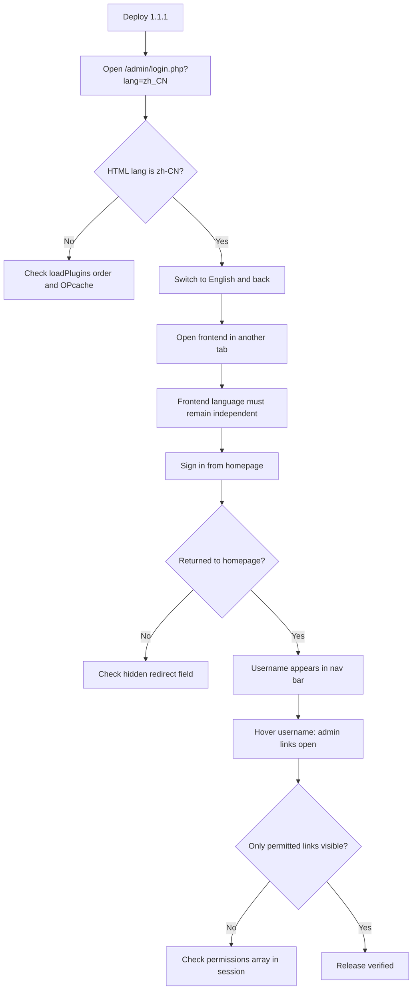
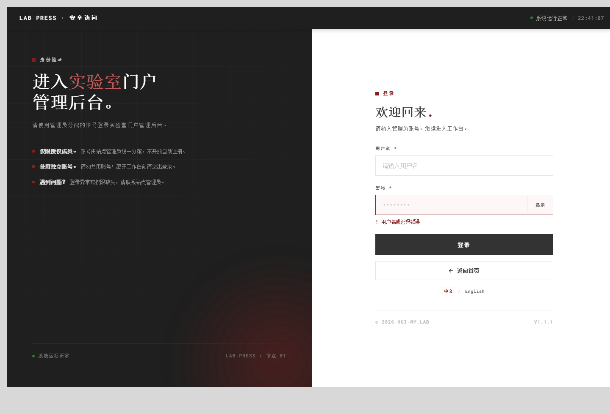

# Changelog

All notable changes to LabPress are documented in this file.

The format follows [Keep a Changelog](https://keepachangelog.com/en/1.1.0/), and the project follows [Semantic Versioning](https://semver.org/spec/v2.0.0.html). Versions are ordered from newest to oldest.

## [1.2.0] - 2026-11-27

LabPress 1.2.0 is the kernel and installation release. It hardens the bootstrap, database migrations, plugin lifecycle, admin routing, permissions, errors, and asset loading, replaces the SQL-dump install path with a browser/CLI installer, and adds a dashboard data overview. It does not add a marketplace UI.

### Added

- `includes/bootstrap.php` as the single entry for autoload, application config, session, PDO, timezone, error handling, and asset hooks.
- `storage/config/site.php` (ignored by Git and protected by `.htaccess`) plus `storage/config/site.example.php` and `storage/config/features.php`.
- `schema_version` and `bin/migrate.php` with `status`, `up`, and `down` commands. Three initial migrations add plugin metadata columns, extend the multilingual translation contract, and archive the unused `categories` table.
- Browser installer at `install.php` with preflight checks, CSRF protection, attempt throttling, database creation when permitted, schema creation, migrations, administrator creation, optional demo seeding, `storage/config/site.php` generation and `storage/install.lock`.
- `install/Schema.php` as the fresh-install base schema; `install/DemoData.php` with a newly written computational-biology demo site (projects, publications, news, tools, navigation and homepage sections).
- `bin/install.php` CLI installer for CI and automated deployments, including `--demo` / `--no-demo` and environment-variable inputs.
- Dashboard ECharts overview: content mix, project-category distribution and a 14-day new-content trend. ECharts is served locally from `admin/assets/js/echarts.min.js` only on the dashboard.
- Database port and optional Unix socket support in `includes/bootstrap.php`, `storage/config/site.example.php` and the installer.
- Hook Engine v2: `removeAction` / `removeFilter`, `hasAction` / `hasFilter`, `didAction`, `currentHook`, `collect`, `acceptedArgs`, exception isolation, and plugin-scoped lifecycle actions.
- Plugin Manager v1: discovery, metadata refresh, priority boot, activate/deactivate/uninstall lifecycle, `Requires LabPress` compatibility, and per-plugin context filtering.
- Admin Registry: plugins register admin pages through `LabPress::registerAdminPage()`; the core checks login, permission/capability, and catches page exceptions.
- Guard: session-level login throttling, CSRF verification, same-origin checks for write requests, audit logging, and unified login/logout events.
- Logger, ErrorCode, and JSON `Response` envelope with `request_id`; API exceptions now go to `storage/logs/app-*.log` instead of leaking SQL/path detail.
- Asset registry: `LabPress::enqueueStyle()` / `enqueueScript()` with URL de-duplication and dependency ordering.
- `tests/smoke.php` and a GitHub Actions workflow covering syntax, installation, migrations, smoke checks, and HTTP availability.
- `site_config` key whitelist via `LabPress\SiteConfig`; unknown keys are rejected instead of being written blindly.

### Changed

- Fresh installations no longer import `labpressexample.sql`. The SQL dump and the old `sql/upgrade-v1.1.1.sql` file were removed; `install/Schema.php` plus `migrations/` are the single source of truth.
- `includes/config.php` no longer starts a session or creates a PDO connection. It only defines `DB_*` fallbacks and requires the bootstrap.
- `includes/functions.php` now delegates `getActivePlugins()`, `syncPlugins()`, and `loadPlugins()` to the Plugin Manager, and `hasPermission()` / CSRF helpers to Guard.
- `api/save.php` plugin activate/deactivate now uses the Plugin Manager lifecycle instead of raw SQL plus `require_once`.
- `admin/index.php` renders plugin pages through the Admin Registry and loads the dashboard chart bundle only on the dashboard.
- Official plugins `FooterInfo` and `dynamic-multilang` declare `Requires LabPress: >=1.2.0`; the multilingual admin CSS now goes through the asset registry.
- Plugin install endpoints call discovery after extraction so new plugins are registered before activation.

### Notes

- **New install:** open `/install.php` and use an empty database.
- **Existing sites:** do not run the installer; deploy the files and run `php bin/migrate.php up` before opening the admin panel.
- The `categories` table is renamed to `categories_legacy` on existing sites, not dropped. Fresh installs do not create it.
- `storage/` must be writable by PHP and blocked from direct web access. Apache uses the included `.htaccess`; Nginx needs an explicit `location` rule.
- Remove or block `install.php` after installation. `storage/install.lock` prevents a second run but is not a substitute for web-server access control.
- Marketplace UI and one-click remote installation remain out of scope until v1.3.0 Manifest v2 and the v1.4.0 client work.

## [1.1.1] - 2026-11-24

LabPress 1.1.1 is a maintenance and integration release. It does not add a new database schema or a new top-level module; instead, it tightens the boundary between the core and plugins, makes the admin language setting genuinely independent from the frontend, and completes the public navigation with an account entry.

### Highlights

- **Cleaner i18n boundary.** Core language packs now contain only framework-owned strings. Plugin language files are loaded only through an explicit `plugin:{slug}` module, so a plugin can no longer overwrite a core label by accident.
- **Independent admin language.** The admin panel can use its own locale, persisted in `ml_admin_locale`, without changing the visitor-facing `lang` cookie. The switch is available on the login page and in the admin topbar.
- **Correct first-request locale resolution.** `loadPlugins()` now runs before the early `getLocale()` call. A `?lang=zh_CN` request therefore reaches the plugin's `admin_locale` filter instead of caching the site default for the whole request.
- **Public account entry.** The front-end navigation now shows a **Sign in** button for guests and the signed-in username for administrators. The username links to the dashboard and exposes a hover menu of permitted admin pages.
- **Front-end-safe login redirect.** A login started from the public homepage can return to the homepage after success instead of always landing in `/admin/index.php`.

### Added

- Added the `admin_locale` filter in `getLocale()`. Signature: `applyFilters('admin_locale', $defaultLocale, $availableLocales)`. The filter must return a locale directory name; invalid or non-string values fall back to the site default.
- Added the `admin_topbar_actions` action in the admin topbar. Plugins can render compact controls without replacing the whole topbar template.
- Added Dynamic Multi-Language 2.0.2 with backend language selection on `admin/login.php` and in the admin topbar.
- Added the `ml_admin_locale` session and cookie preference. Resolution order is request `lang`, session value, cookie value, then the core site default.
- Added the public navigation account entry in `includes/header.php`:
  - guests see a **Sign in** button linking to `admin/login.php?redirect=home`;
  - authenticated users see `$_SESSION['user']`;
  - the username links directly to `admin/index.php`;
  - hovering or keyboard-focusing the username opens a menu with dashboard, publications, projects, tools, and research-news shortcuts;
  - entries that require a permission the current user does not have are not rendered.
- Added `redirect=home` handling in `admin/login.php`, including a hidden form field and the existing `login_redirect_url` filter. Only the literal value `home` is treated as a homepage redirect, so the parameter cannot be used as an open redirect.
- Added the front-end language keys `nav_login`, `nav_admin`, `nav_admin_dashboard`, `nav_admin_publications`, `nav_admin_projects`, `nav_admin_tools`, and `nav_admin_news` in both `zh_CN` and `en_US`.
- Added regression notes for the locale-order fix in `docs/i18n/core-lang.md` and `docs/changelog.md`.

### Changed

- Core `__()` no longer scans and merges every active plugin's language file. It loads:
  - `languages/{locale}/{module}.php` for core modules; or
  - `plugins/{slug}/languages/{locale}.php` when the caller explicitly uses `plugin:{slug}`.
- Plugin language keys are no longer part of the global core namespace. A plugin must call `__('key', 'plugin:plugin-slug')` for its own strings, and should still use a unique prefix such as `ml_`, `fi_`, or `acme_`.
- Dynamic Multi-Language registers its admin menu title with `__('ml_plugin_name', 'plugin:dynamic-multilang')` instead of relying on an implicit merge.
- Admin JavaScript for project management, news management, plugin market, and plugin installation now reads language objects injected by PHP rather than embedding Chinese labels in JS source.
- The admin language policy is now explicitly plugin-owned. The core supplies only the `admin_locale` filter and a safe fallback; without the plugin, the admin panel follows the site default language.
- The front-end header is now the single source of truth for the account entry. Because it is shared by all public pages, the entry is not limited to `index.php`.

### Fixed

- Fixed the admin language switch being ignored on the first request. `getLocale()` previously ran before `loadPlugins()`, so the `admin_locale` filter did not exist and the site default locale was cached in the static `$locale` variable. Locale resolution now runs after plugin loading.
- Fixed the Dynamic Multi-Language admin page reading a non-existent `original_content` key; it now uses `ml_original_content`.
- Fixed missing `ml_no_translations_yet` interface text in the plugin language packs.
- Fixed hard-coded `个` and `无` strings in the tool-version admin view; the page now uses the `count_unit` and `none` core keys.
- Fixed the account dropdown inheriting the main navigation's flex layout; the nested list is explicitly rendered as a vertical block.
- Fixed the public login link losing its return target after form submission; the hidden `redirect` field preserves `home`.

### Documentation

- Reworked the v1.1.1 changelog into a release note with upgrade and verification steps.
- Documented the core/plugin language boundary, the `admin_locale` contract, the login-page and topbar switchers, and the locale-order regression.
- Added Mermaid diagrams for the request lifecycle, locale resolution, plugin lifecycle, translation flow, and content-management workflows.
- Corrected stale navigation paths and installation section numbering.

### Upgrade Notes

1. **Back up first.** Export the MySQL database and archive `includes/config.php`. The file is intentionally untracked or skip-worktree in many deployments and must not be overwritten by a pull.
2. **Update the working tree.** On the server, run `git pull` from the project root. If the server has local edits that are known to be disposable, stash them first; do not run `git reset --hard` on a tree that contains a protected `includes/config.php`.
3. **Confirm the plugin version.** Open **Plugins → Installed Plugins** and verify that Dynamic Multi-Language reports `2.0.2`. If the plugin is active but its files are older, replace the plugin directory from the release package and reactivate it.
4. **Clear opcache if applicable.** If PHP OPcache is enabled, reload PHP-FPM or restart the pool so the new `includes/functions.php` is compiled. A stale opcode cache can make the language fix appear not to work.
5. **Do not copy old plugin language files into `languages/`.** Plugin strings must stay inside the plugin. Moving them into the core pack reintroduces key collisions.
6. **Re-login once.** The account entry reads `$_SESSION['user']`; after deployment, sign out and sign in again so the public header can render the username.

No database migration is required for 1.1.1. Existing `ml_translations`, `plugins`, and content tables remain compatible.

### Verification Checklist

- `curl -s 'https://your-site/admin/login.php?lang=zh_CN' | grep '<html'` should show `lang="zh-CN"` (or the locale attribute used by the current template).
- The language switch must survive a reload and must not change the public site's language.
- The public **Sign in** button must appear only when no user session exists.
- After login from the homepage, the browser must return to `/index.php`, not to `/admin/index.php`.
- The username menu must show **Dashboard** for every authenticated user and hide publication/project/tool/news entries that the account cannot access.
- The plugin can be deactivated without breaking the admin panel; the backend then falls back to the site default language.

> The login-page switcher added by Dynamic Multi-Language 2.0.2. The URL carries `?lang=zh_CN`; the interface and `<html lang>` must both be Chinese, not only the address bar.

### Compatibility and Boundaries

| Item | 1.1.1 status |
| --- | --- |
| PHP | 7.4 or newer; PHP 8.x supported by the code path used in this release |
| MySQL / MariaDB | MySQL 5.7+ / MariaDB 10.3+ |
| Database migration | None |
| Plugin API | `admin_locale` filter and `admin_topbar_actions` action are additive |
| Language packs | Core packs own framework strings; plugin packs must use `plugin:{slug}` |
| Front-end account menu | Requires a valid `$_SESSION['user']` and the `hasPermission()` helper |
| Screenshots | v1.1.1 admin dashboard and login captures are refreshed; older module captures remain in place until the host is reachable again |

## [1.1.0] - 2026-08-14

### Added

- Translation function `__()` now supports explicit plugin language loading with the `plugin:` prefix. Plugin authors can call `__('key', 'plugin:plugin-slug')` to load translations from a specific plugin without merging them into the core namespace.

### Changed

- Plugin language files are loaded only when explicitly requested or during the legacy scan of active plugins. The scan sanitizes plugin slugs before constructing file paths.
- Dynamic Multi-Language language keys use the `ml_` prefix to avoid collisions with core keys.

### Fixed

- Fixed an issue where Dynamic Multi-Language keys such as `plugin_name`, `about_us`, and `research_title` overwrote core language keys and produced incorrect admin labels.
- Fixed the plugin language file path when using the explicit `plugin:` module prefix.

### Documentation

- Documented the explicit `plugin:` syntax and the recommended key-prefix convention.

## [1.0.0] - 2026-08-11

### Added

- Initial stable release of LabPress, an open-source academic CMS for research laboratories.
- Dynamic content management for About Us, research directions, statistics, and navigation menus.
- Built-in academic modules for publications, projects, research news, tools, and tool versions.
- Hook-driven plugin system with WordPress-style actions and filters.
- Two-layer internationalization: static language packs plus the Dynamic Multi-Language plugin for database content.
- Markdown editing with EasyMDE and live preview.
- Pure PHP + MySQL runtime with no framework, Composer, or build step.
- Plugin installation, activation, update, and uninstallation from the admin panel.

### Installation

- Historical v1.0.0 flow: clone or download the repository, copy `includes/config-sample.php` to `includes/config.php`, import the then-shipped SQL dump, and open `/admin`.
- v1.2.0 replaces this flow with `install.php` / `bin/install.php`; the SQL dump is no longer part of the repository.

### Important

- Set a strong administrator password during installation; no default credentials are shipped.
- LabPress is distributed under GPL-3.0.
