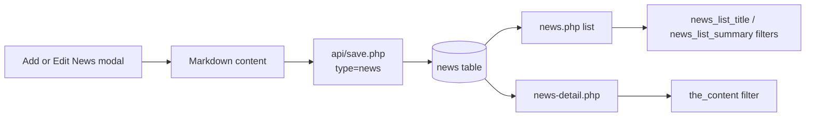
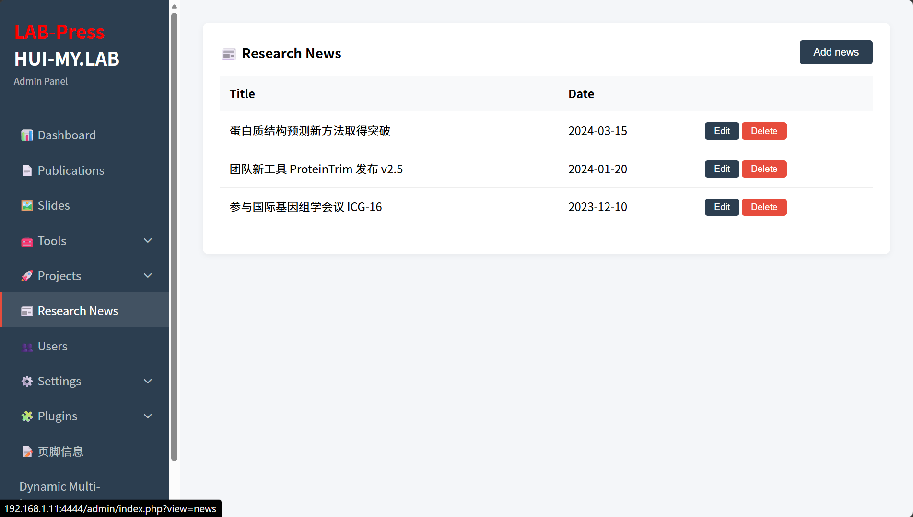
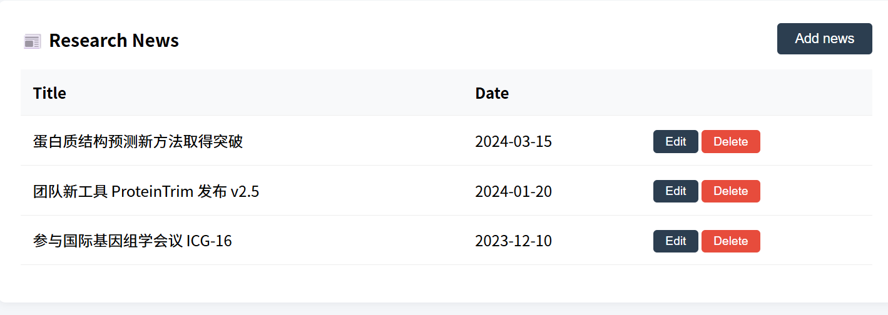
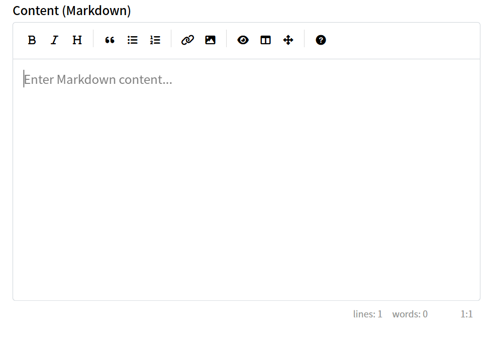
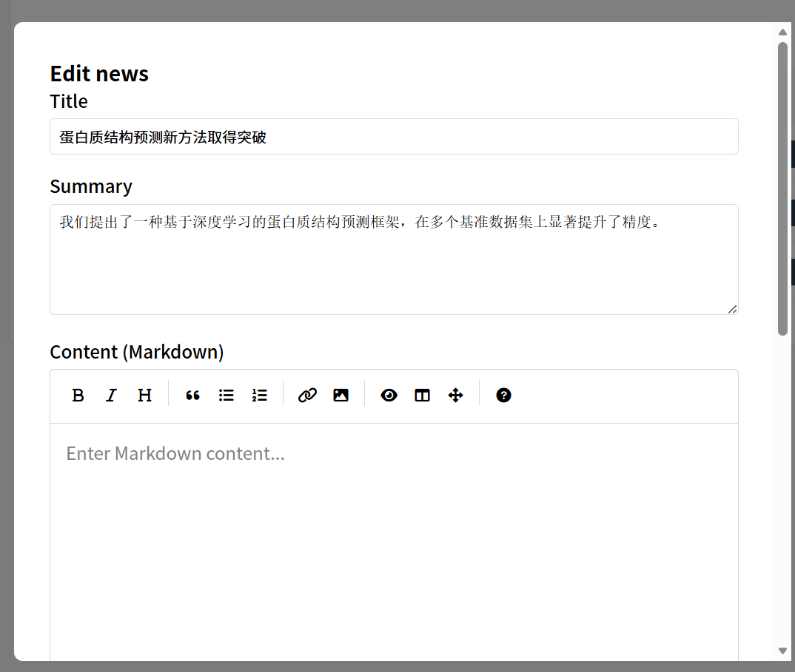
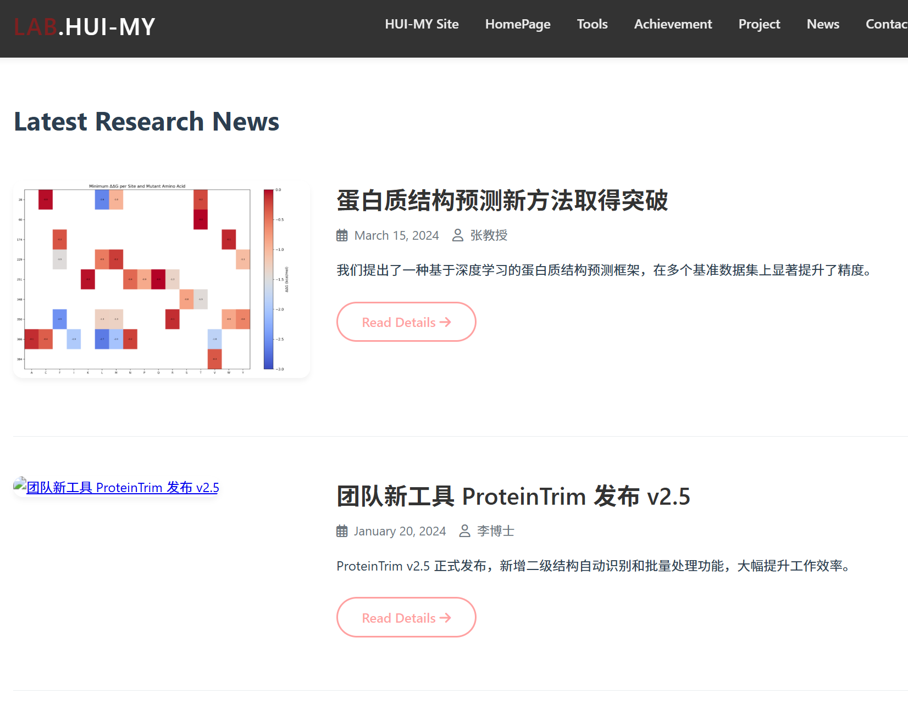
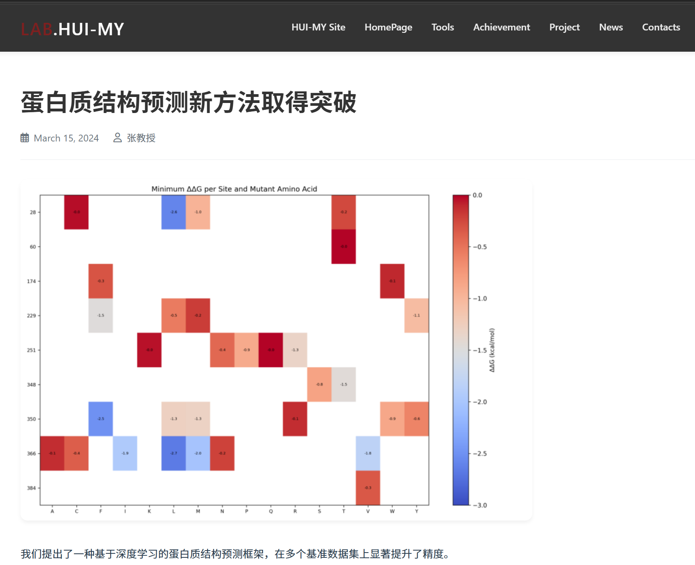

# Research News Management

This chapter explains how to manage research news and announcements in the LabPress administration panel. The News module is used to publish laboratory updates, research highlights, conference reports, and other time-sensitive content on the public website.

The guide focuses on practical operations. It describes how to create, edit, and delete news entries, how to format content using Markdown, how to attach images, and how news items are displayed on the frontend.

## 1. Overview

The News module stores each announcement as a record containing a title, summary, Markdown content, optional image, author, publication date, and display order. The public website presents news in two views: a list page and a detail page.

Each news item can include a featured image that appears alongside the summary in the list and at the top of the detail page. The content field supports Markdown, allowing you to format paragraphs, headings, lists, links, and code blocks without writing HTML.

All news data is stored in the `news` table. The admin panel provides a dedicated management page for maintaining news entries.

### 1.1 Data and publishing workflow

The list page and the detail page both read the same record. There is no separate “draft” state in the current module: saving a news item makes it part of the public list immediately.

> **Figure 1.** The Research News manager. The list is ordered by date and then sort value.

## 2. Accessing the News Manager

The News manager is available from the admin sidebar under **Research News**. In the admin menu, this page is labeled **Research News** or **News**, depending on the active language.

Access to the news manager requires the `publications` permission. Administrator accounts with the `all` permission can also access it. Users without the required permission will see a permission error message.

To open the page, click **Research News** in the sidebar. The page displays a table containing all existing news entries, ordered by date and sort value.

## 3. Understanding the News List

The news list shows the following columns:

- **Title** – the headline of the news item.
- **Date** – the publication date as stored in the database.
- **Actions** – buttons for editing and deleting the entry.

The list is sorted by date descending and then by the sort order field. This means the most recent news appears at the top. The public news page follows the same ordering rule.

If no news entries have been added, the page displays a “No data” message.

> **Figure 2.** News list. The newest date is not automatically the top item when another item has a stronger sort value in the same date group.
## 4. Adding a News Item

To add a new news item:

1. Open the **Research News** page.
2. Click the **Add News** button at the top of the table.
3. In the modal form that appears, fill in the fields described below.

The news form includes the following fields:

| Field | Description |
|-------|-------------|
| **Title** | The headline of the news item. This field is required. |
| **Summary** | A short summary displayed in the news list. This field is recommended. |
| **Content** | The full article content, written in Markdown. Optional, but recommended for detail pages. |
| **Image** | An optional image displayed with the news item. Use the upload button to attach an image. |
| **Author** | The author or source of the news, for example a professor’s name or the lab name. |
| **Date** | The publication date. This field is required. |

4. Click **Save**.

The new news item is inserted into the database and appears immediately in the admin list and on the public news page.

### 4.1 Writing Markdown Content

The content field uses a Markdown editor. You can write formatted text without knowing HTML. The editor provides a toolbar with common formatting buttons, including bold, italic, headings, quotes, lists, links, images, and code blocks.

Common formatting examples include:

- Use `# Heading` for headings.
- Use `**bold**` for emphasis.
- Use `- item` for bullet lists.
- Use `[link text](https://example.com)` for links.
- Use triple backticks for code blocks.

The public news detail page automatically converts Markdown to HTML when displaying the content.

> **Figure 3.** The Markdown editor in the news modal. Formatting is stored as Markdown and converted by Parsedown on the detail page.

### 4.2 Uploading a News Image

The image field includes an upload button. To attach an image:

1. Click the **Upload** button next to the image field.
2. Select an image file from your computer.
3. The system uploads the image to the `uploads/news/` directory.
4. A preview appears in the form.

The image will be shown as a thumbnail in the news list and as a featured image at the top of the news detail page. If no image is uploaded, the news item will still display correctly, with only text content.

## 5. Editing a News Item

To modify an existing news item:

1. Find the entry you want to change in the news list.
2. Click the **Edit** button in that row.
3. The same modal form opens with the current values filled in.
4. Update any field, including the Markdown content or image.
5. Click **Save**.

The changes are saved immediately and reflected on the public website after the next page load.

> **Figure 4.** Editing an existing item. The current Markdown and image path are loaded into the same modal.
## 6. Deleting a News Item

To remove a news item:

1. Find the entry in the news list.
2. Click the **Delete** button in that row.
3. Confirm the deletion when prompted.

The news item is permanently removed from the database. The associated image file may remain in the uploads directory, but the item will no longer appear on the website.

If you want to temporarily hide a news item without deleting it, consider changing its date to an older value or editing the content to indicate that the item is no longer current, as there is no separate visibility switch in this module.

## 7. Controlling Date and Display Order

The public news list is sorted by the **Date** field, with the most recent dates appearing first. The sort order field is also considered, but its practical use is limited because date ordering usually dominates.

To control the display order of news items, set the **Date** field appropriately when creating or editing an entry. For example, if you want an item to appear at the top, assign it a more recent date.

If you need to pin an important announcement to the top regardless of its date, you can adjust the sort order value and, if necessary, modify the frontend template to prioritize sort order over date. By default, the current implementation prioritizes date descending.

## 8. Frontend Display

News items are displayed in two public views.

### 8.1 News List Page

The public **Research News** page lists all news entries. Each entry shows:

- The news image, if available.
- The title as a clickable link to the detail page.
- The author and date.
- A short summary.
- A “Read More” button linking to the full article.

The list is rendered by `news.php` and uses the `news_list_title` and `news_list_summary` filters before output. This allows plugins to modify the displayed text if needed.

> **Figure 5.** The public news list. Images, titles, authors, dates, and summaries are rendered from the same record.

### 8.2 News Detail Page

Clicking a news title opens the detail page. This page displays the full Markdown-rendered content, the featured image if present, the author, and the date. A back link returns to the news list.

The detail page applies the `page_title` filter to the news title and the `the_content` filter to the rendered Markdown content. These filters allow plugins such as Dynamic Multi-Language or custom plugins to modify the output.

> **Figure 6.** The public detail page. The Markdown body is rendered to HTML and filtered through `the_content`.

## 9. Multilingual Considerations

News titles, summaries, and content are stored as raw text in the database. The core does not automatically translate news content.

If your site needs news in multiple languages, consider these options:

- Publish news in a single primary language, such as English or Chinese, while the rest of the site interface remains multilingual.
- Write bilingual news content by including both languages in the Markdown body, separated by headings or paragraphs.
- Use custom plugins or filters to translate news titles and summaries if multilingual news support becomes a requirement. The `news_list_title` and `news_list_summary` filters are available for this purpose.

The Dynamic Multi-Language plugin does not currently provide a dedicated translation tab for news content, but its filter system can be extended to support news fields if needed.

## 10. Operational Checks

- [ ] Title, date, summary, and Markdown body are all present before publishing.
- [ ] The date is in the expected time zone and format.
- [ ] Images exist under `uploads/news/` and are readable.
- [ ] The detail page renders Markdown links and code blocks correctly.
- [ ] The list ordering matches the intended date/sort policy.
- [ ] The item is not being cached with an older version on the frontend.

If a news item is missing from the public list, check the date value and the query limit before assuming a failed save. If the detail page is empty, inspect the stored `content` field and confirm that Markdown is being passed to Parsedown.

## 11. Next Steps

After managing research news, you may want to continue with:

- [Publications](publications.md) – manage academic publications.
- [Slides](slides.md) – manage homepage carousel slides.
- [Tools](tools.md) – manage bioinformatics tools and software.
- [Projects](projects.md) – manage research projects.
- [Site Settings](../setup/site-settings.md) – configure homepage sections that display news and other content.