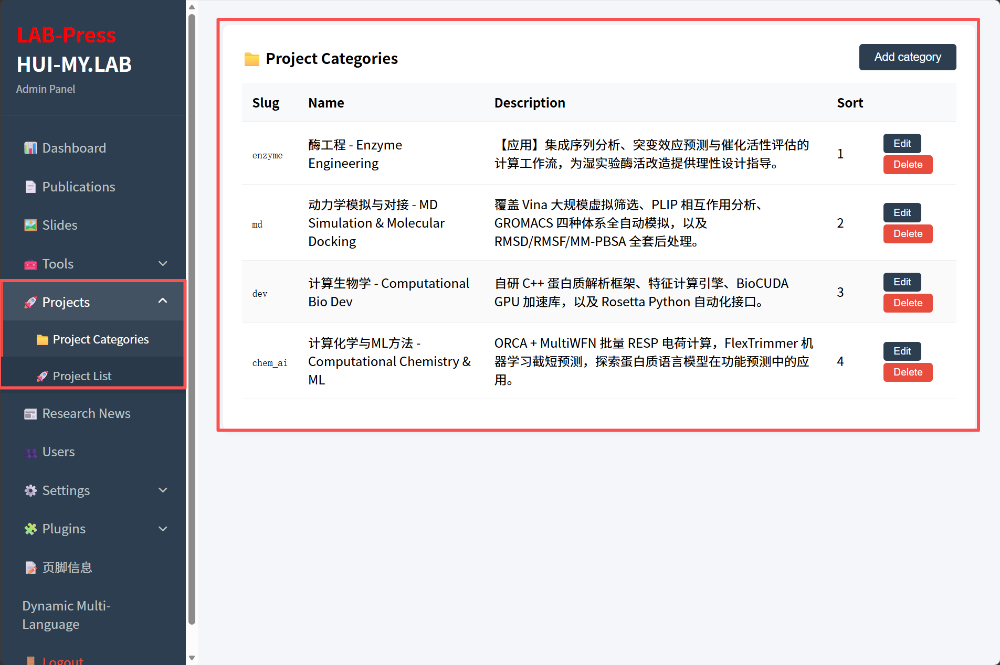
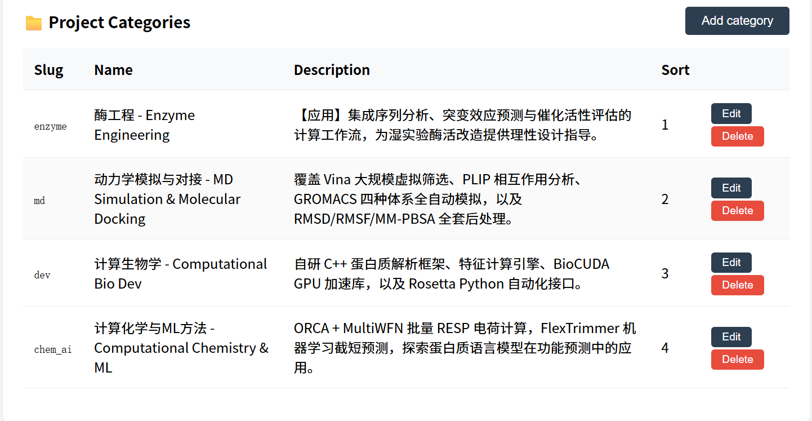
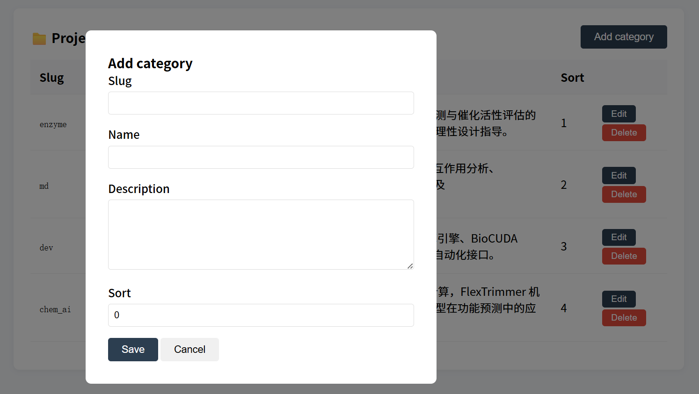
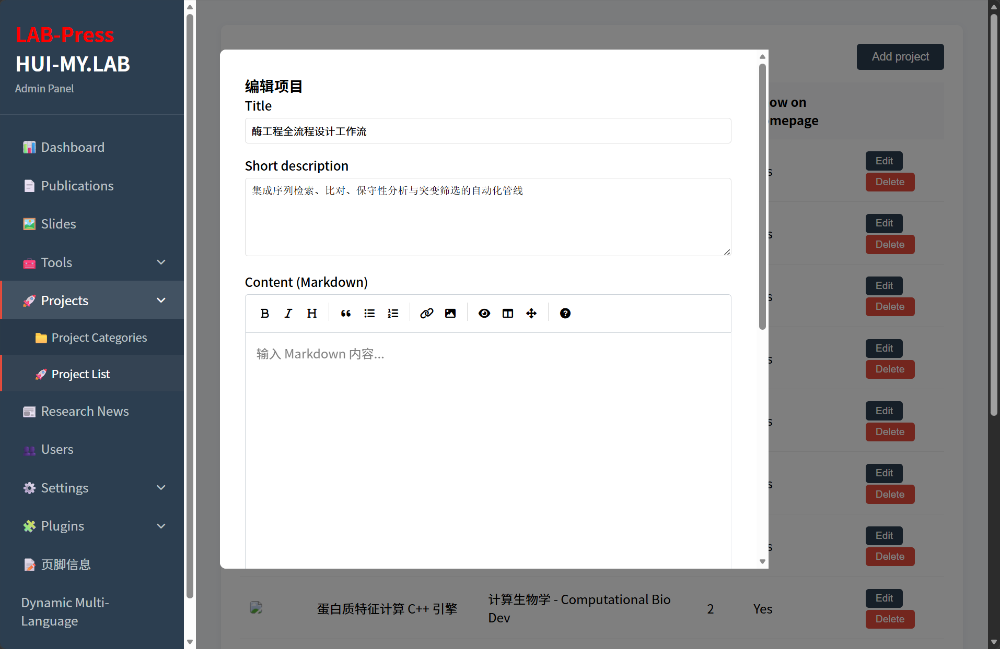
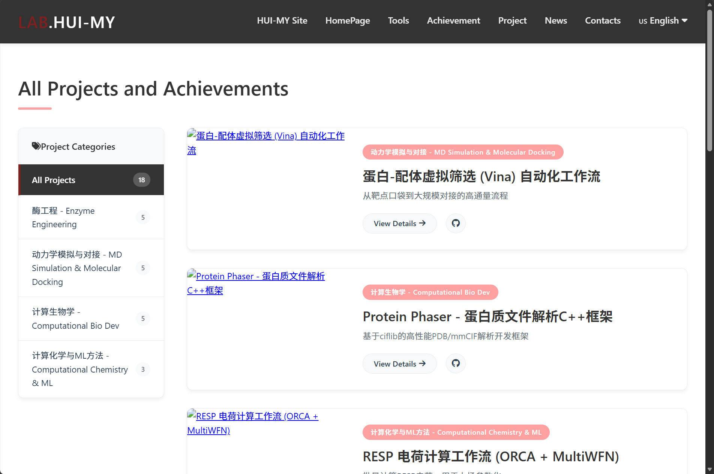
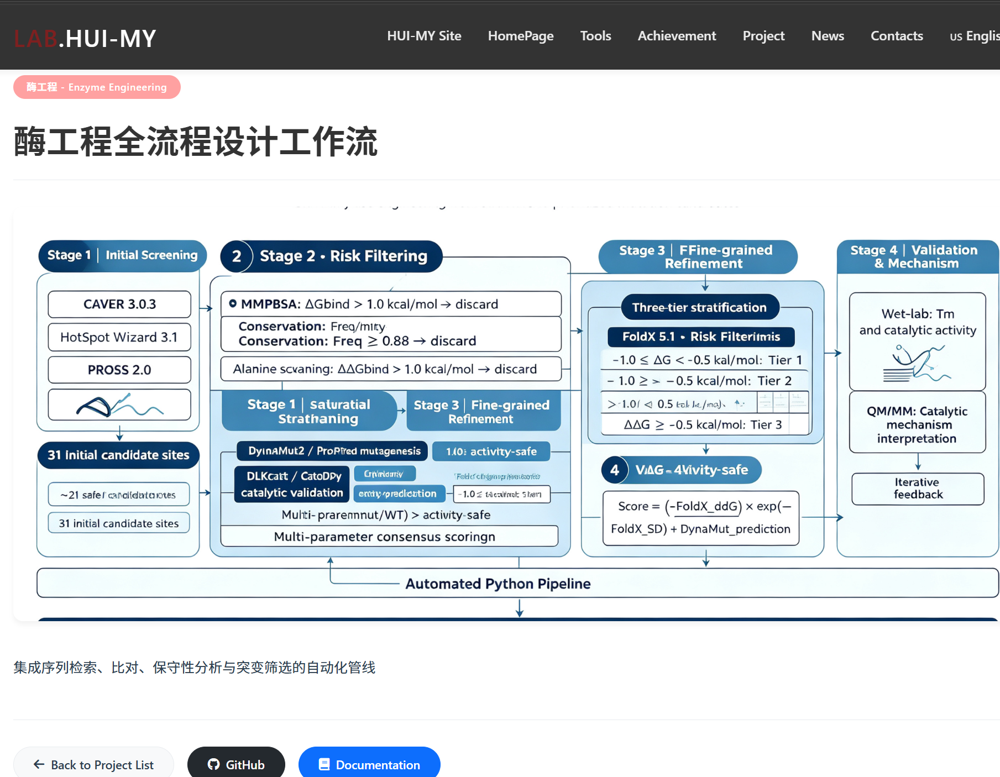

# Projects Management

This chapter explains how to manage research projects and project categories in the LabPress administration panel. The Projects module is designed to present research activities, software development, or laboratory initiatives in a structured and visually organized manner on the public website.

The guide focuses on practical operations. It describes how to create project categories, add and maintain project entries, control homepage featured projects, and understand how projects are displayed on the frontend.

## 1. Overview

LabPress organizes projects into categories and presents them using a filterable list and individual detail pages. Each project can include a title, summary, detailed Markdown content, an image, external links, and a featured flag that controls whether the project appears on the homepage.

Project management is divided into two admin pages:

- **Project Categories** – manages the categories used to group projects.
- **Project List** – manages individual project entries and their display order.

Both pages are accessible from the **Projects** parent menu in the admin sidebar.

> **Administrator Project Manage Page**

## 2. Accessing the Projects Module

To manage projects, click **Projects** in the admin sidebar. A submenu appears with two entries:

- **Project Categories**
- **Project List**

Access to these pages requires the `tools` permission. Administrator accounts with the `all` permission can also access them. Users without the appropriate permission will see a permission error message.

## 3. Managing Project Categories

Project categories allow you to group related projects and provide a way for visitors to filter the project list on the public site.

### 3.1 Understanding the Category List

The **Project Categories** page displays a table with the following columns:

- **Slug** – a short English identifier used in URLs.
- **Name** – the display name of the category.
- **Description** – a brief explanation of the category, shown on the public category page.
- **Sort** – the display order of the category.
- **Actions** – buttons for editing and deleting the category.

The category list is ordered by the `sort_order` field.

> **Administrator Project Manage Page**

### 3.2 Adding a Category

To add a new category:

1. Open **Projects > Project Categories**.
2. Click the **Add Category** button.
3. In the modal form, fill in the following fields:

| Field | Description |
|-------|-------------|
| **Slug** | A unique English identifier, for example `deep-learning` or `structural-biology`. Use lowercase letters, numbers, hyphens, or underscores. This field is required. |
| **Name** | The display name, such as `Deep Learning` or `Structural Biology`. This field is required. |
| **Description** | A short description of the category. This text may be displayed on the category detail page. |
| **Sort** | A numeric value that controls the order in which categories appear in the sidebar and filter buttons. Lower values appear first. |

4. Click **Save**.

The new category is inserted into the `project_categories` table and becomes available for use when creating projects.

> **Administrator Add Category Page**

### 3.3 Editing and Deleting Categories

Each category row has **Edit** and **Delete** buttons.

Editing opens the modal with the current values filled in. You can update the slug, name, description, or sort order and save the changes.

Deleting a category permanently removes it from the database. Before deleting, ensure that no projects are assigned to the category, because the database may prevent deletion if projects still reference the category. If you need to remove a category that is in use, first reassign its projects to another category.

## 4. Managing the Project List

The **Project List** page is the main interface for managing project entries. It shows all projects in a paginated table and provides controls for adding, editing, and deleting projects.

### 4.1 Understanding the Project List

The project list displays the following columns:

- **Image** – a small thumbnail of the project image.
- **Title** – the project title.
- **Category** – the assigned category name.
- **Sort** – the display order value.
- **Featured** – whether the project is shown on the homepage.
- **Actions** – buttons for editing and deleting the project.

The list is paginated, showing twelve projects per page by default. Use the pagination controls at the bottom of the table to navigate through the list.

### 4.2 Adding a Project

To add a new project:

1. Open **Projects > Project List**.
2. Click the **Add Project** button.
3. In the modal form, fill in the fields described below.

The project form includes the following fields:

| Field | Description |
|-------|-------------|
| **Title** | The name of the project. This field is required. |
| **Summary** | A short description shown in list cards. This field is optional but recommended. |
| **Content** | The detailed project description, written in Markdown. |
| **Image** | A representative image for the project. Use the upload button to select an image. |
| **Category** | The category to which the project belongs. This field is required. |
| **GitHub URL** | Optional link to the project’s source code repository. |
| **Documentation URL** | Optional link to the documentation or manual. |
| **External URL** | Optional link to a project website or related page. |
| **Sort** | A numeric value that controls the display order. Lower values appear first. |
| **Featured** | Select **Yes** to show the project on the homepage, or **No** to hide it from the homepage. |

4. Click **Save**.

The project is inserted into the `projects` table and appears in the project list and on the public projects page. If featured, it may also appear on the homepage.

> **Administrator Project List Page**

### 4.3 Writing Project Content in Markdown

The project content field uses Markdown for formatting. You can write headings, paragraphs, lists, code blocks, tables, and links. The public project detail page automatically converts Markdown to HTML using the bundled Parsedown library.

For example, a project description may include:

- A short introduction paragraph.
- A section explaining the background or motivation.
- A list of key features.
- A code block for command examples.
- Links to external documentation or papers.

The Markdown editor in the admin form provides basic toolbar buttons for formatting, preview, and split-screen editing.

> **Administrator Edit Project Page**

> **截图占位**：此处可插入项目编辑弹窗中 Markdown 编辑器的截图，展示工具栏和预览功能，建议尺寸 900×700。

### 4.4 Uploading a Project Image

The project form includes an image upload control. To add or change the project image:

1. Click the **Upload** button next to the image field.
2. Select an image file from your computer.
3. The system uploads the image to the `uploads/projects/` directory.
4. A preview appears in the form.

Supported image types include JPG, PNG, GIF, and WebP. The uploaded image is displayed in the project list card and on the project detail page.

### 4.5 Editing a Project

To edit an existing project:

1. Find the project in the project list.
2. Click the **Edit** button in that row.
3. The modal opens with the current values filled in.
4. Update any field, including the category, featured status, or Markdown content.
5. Click **Save**.

The changes take effect immediately and are reflected on the frontend after the next page load.

### 4.6 Deleting a Project

To delete a project:

1. Find the project in the project list.
2. Click the **Delete** button in that row.
3. Confirm the deletion when prompted.

The project is permanently removed from the database. This operation cannot be undone. If you want to temporarily remove a project from display, consider changing its featured status or sort order instead of deleting it.

## 5. Controlling Display Order

Project order is controlled by the **Sort** field. Lower values appear earlier in the list.

The public projects page orders projects by `sort_order` ascending, followed by creation date descending for projects with the same sort value. It is recommended to use increments of ten (10, 20, 30) for easier insertion of new projects later.

To reorder projects, edit each project and adjust its sort value.

## 6. Frontend Display

Projects are displayed in three public areas: the homepage featured section, the projects listing page, and the project detail page.

### 6.1 Homepage Featured Projects

The homepage displays featured projects in a section titled **Projects and Achievements**. Only projects with `featured = 1` appear here. The section shows a limited number of featured projects, typically eight, in a row-style layout with image, category, title, summary, and links.

### 6.2 Projects Listing Page

The public **Projects** page includes a left sidebar with category filters and a main content area listing projects. Visitors can click a category to filter the displayed projects. Each project row shows the image, category tag, title, summary, and action links.

The page also includes pagination for projects when the total number exceeds the page size.

> **Project List**

### 6.3 Project Detail Page

The project detail page displays the full Markdown-rendered content, featured image, category tag, and external links. The page title and content are filterable by plugins.

A prominent button row at the bottom provides links to the GitHub repository, documentation, and any external project page if those URLs are set.

> **Project Detail Page**

## 7. Multilingual Considerations

Project titles, summaries, and content are stored as raw text in the database. The core does not automatically translate project data.

If you need multilingual project content, consider the following:

- Maintain project content in a single primary language, such as English, while the site interface remains multilingual.
- Store bilingual text within the Markdown content using headings to separate language sections.
- Use the Dynamic Multi-Language plugin’s filters or custom plugins to translate project titles or summaries if required.

The project list and detail templates apply filters such as `project_list_title` and `project_list_summary`, which can be extended by developers for translation purposes.

## 8. Next Steps

After managing projects, you may want to continue with:

- [Tools](tools.md) – manage bioinformatics tools and software.
- [Publications](publications.md) – manage academic publications.
- [Slides](slides.md) – manage homepage carousel slides.
- [Research News](news.md) – manage laboratory news.
- [Site Settings](../setup/site-settings.md) – configure homepage sections that include featured projects.