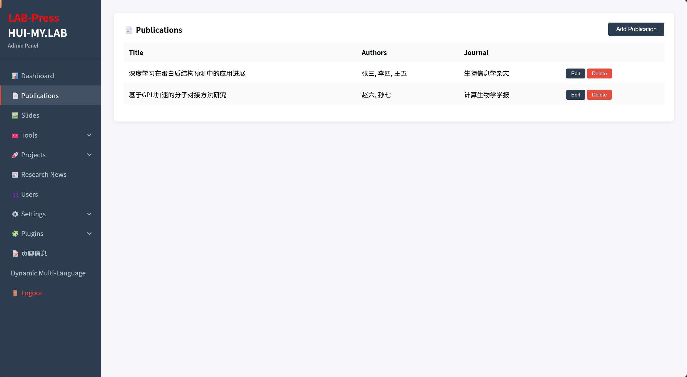
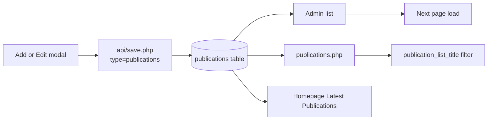
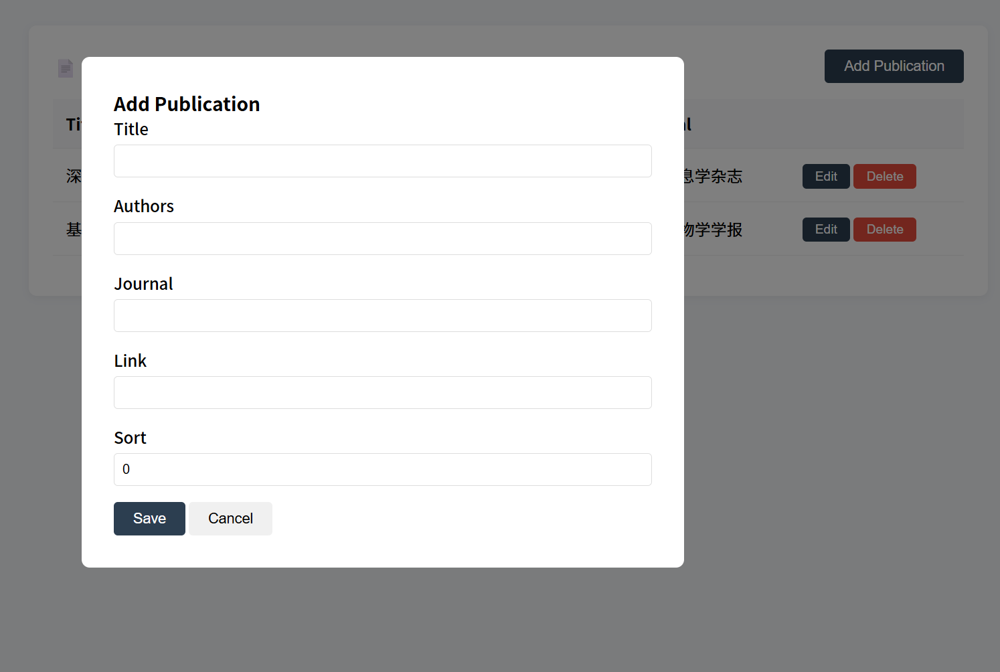
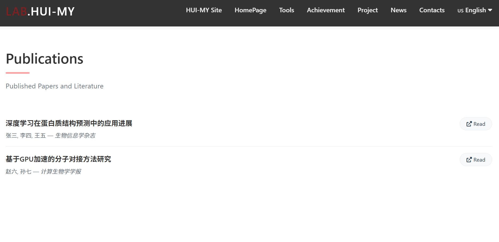

# Publications Management

This chapter explains how to manage publication entries in the LabPress administration panel. Publications are used to display research papers, journal articles, and other academic outputs on the public website.

The guide focuses on practical operations. It describes how to add, edit, delete, and organize publication records through the admin interface, and how these records appear on the frontend.

## 1. Overview

The Publications module provides a simple way to maintain a list of papers and journal articles. Each publication consists of a title, authors, journal name, external link, and sort order. These entries are displayed on the public **Publications** page and are also used in the **Latest Publications** section of the homepage.

All publication data is stored in the `publications` table. The admin panel provides a dedicated management page that allows administrators to maintain the list without editing the database directly.


> **Figure 1.** The Publications manager. The table is read directly from the `publications` table.

## 2. Accessing the Publications Manager

The Publications manager is available from the admin sidebar under **Publications**.

Access to this page requires the `publications` permission. Administrator accounts with the `all` permission can also access it. Users without the required permission will see a permission error message.

To open the page, click **Publications** in the sidebar. The page displays a table containing all existing publication entries.

## 3. Publication Workflow at a Glance



The important consequence is that the admin list is not a separate cache. A successful save updates the table; the public page reflects it on the next request.


## 4. Understanding the Publication List

The publication list shows the following columns:

- **Title** – the title of the paper or article.
- **Authors** – the list of authors as stored in the database.
- **Journal** – the name of the journal or publication venue.
- **Actions** – buttons for editing and deleting the entry.

The list is ordered by the `sort_order` field, with lower values appearing first. Entries with the same sort order may appear in the order they were inserted.

If no publications have been added, the page displays a “No data” message.


> **Figure 2.** The list view. The **Edit** action opens the same modal used for creation.

## 5. Adding a Publication

To add a new publication:

1. Open the **Publications** page.
2. Click the **Add Publication** button at the top of the table.
3. In the modal form that appears, fill in the following fields:

| Field | Description |
|-------|-------------|
| **Title** | The title of the publication. This field is required. |
| **Authors** | The author list, for example `Zhang San, Li Si, Wang Wu`. This field is required. |
| **Journal** | The journal or conference name. This field is required. |
| **Link** | An optional external URL, such as a DOI link or publisher page. |
| **Sort** | A numeric value that determines the display order. Lower values appear first. |

4. Click **Save**.

The new entry is inserted into the database and immediately appears in the publication list and on the public website.


> **Figure 3.** The add/edit modal. **Title**, **Authors**, and **Journal** are required; **Link** and **Sort** are optional.

### 5.1 Field behavior and validation

| Field | Required | Behavior |
| --- | --- | --- |
| Title | Yes | Trimmed text; HTML is escaped on output. |
| Authors | Yes | Free text; commas are display separators, not a structured author list. |
| Journal | Yes | Free text; no journal-name normalization is performed. |
| Link | No | Stored as a URL; an empty value omits the public action link. |
| Sort | No | Integer; lower values sort first. Default is `0`. |

The form does not validate DOI syntax or author order. Use a consistent internal convention (for example “Family Name, Given Name”) if the list is consumed by other systems.

## 6. Editing a Publication

To modify an existing publication:

1. Find the entry you want to change in the publication list.
2. Click the **Edit** button in that row.
3. The same modal form opens with the current values filled in.
4. Update the title, authors, journal, link, or sort order.
5. Click **Save**.

The changes are saved immediately and reflected on the frontend after the next page load.


## 7. Deleting a Publication

To remove a publication:

1. Find the entry in the publication list.
2. Click the **Delete** button in that row.
3. Confirm the deletion when prompted.

The entry is permanently removed from the database. There is no undo, so use this operation with care.

If a publication should no longer be displayed but you want to keep the record for future use, consider changing its sort order or temporarily removing the public link instead of deleting it.

## 8. Controlling Display Order

The display order of publications is controlled by the **Sort** field. Lower values appear first.

The homepage and the public Publications page query the database using the following ordering rule:

```sql
ORDER BY sort_order ASC
```

This means that a publication with sort order `0` will appear before one with sort order `10`.

When adding several new publications, it is useful to assign sort values in increments of ten, such as `10`, `20`, `30`. This leaves space to insert additional entries later without renumbering the entire list.

To reorder publications, edit each entry and change its sort value as needed.

## 9. Frontend Display

Publication entries are displayed in two public locations.

### 9.1 Publications Page

The public **Publications** page lists all publication entries in a simple, readable format. Each entry shows the title, authors, and journal. If an external link is provided, a button labeled **Read** or **Read More** links to the original article or DOI.

The page uses the `publications.php` template and applies the `publication_list_title` filter to each title before rendering. This allows plugins to modify the displayed title if necessary.

### 9.2 Homepage Latest Publications

The homepage also shows a limited number of recent publications in the **Latest Publications** section. The homepage loads publications asynchronously from the API and displays only the first five entries.

The homepage section includes a **View More** button that links to the full Publications page.


> **Figure 4.** The public publications page. The title is filtered through `publication_list_title` before output.

## 10. Multilingual Considerations

Publication titles, author lists, and journal names are stored as raw text in the database. The current core does not translate these fields automatically.

If you need to display publications in multiple languages, you have two practical options:

- Store the publication information in the desired primary language and let the rest of the site switch languages while the publication details remain unchanged.
- Use a plugin or custom filter to manage translations for publication titles if multilingual publication display becomes a requirement.

The Dynamic Multi-Language plugin does not currently provide a dedicated translation tab for publications, but custom translations can be extended through the plugin’s filter system if needed.

## 11. Operational Checks

Before considering a publication entry complete:

- [ ] Title, authors, and journal are present.
- [ ] The external link opens the intended DOI or publisher page.
- [ ] The sort value follows the site's numbering convention.
- [ ] The public list shows the entry in the expected position.
- [ ] The homepage "Latest Publications" block shows the item if it belongs in the newest set.

If a save appears to succeed but the public page does not change, check the response from `api/save.php`, the `publications` table, and any page cache in front of the site. The admin table reads the database directly; a stale public page is usually a caching layer, not a failed insert.

## 12. Next Steps

After managing publications, you may want to continue with:

- [Slides](slides.md) – manage homepage carousel slides.
- [Tools](tools.md) – manage bioinformatics tools and software.
- [Projects](projects.md) – manage research projects and portfolios.
- [Research News](news.md) – manage laboratory news and announcements.
- [Site Settings](../setup/site-settings.md) – configure the homepage sections that display publications.