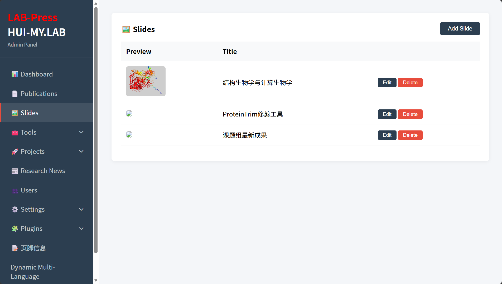
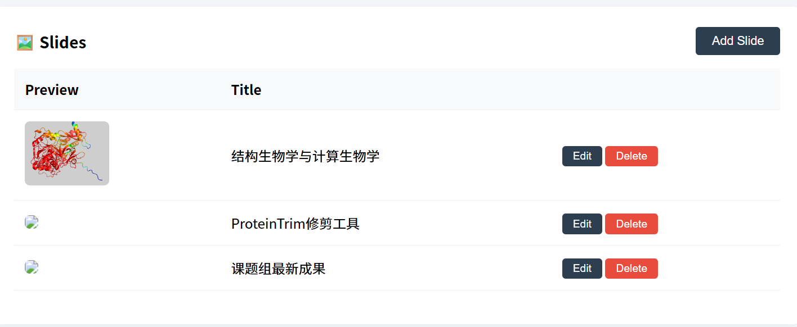
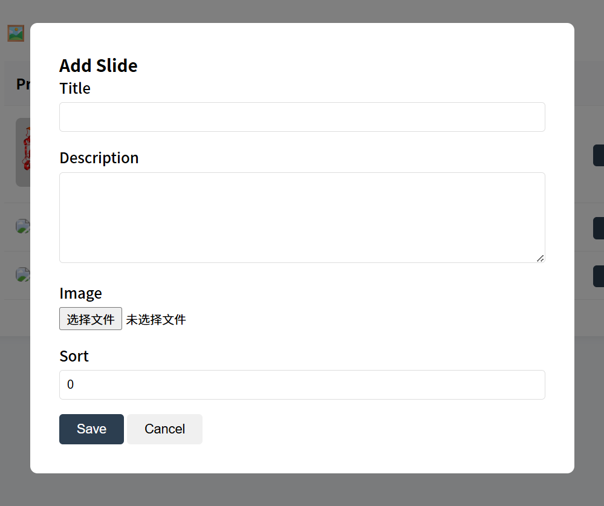
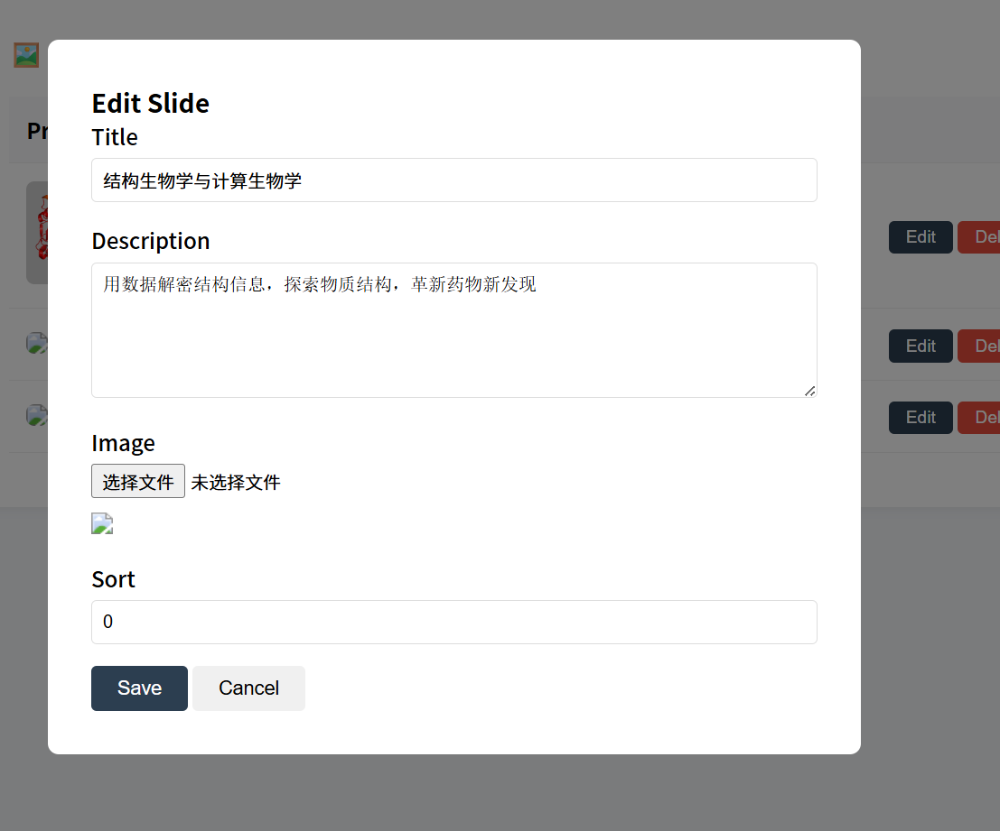
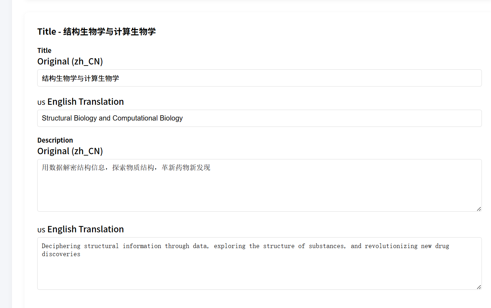

# Slides Management

This chapter explains how to manage homepage slides in the LabPress administration panel. Slides are the large banner images displayed in the rotating carousel at the top of the homepage.

The guide focuses on practical operations: adding, editing, deleting, and ordering slides through the admin interface. It also describes how slides are loaded on the frontend and how multilingual content can be applied.

## 1. Overview

The Slides module controls the homepage carousel. Each slide consists of an image, a title, a short description, and a sort order. The homepage displays these slides as a rotating banner with automatic transition and manual navigation indicators.

All slide data is stored in the `slides` table. The admin panel provides a dedicated management page that allows administrators to maintain the carousel content without editing the database directly.


> **Administrator Slides Panels**

## 2. Accessing the Slides Manager

The Slides manager is available from the admin sidebar under **Slides**.

Access to this page requires the `slides` permission. Administrator accounts with the `all` permission can also access it. Users without the required permission will see a permission error message.

To open the page, click **Slides** in the sidebar. The page displays a table containing all existing slides.

## 3. Understanding the Slide List

The slide list shows the following columns:

- **Preview** – a small thumbnail of the slide image.
- **Title** – the main heading displayed on the slide.
- **Actions** – buttons for editing and deleting the slide.

The list is ordered by the `sort_order` field, with lower values appearing first in the carousel. If no slides have been added, the page displays a “No data” message.


> **Administrator Slides List Panels**
## 4. Adding a Slide

To add a new slide:

1. Open the **Slides** page.
2. Click the **Add Slide** button at the top of the table.
3. In the modal form that appears, fill in the following fields:

| Field | Description |
|-------|-------------|
| **Title** | The main heading displayed on the slide. This field is required. |
| **Description** | A short supporting text displayed below the title. This field is required. |
| **Image** | The background image for the slide. Upload an image using the file picker. |
| **Sort** | A numeric value that controls the order of the slide in the carousel. Lower values appear first. |

4. Click **Save**.

The new slide is inserted into the database and will appear in the homepage carousel after the next page load.

### 4.1 Uploading a Slide Image

The slide form includes an image upload field. When you select an image file, the browser uploads it to the server through the `api/upload.php` endpoint.

The upload process:

1. Select an image file from your computer.
2. The system uploads the image to the `uploads/slides/` directory.
3. If the upload succeeds, a preview is displayed in the form.
4. The image path is stored in the hidden form field.

Supported image types include JPG, PNG, GIF, and WebP. The maximum file size is determined by the server’s PHP configuration.


> **Administrator Add Slides**

## 5. Editing a Slide

To modify an existing slide:

1. Find the slide you want to change in the slide list.
2. Click the **Edit** button in that row.
3. The same modal form opens with the current values filled in.
4. Update the title, description, image, or sort order.
5. Click **Save**.

If you need to replace the existing image, use the file picker to upload a new image. The new image will replace the previous one after saving.

> **Administrator Edit Slides**

## 6. Deleting a Slide

To remove a slide:

1. Find the slide in the slide list.
2. Click the **Delete** button in that row.
3. Confirm the deletion when prompted.

The slide is permanently removed from the database. The image file itself may remain in the uploads directory, but the slide will no longer be shown in the carousel.

If you want to temporarily hide a slide without deleting it, consider changing its sort order to a very high value or replacing its content later, as there is currently no separate active/inactive switch in this module.

## 7. Controlling Slide Order

The order of slides is controlled by the **Sort** field. Lower values appear earlier in the carousel.

The homepage loads slides using the following database query:

```sql
SELECT id, image, title, description FROM slides ORDER BY sort_order ASC
```

The carousel then cycles through the slides in this order. To rearrange slides, edit each slide and adjust its sort value. It is recommended to use increments of ten (10, 20, 30, etc.) so that future insertions are easier.

## 8. Frontend Display

The homepage carousel is rendered by `index.php` and the JavaScript file `assets/js/index.js`.

The frontend attempts to load slide data asynchronously from the API endpoint `api/data.php?type=slides`. If the API returns slides, the JavaScript dynamically builds the carousel HTML and replaces any static fallback slides.

Each slide is displayed with its title and description overlaid on the background image. The carousel automatically advances every few seconds and includes navigation indicators that users can click to jump to a specific slide.

If the API request fails or no slides are found, the frontend falls back to the static slides defined in the homepage HTML. However, the static slides are only a fallback and should not be relied upon for production content.

> **Index  Slides**

## 9. Multilingual Support

Slide titles and descriptions are stored as raw text in the database. The Dynamic Multi-Language plugin can translate these fields without modifying the original content.

The plugin registers the `slides_data` filter, which is applied when the homepage loads slide data. It retrieves translations from the `ml_translations` table and replaces the title and description if a translation exists for the current locale.

To manage slide translations:

1. Open the **Dynamic Multi-Language** admin page.
2. Go to the **Slides** tab.
3. For each slide, enter the translated title and description for the target language.
4. Save the translations.

When the frontend language is switched, the translated slide content appears automatically.

> **Dynamic Multi-Language of Slides**

## 10. Next Steps

After managing slides, you may want to continue with:

- [Publications](publications.md) – manage academic publications.
- [Tools](tools.md) – manage bioinformatics tools and software.
- [Projects](projects.md) – manage research projects.
- [Research News](news.md) – manage laboratory news.
- [Site Settings](../setup/site-settings.md) – configure the homepage sections that work together with the slides.