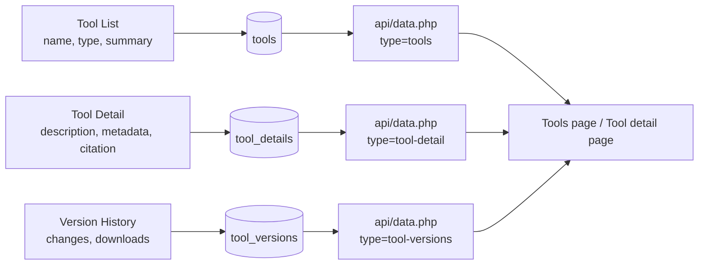
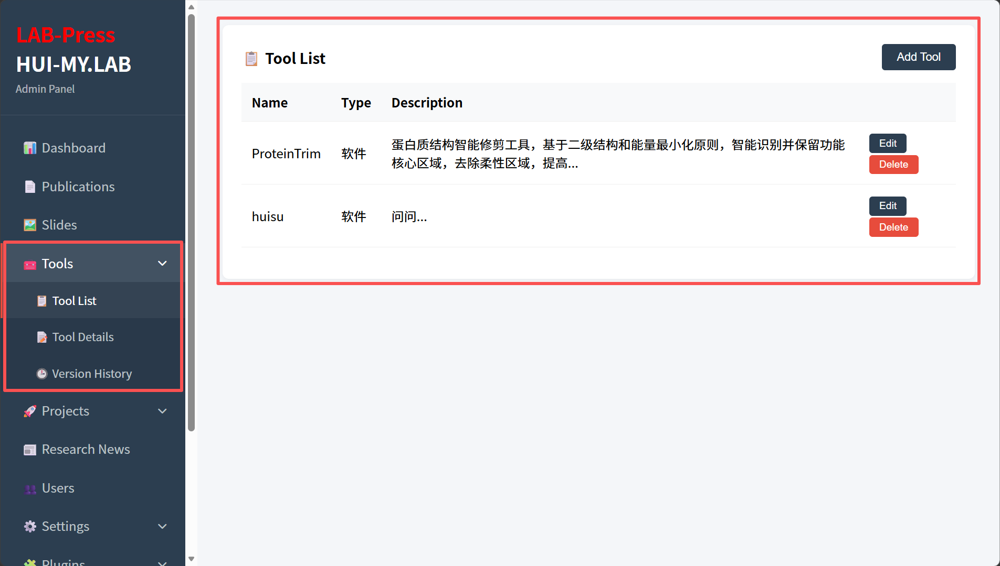
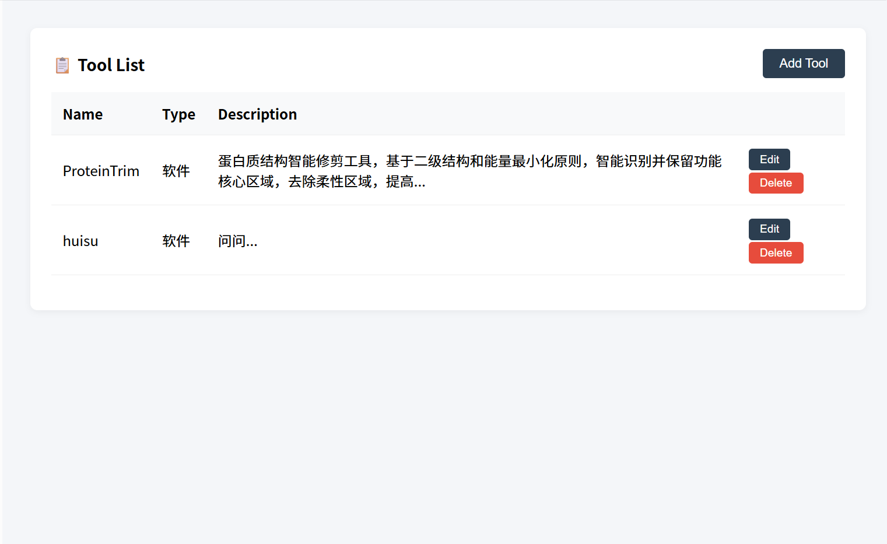
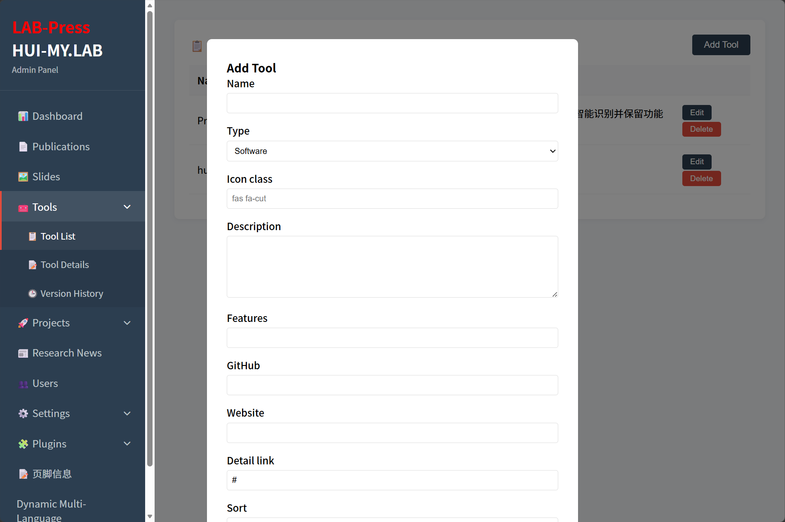
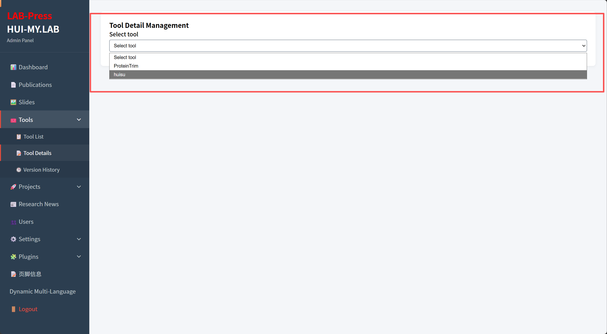
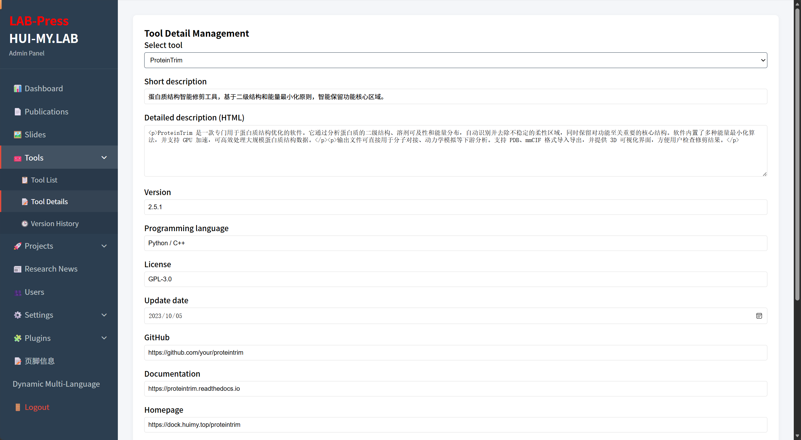
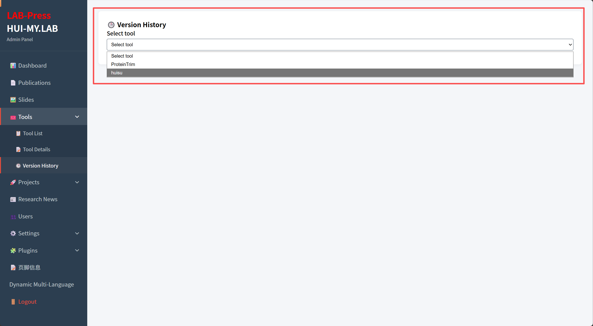
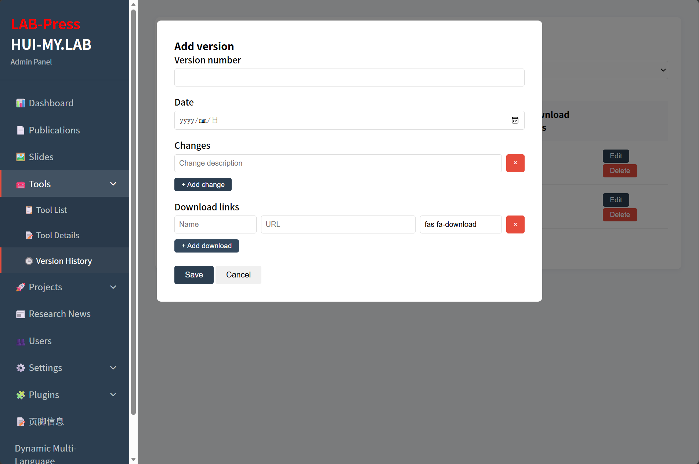
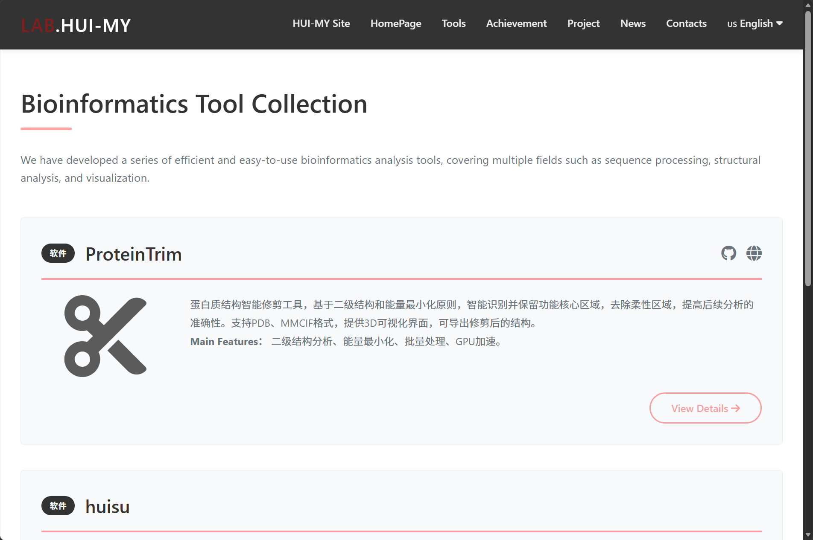
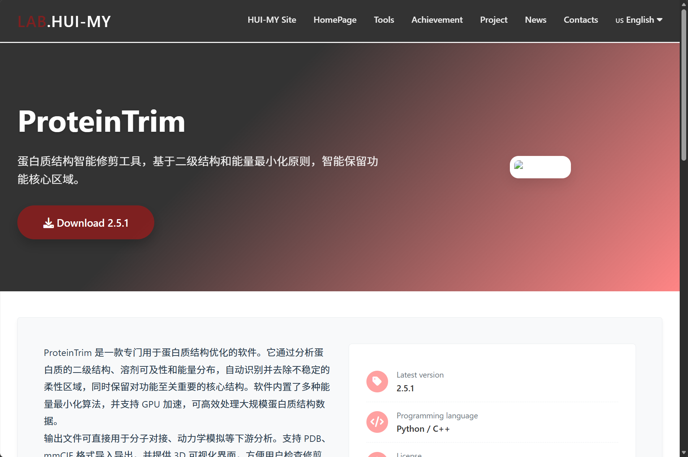

# Tools Management

This chapter explains how to manage bioinformatics tools and software in the LabPress administration panel. The Tools module is designed for laboratories that develop or maintain computational tools, databases, or software packages and want to present them professionally on the public website.

LabPress divides tool management into three related areas:

- **Tool List** – manages the basic information for each tool.
- **Tool Detail** – manages the extended description, metadata, and citation information.
- **Version History** – records multiple versions and download links for each tool.

These three areas are accessed through the **Tools** parent menu in the admin sidebar. The following sections describe each area in a practical, task-oriented manner.

### 1.1 Data model at a glance

The module uses three related tables rather than one large tool record:

A tool can exist without a detail record or version records. The reverse is not true: detail and version rows are attached to a tool identifier. For that reason, create the tool first, then its detail, then its versions.

> **Figure 1.** The Tools entry in the admin sidebar expands into Tool List, Tool Detail, and Version History.

## 1. Accessing the Tools Module

To manage tools, hover over or click **Tools** in the admin sidebar. A submenu appears with the following entries:

- **Tool List**
- **Tool Detail**
- **Version History**

Click the corresponding submenu item to open the desired management page.

Access to all tool management pages requires the `tools` permission. Administrator accounts with the `all` permission can also access them. Users without the appropriate permission will see a permission error message.

## 2. Managing the Tool List

The **Tool List** page is the starting point for managing tools. It displays all existing tools in a table and allows you to add new tools, edit basic information, and delete tools that are no longer needed.

### 2.1 Understanding the Tool List

The table contains the following columns:

- **Name** – the display name of the tool.
- **Type** – the tool category, either “Software” or “Database”.
- **Description** – a short summary of the tool, truncated for display.
- **Actions** – buttons for editing and deleting the tool.

The list is ordered by the `sort_order` field, which you can set when creating or editing a tool. Lower values appear earlier on the frontend.

> **Figure 2.** Tool List. The table is the entry point for creating the record that detail and version pages attach to.

### 2.2 Adding a Tool

To add a new tool:

1. Open **Tools > Tool List**.
2. Click the **Add Tool** button at the top of the table.
3. In the modal form, fill in the following fields:

| Field | Description |
|-------|-------------|
| **Name** | The unique name of the tool. This field is required. |
| **Type** | Select **Software** or **Database**. |
| **Icon Class** | A Font Awesome icon class, for example `fas fa-cut` or `fas fa-cube`. Optional. |
| **Description** | A concise summary of the tool. This field is required. |
| **Features** | A short list of key features or capabilities. Optional. |
| **GitHub** | The GitHub repository URL. Optional. |
| **Website** | The official website or project page. Optional. |
| **Detail Link** | A custom link to the tool detail page. By default, this can be set to `#` or a specific URL. |
| **Sort** | A numeric value that controls the display order. Lower values appear first. |

4. Click **Save**.

The new tool is inserted into the `tools` table and appears immediately in the tool list and on the public tools page.

> **Figure 3.** Add Tool. The detail link can be left as a placeholder until the tool detail page exists.

### 2.3 Editing a Tool

To edit an existing tool:

1. Find the tool in the list.
2. Click the **Edit** button in that row.
3. The modal form opens with the current information filled in.
4. Update any field as needed.
5. Click **Save**.

The changes take effect immediately and are reflected on the frontend after the next page load.

### 2.4 Deleting a Tool

To delete a tool:

1. Find the tool in the list.
2. Click the **Delete** button in that row.
3. Confirm the deletion.

The tool record is permanently removed. Associated tool detail and version history records may also be affected depending on the database foreign key constraints. Use this operation carefully.

## 3. Managing Tool Details

The **Tool Detail** page allows you to manage the extended information that appears on the tool’s detail page. This includes a detailed description, version, programming language, license, update date, external links, images, and citation information.

### 3.1 Selecting a Tool

When you open **Tools > Tool Detail**, the page displays a dropdown list of all tools. Select a tool from the list to load its current detail information.

If no detail record exists for the selected tool, the form appears empty, and you can create a new detail record by filling in the fields and saving.

> **Figure 4.** Tool Detail. Select a tool first; the form then loads an existing detail record or starts an empty one.

### 3.2 Tool Detail Fields

The tool detail form contains the following fields:

| Field | Description |
|-------|-------------|
| **Short Description** | A brief summary shown at the top of the tool detail page. |
| **Detailed Description** | The main description content. This field supports HTML. |
| **Version** | The current version number of the tool. |
| **Programming Language** | The primary language used to develop the tool, such as Python, C++, or R. |
| **License** | The software license, for example GPL-3.0 or MIT. |
| **Update Date** | The last update date of the tool. |
| **GitHub** | The GitHub repository URL. |
| **Documentation** | The documentation or readthedocs URL. |
| **Homepage** | The official homepage or project page URL. |
| **Image** | An image or logo path for the tool. |
| **Screenshot** | A screenshot of the tool interface. |
| **Citation Title** | The title of the citation or publication to cite when using the tool. |
| **Citation URL** | The DOI or URL of the citation. |

The detailed description supports HTML, allowing you to format paragraphs, lists, headings, and links. You can also include images directly in the HTML content.

To save the detail information, click **Save** at the bottom of the form.

> **Figure 5.** The extended detail form. Field values are stored separately from the tool-list summary.

### 3.3 Updating Tool Details

If a tool already has a detail record, selecting it from the dropdown loads the existing data into the form. You can update any field and save the changes. The updated information appears on the public tool detail page immediately.

## 4. Managing Version History

The **Version History** page allows you to track multiple versions of a tool and provide download links for each version. This is useful for software releases, updates, and changelogs.

### 4.1 Selecting a Tool

When you open **Tools > Version History**, the page displays a dropdown list of all tools. Select a tool to load its version records.

If the selected tool has no versions, the page displays a message such as “No version records”.

> **Figure 6.** Version History. The page is tool-scoped after a tool is selected from the dropdown.

### 4.2 Viewing Version Records

The version list shows each version with its number, release date, changes, and download links. Changes are displayed as bullet points, and downloads are shown as clickable links.

The page also includes an **Add Version** button to create a new version record.

### 4.3 Adding a Version

To add a new version:

1. Select a tool from the dropdown.
2. Click **Add Version**.
3. In the modal form, fill in the version number and release date.

The form also includes two dynamic sections: **Changes** and **Downloads**.

For **Changes**, you can add multiple change entries. Click the **+ Add change** button to create a new input field for each change. Enter a short description such as “Fixed a parsing error” or “Added GPU acceleration support”.

For **Downloads**, you can add multiple download links. Each download entry contains:

- **Name** – the label for the download, such as “Windows 64-bit” or “Linux source”.
- **URL** – the download URL.
- **Icon Class** – a Font Awesome icon class, such as `fab fa-windows` or `fab fa-linux`.

Click **Save** to store the version.

> **Figure 7.** Add Version. Each change and download is a separate dynamic row; the version number is the user-facing label, not an automatic build counter.

### 4.4 Editing and Deleting Versions

Each version row in the list has **Edit** and **Delete** buttons.

Clicking **Edit** opens the version modal with the existing changes and downloads pre-filled. You can modify any value, add new entries, or remove existing ones.

Clicking **Delete** prompts for confirmation and then removes the version record permanently.

## 5. Frontend Display

The public website displays tools in two places: the **Tools** listing page and the **Tool Detail** page.

The tools listing page shows all tools in a card-style layout. Each card includes the tool icon, name, type badge, description, key features, and links to GitHub and the official website. A “View Details” button leads to the tool detail page.

The tool detail page presents the extended information from the **Tool Detail** management page. It includes a hero section with the tool name and short description, a metadata panel with version, language, license, and update date, the detailed description content, citation information if available, and a version history section with download links.

The frontend loads tool data through the API endpoints. The tool list page fetches data from `api/data.php?type=tools`, while the tool detail page loads `api/data.php?type=tool-detail&name=...` and `api/data.php?type=tool-versions&name=...`.

> **Figure 8.** The public Tools page. Cards are rendered from the tool list API and link to the detail page.

> **Figure 9.** The public tool detail page. Metadata, citation, and version downloads are assembled from separate records.

## 6. Multilingual Considerations

Tool names, descriptions, and version information are stored as raw text in the database. The current core does not translate these fields automatically.

If you need to present tool information in multiple languages, consider one of the following approaches:

- Keep the tool content in a single primary language, such as English, while the rest of the site interface switches language normally.
- Use the Dynamic Multi-Language plugin’s filter system to add custom translations for tool fields if needed.
- Store bilingual text directly in the tool description field, for example by providing both Chinese and English paragraphs separated by headings.

The plugin system provides the `tool_list_item` filter, which allows developers to modify tool data before it is rendered on the frontend.

## 7. Operational Checks

- [ ] Every tool has a unique name and a valid type.
- [ ] A detail record exists before the public detail link is promoted.
- [ ] Version numbers follow one convention (for example `1.2.0`, not a mix of `v1.2` and `1.2.0`).
- [ ] Each download URL is reachable without an admin session.
- [ ] The tool card and detail page return the same record after a rename.
- [ ] Deleting a tool has been checked against its detail/version rows in a staging database.

If a detail page returns 404 for a tool that exists in the list, check the detail record's identifier and the `tool-detail` API parameter. If a version is missing, confirm that the selected tool in the dropdown matches the tool that owns the version row.

## 8. Next Steps

After managing tools, you may want to continue with:

- [Projects](projects.md) – manage research projects and portfolios.
- [Publications](publications.md) – manage academic publications.
- [Slides](slides.md) – manage homepage carousel slides.
- [Research News](news.md) – manage laboratory news and announcements.
- [Site Settings](../setup/site-settings.md) – configure the homepage sections that display tools and other content.