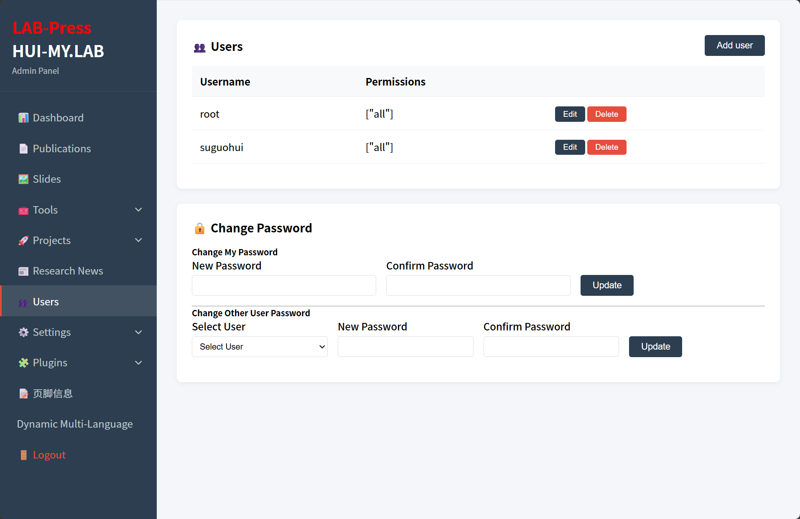
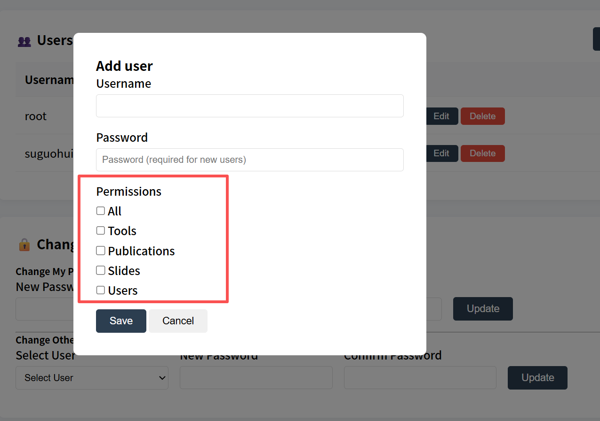
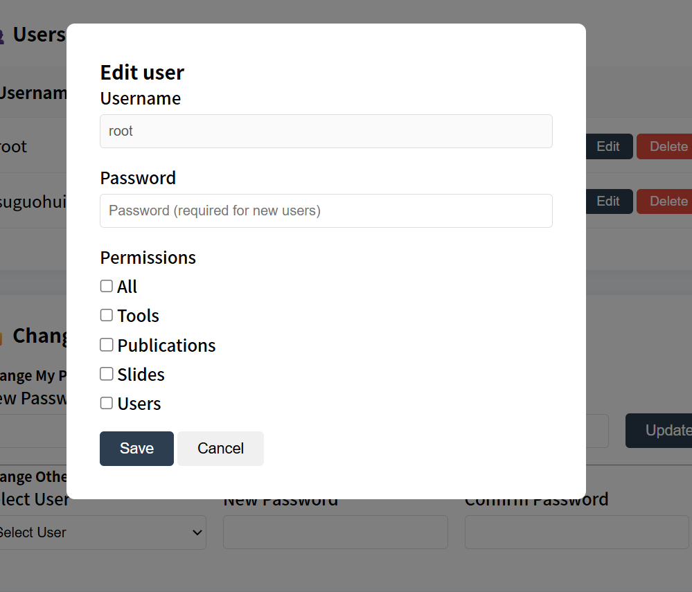
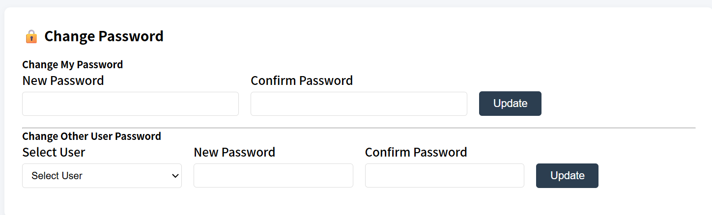

# Users Management

This chapter explains how to manage administrator accounts in the LabPress administration panel. The Users module controls who can access the admin area and which parts of the system each user is allowed to manage.

The guide focuses on practical operations: creating users, editing permissions, changing passwords, and removing accounts. It also describes the permission model and provides security recommendations for day-to-day user management.

## 1. Overview

LabPress uses a simple role-based permission system. Every user account has a username, a password hash, and a list of permissions stored as a JSON array. The permission list determines which admin pages and API endpoints the user can access.

The user management page is available from the admin sidebar under **Users**. From this page, administrators can add new users, edit existing users, delete accounts, and change passwords.

All user data is stored in the `users` table. The permission values are stored in JSON format and can include one or more of the following:

- `all` – full access to every module and setting.
- `publications` – access to publications management.
- `slides` – access to slides management.
- `tools` – access to tool, project, and category management.
- `users` – access to user management.

> **Administrator User Manager**

## 2. Accessing the Users Manager

The Users manager is available from the admin sidebar under **Users**.

Access to this page requires the `users` permission. Administrator accounts with the `all` permission can also access it. Users without the required permission will see a permission error message and will not be able to view the user list.

To open the page, click **Users** in the sidebar. The page displays a list of existing user accounts and provides several forms for account and password management.

## 3. Understanding the User List

The user list is loaded dynamically and shows the following information for each user:

- **Username** – the login name of the user.
- **Permissions** – the list of permissions assigned to that user.

Each row also includes **Edit** and **Delete** buttons if the current user has permission to manage users.

The list is displayed in a table format. If no users have been added, the page shows a “No data” message.

## 4. Adding a User

To add a new administrator account:

1. Open the **Users** page.
2. Click the **Add User** button.
3. In the modal form, fill in the following fields:

| Field | Description |
|-------|-------------|
| **Username** | The login name for the new user. This field is required. |
| **Password** | The initial password for the new account. Required for new users. |
| **Permissions** | Select one or more checkboxes to assign permissions. |

4. Click **Save**.

The new user is inserted into the `users` table with the password securely hashed. The user can now log in to the admin panel with the credentials you provided.

When creating a user, grant only the permissions that are necessary for that person’s role. For full administrative access, select the **All** permission. For limited roles, select only the relevant module permissions.

> **Administrator Add User**

## 5. Editing a User

To modify an existing user:

1. Find the user in the user list.
2. Click the **Edit** button in that row.
3. The modal form opens with the current permissions filled in.
4. Update the permissions as needed.
5. Click **Save**.

The username field may be disabled when editing an existing user. The current implementation allows you to change permissions without resetting the password. If you need to change the username, you may need to create a new account or update the record directly in the database, depending on the current version.

> **Administrator Edit User**

## 6. Deleting a User

To remove a user account:

1. Find the user in the user list.
2. Click the **Delete** button in that row.
3. Confirm the deletion when prompted.

The user is permanently removed from the `users` table. This cannot be undone. Avoid deleting your own account while you are logged in, because you may lose access to the admin panel.

If you want to temporarily disable a user without deleting the account, consider changing the user’s permissions to an empty set or removing all module permissions. This effectively prevents the user from performing any administrative actions.

## 7. Password Management

The Users page includes two password management forms. One is for changing your own password, and the other is for administrators to change another user’s password.

### 7.1 Changing Your Own Password

The **Change My Password** form allows the currently logged-in user to update their own password.

To change your password:

1. Scroll to the **Change My Password** form on the Users page.
2. Enter a new password in the **New Password** field.
3. Repeat the password in the **Confirm Password** field.
4. Click **Update**.

The system verifies that both password fields match before saving. After a successful change, the new password takes effect immediately.

If the account is still using the default password, the page displays a warning. This warning disappears once the password is changed.

### 7.2 Changing Another User’s Password

The **Change Other User Password** form is visible only to users with the `all` permission. This form allows an administrator to reset the password for any other account.

To change another user’s password:

1. Select the target user from the **Select User** dropdown.
2. Enter a new password.
3. Repeat the password.
4. Click **Update**.

This is useful when a user forgets their password or when you need to enforce a password reset.

> **Administrator Edit User**

## 8. Permission Model

LabPress uses a flat permission model. Each user account has a list of strings that represent the modules they can access.

The following permission values are recognized by the core:

| Permission | Access Level |
|------------|--------------|
| `all` | Full access to every admin page, setting, and action. |
| `publications` | Access to publications and news management. |
| `slides` | Access to slides management. |
| `tools` | Access to tool, project, and project category management. |
| `users` | Access to user management and password forms. |

Users with the `all` permission automatically pass all permission checks, regardless of whether other permissions are also assigned. For example, assigning both `all` and `tools` is redundant.

Users without any permissions can still log in, but they will not see any management pages and will be denied access to all admin actions.

The permission checks are performed in the admin views and API endpoints using the `hasPermission()` function. If a user does not have the required permission, the system returns a permission error.

## 9. Security Recommendations

User accounts control access to the entire admin panel. Follow these recommendations to keep the site secure:

- Change the default `root` password immediately after installation.
- Use strong, unique passwords for all administrator accounts.
- Grant the `all` permission only to trusted administrators.
- Create limited accounts for staff members who only need to manage one module, such as publications or slides.
- Regularly review the user list and remove accounts that are no longer needed.
- Avoid sharing administrator credentials. Create separate accounts for each person who needs access.
- If an account is compromised, change its password immediately and review the content for unauthorized changes.

The user management system uses PHP’s `password_hash()` and `password_verify()` functions with bcrypt hashing. Passwords are never stored in plain text.

## 10. Next Steps

After managing users, you may want to continue with:

- [Site Settings](../setup/site-settings.md) – configure site identity and homepage content.
- [Navigation Menus](../setup/navigation.md) – manage header and footer menus.
- [Plugin Management](../setup/plugins.md) – manage plugins and extensions.
- [Publications](publications.md) – manage academic publications.
- [Projects](projects.md) – manage research projects.
- [Research News](news.md) – manage laboratory news.