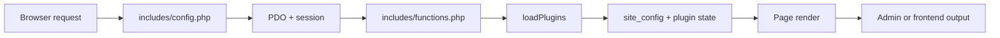
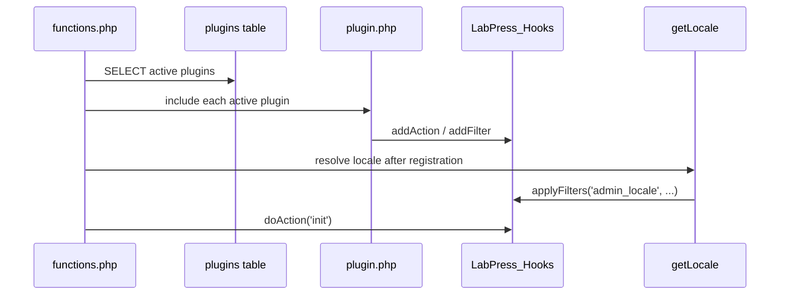

# Configuration Layers

This chapter explains how LabPress stores and resolves configuration. It is aimed at administrators and developers who need to know which values belong in a file, which values belong in the database, and which layer wins when both exist.

For procedural setup, use [Installation](installation.md); for first-run checks, use [Quick Start](quick-start.md).

## 1. Two Configuration Layers

| Layer | Storage | Examples | Edited by |
| --- | --- | --- | --- |
| Environment | `includes/config.php` | Database host/name/user/password, PHP session start, time zone | Server operator, via file editor or deployment secret |
| Site | `site_config` table | Site name, browser title format, default language, About Us, statistics, research cards | Administrator, via **Settings → Site Config** |
| Plugin state | `plugins` table + plugin files | Enabled/disabled status, plugin header metadata | Administrator, via **Plugins** |
| Runtime | PHP INI / FPM pool | Upload size, memory, execution time, error display | Hosting panel or `php.ini` |

Keep credentials in `config.php`, not in `site_config`. Keep editorial content in `site_config`, not in PHP files. This separation makes the database portable and keeps secrets out of admin exports.



## 2. Environment Configuration

`includes/config.php` is deployment-owned. It performs four jobs:

1. starts the PHP session;
2. defines the database constants;
3. creates the shared PDO connection;
4. sets the default time zone.

```php
<?php
session_start();

define('DB_HOST', 'localhost');
define('DB_NAME', 'labpress');
define('DB_USER', 'labpress_user');
define('DB_PASS', 'replace-with-a-strong-password');

try {
    $pdo = new PDO(
        'mysql:host=' . DB_HOST . ';dbname=' . DB_NAME . ';charset=utf8mb4',
        DB_USER,
        DB_PASS,
        [
            PDO::ATTR_ERRMODE => PDO::ERRMODE_EXCEPTION,
            PDO::ATTR_DEFAULT_FETCH_MODE => PDO::FETCH_ASSOC,
            PDO::ATTR_EMULATE_PREPARES => false,
        ]
    );
} catch (PDOException $e) {
    die('Database Connect Error: ' . $e->getMessage());
}

date_default_timezone_set('Asia/Shanghai');
```

Rules:

- `DB_HOST` is usually `localhost`; use a socket or remote host only when the database is not local.
- `DB_NAME` must contain the imported LabPress schema.
- `DB_USER` needs `SELECT`, `INSERT`, `UPDATE`, and `DELETE` on the LabPress database. DDL privileges are only needed for manual schema work.
- Do not change the PDO options unless you understand the consequences. `EMULATE_PREPARES => false` keeps native prepared statements on.
- `config.php` must not be committed with real credentials. It is intentionally deployment-specific.

## 3. PHP Runtime Settings

These values are not stored in `site_config`; they belong to the PHP process.

| Directive | Suggested value | Why it matters |
| --- | --- | --- |
| `upload_max_filesize` | `10M` or higher | Slide, project, and news images; plugin ZIPs. |
| `post_max_size` | Greater than `upload_max_filesize` | The whole multipart request, not just the file. |
| `max_execution_time` | `60` or higher | Larger imports and ZIP extraction. |
| `memory_limit` | `128M` or higher | Markdown rendering and larger result sets. |
| `display_errors` | `Off` in production | Prevents path and SQL detail leakage. |
| `log_errors` | `On` | Keeps diagnostics available without exposing them. |
| `file_uploads` | `On` | Required for every upload endpoint. |
| `session.cookie_httponly` | `1` | Reduces session theft via JavaScript. |
| `session.cookie_samesite` | `Lax` | Basic CSRF hardening for browser flows. |

The plugin installer page includes an environment panel. Use it to confirm `zip`, writable paths, and upload limits before debugging a failed installation.

## 4. Site Configuration Storage

Site settings live in `site_config` as key/value rows:

| Column | Meaning |
| --- | --- |
| `config_key` | Unique setting name. |
| `config_value` | Stored value. JSON is used for arrays such as statistics and research cards. |

Core accessors:

```php
LabPress::config($key, $default = '');
LabPress::setConfig($key, $value);
```

`LabPress::config()` loads the table once per request and caches it statically. A direct database edit therefore becomes visible on the next request, not in the current one.

## 5. Core Configuration Keys

These keys are normally edited through **Settings → Site Config**.

| Key | Type | Used for |
| --- | --- | --- |
| `site_name` | string | Footer, admin sidebar, compact brand text. |
| `site_title` | string | Full browser title and metadata. |
| `title_format` | string | Pattern such as `{page} - {site}`. |
| `language` | locale | Default site language and admin fallback. |
| `about_us` | HTML | About Us section on the homepage. |
| `stat_items` | JSON array | Homepage statistics: icon, label, value. |
| `research_title` | string | Research direction section heading. |
| `research_subtitle` | string | Research direction subheading. |
| `research_cards` | JSON array | Research direction cards: icon, title, description. |
| `ml_source_locale` | locale | Source locale used by Dynamic Multi-Language. |

Plugins may add their own keys. Treat any `ml_*` key as plugin-owned and do not reuse it for unrelated content.

## 6. Plugin Configuration and Loading

Plugin state is split between files and the `plugins` table:

| Column | Meaning |
| --- | --- |
| `slug` | Directory name; must match `plugins/{slug}/`. |
| `name` | Display name parsed from the plugin header. |
| `description` | Short description parsed from the header. |
| `version` | Plugin version. |
| `author` | Plugin author. |
| `status` | `1` active, `0` inactive. |

### 6.1 Load order

`loadPlugins()` reads active plugins once during bootstrap and includes each `plugin.php`. Plugin files register their hooks during inclusion. After all plugins are loaded, `getLocale()` runs; this ordering is required for `admin_locale`.



### 6.2 Plugin language files

Plugin language files are **not** merged into the core namespace. A plugin must request its own file:

```php
__('ml_plugin_name', 'plugin:dynamic-multilang');
```

The plugin file lives at `plugins/{slug}/languages/{locale}.php`. A plugin that is deactivated simply has no callback; core strings continue to load from the root `languages/` packs.

## 7. Internationalization Configuration

LabPress separates configuration for the two translation layers:

| Question | Where to look |
| --- | --- |
| Which locale is active for this request? | `getLocale()`; URL `lang`, cookie, or site default. |
| Which locale does the admin use? | `admin_locale` filter, implemented by Dynamic Multi-Language via `ml_admin_locale`. |
| Where are framework strings? | `languages/{locale}/{module}.php`. |
| Where are plugin strings? | `plugins/{slug}/languages/{locale}.php`, explicit `plugin:{slug}`. |
| Where are database content translations? | `ml_translations`, managed by Dynamic Multi-Language. |

1.1.1 changed the core rule: plugin language files are not auto-merged. See [Core Language Packs](../i18n/core-lang.md) and [Dynamic Multi-Language](../i18n/dynamic-multilang.md).

## 8. Frontend Resource Loading

Most resources are local:

- `assets/css/` and `assets/js/` for the frontend;
- `admin/assets/` for the admin panel;
- `assets/fontawesome/` for icons;
- `admin/assets/js/easymde.min.js` and `admin/assets/css/easymde.min.css` for Markdown editing;
- `assets/js/isotope.pkgd.min.js` for project filtering.

There is no CDN dependency in the default theme. If a deployment blocks outbound requests, the site still loads its CSS, icons, and JavaScript from the local tree. If you add a CDN later, document the change in `docs/getting-started/overview.md` and verify both HTTP and HTTPS.

## 9. Next Steps

- Field-level site settings: [Site Settings](../setup/site-settings.md).
- Menu configuration and account entry: [Navigation Menus](../setup/navigation.md).
- Plugin lifecycle: [Plugin Management](../setup/plugins.md).
- i18n contracts: [Internationalization Overview](../i18n/overview.md).
