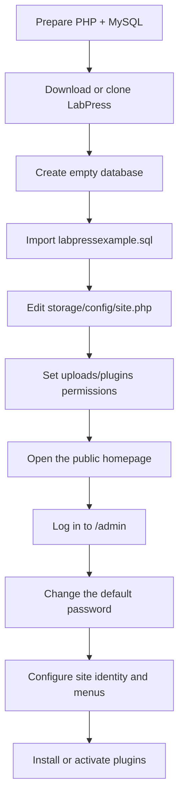
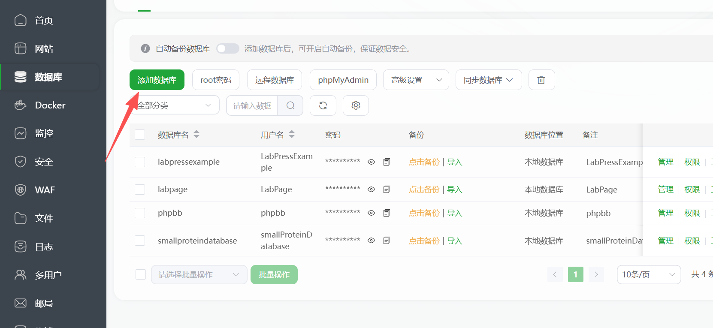
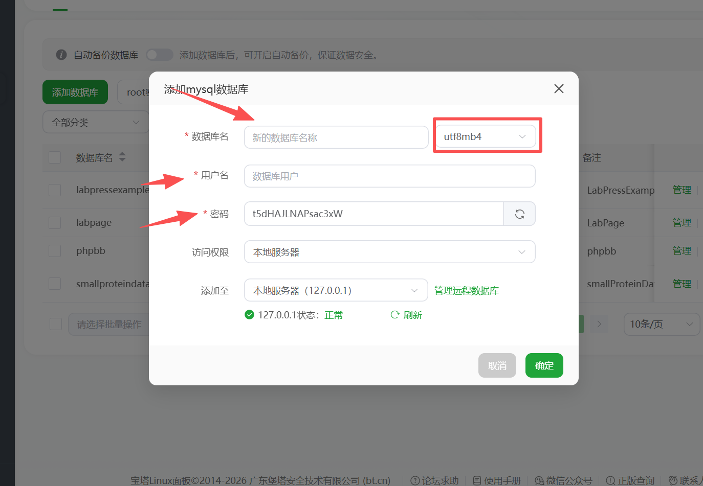
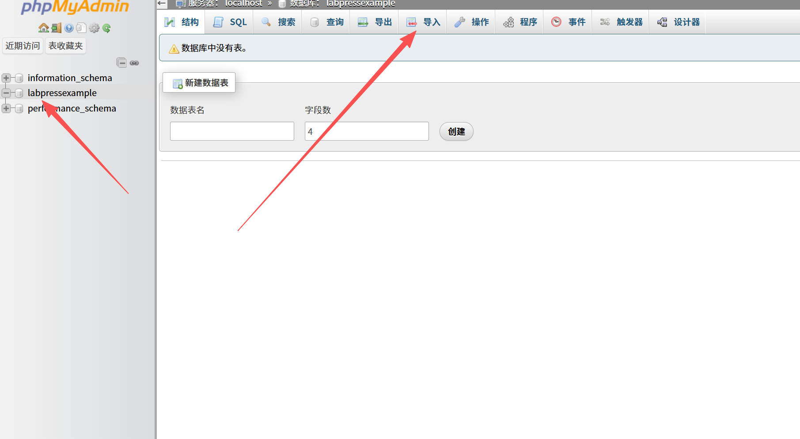
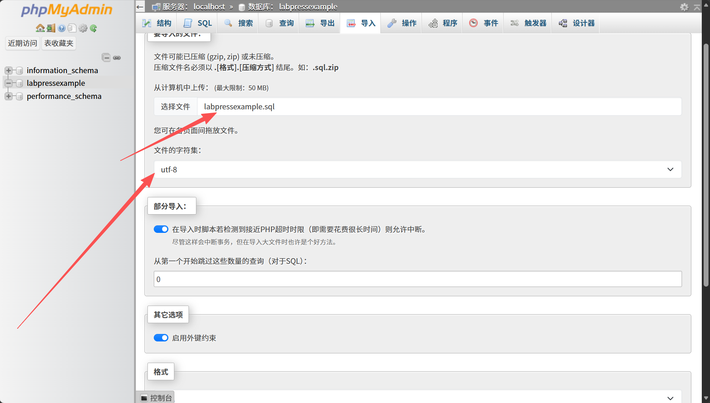
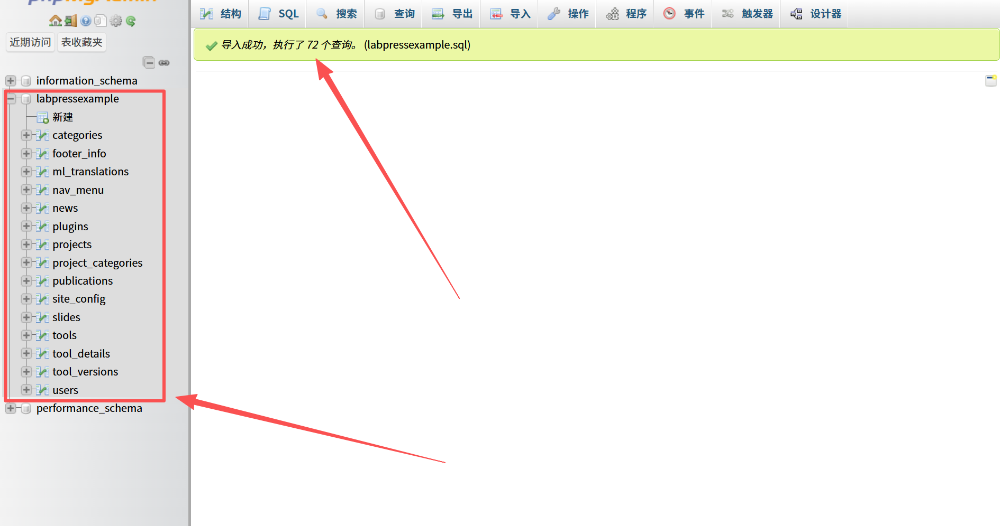
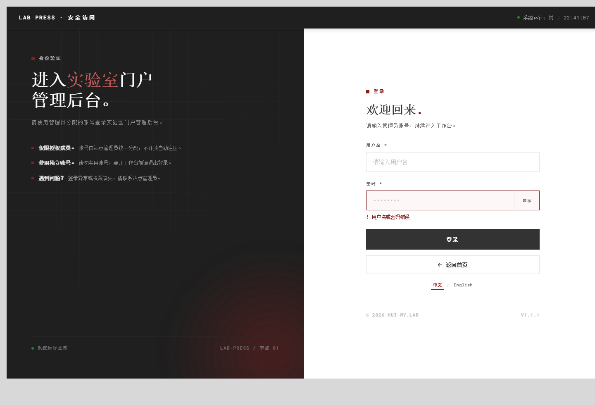
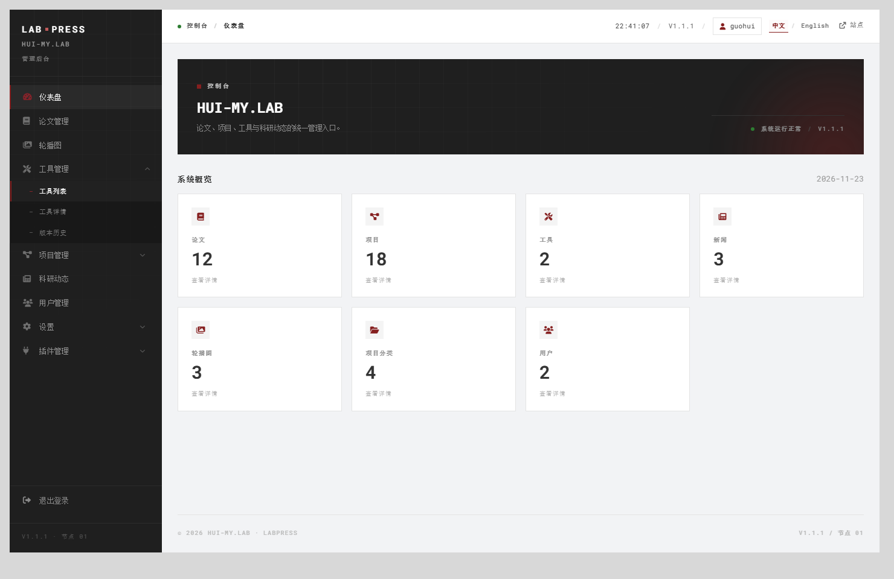

# Installation Guide

This guide walks through a first-time LabPress 1.2.0 installation on a typical PHP/MySQL host. It covers environment checks, source acquisition, database creation, sample-data import, `storage/config/site.php`, directory permissions, first login, and post-install verification.

If you are upgrading an existing 1.1.0 site rather than installing from scratch, use the [1.1.1 upgrade notes](../changelog.md#upgrade-notes) instead of re-importing the sample database.

## 1. Before You Begin

### 1.1 Deployment model

LabPress is a flat-file PHP application. There is no installer wizard and no writable `install/` directory. A deployment consists of:

1. the project files in the web root (or a subdirectory);
2. a MySQL database imported from `labpressexample.sql`;
3. one deployment-owned `storage/config/site.php`;
4. writable `uploads/` and `plugins/` directories.

The browser-facing entry points are `/index.php` and `/admin/index.php`. The default URL layout assumes the project is installed at the domain root. A subdirectory install works, but relative asset and upload paths should be checked after deployment.



### 1.2 Requirements

| Component | Minimum | Recommended | Notes |
| --- | --- | --- | --- |
| Web server | Apache 2.4 / Nginx 1.18 | Current stable | URL rewriting is optional; flat PHP routes work without it. |
| PHP | 7.4 | 8.1 or 8.2 | PDO MySQL is required. |
| Database | MySQL 5.7 / MariaDB 10.3 | MySQL 8.0 | `utf8mb4` is required for content. |
| Disk | Enough for code + uploads | Backups on separate storage | Slides and project images can grow quickly. |
| HTTPS | Recommended | Required for production | Protects admin sessions and login credentials. |

Required PHP extensions:

| Extension | Why it is needed |
| --- | --- |
| `pdo` | Database abstraction. |
| `pdo_mysql` | MySQL driver used by the bootstrap PDO connection. |
| `json` | API payloads, permissions, and plugin metadata. |
| `mbstring` | Multibyte strings in content and UI helpers. |
| `session` | Admin login and permission state. |
| `fileinfo` | Upload MIME detection. |
| `zip` | Installing plugins from a ZIP archive. |

`openssl` is recommended for HTTPS-aware deployments but is not required by the core request path. If `zip` is unavailable, manual plugin upload still works but the ZIP installer page will report a failed environment check.

To inspect the active PHP configuration, create a temporary `phpinfo.php` in the web root:

```php
<?php
phpinfo();
```

Open it in a browser, confirm `pdo_mysql` is enabled, then **delete the file immediately**. Do not leave `phpinfo.php` on a production server.

## 2. Obtaining the Source Code

Choose one method. Both produce the same application tree; the ZIP is easier for a server without Git.

### 2.1 Clone the repository

```bash
git clone https://github.com/GuiHui-huimy/LabPress.git
cd LabPress
```

Upload or move the project into the web root. If the web root is `/www/wwwroot/LabPress`, the repository root should be that directory, not a nested `LabPress/LabPress` directory.

### 2.2 Download the ZIP archive

Download the latest release from [GitHub Releases](https://github.com/GuiHui-huimy/LabPress/releases), extract it locally, and upload the extracted contents. Do not upload the outer folder if your panel already creates the site directory.

### 2.3 Verify the directory

A healthy source tree contains at least:

```text
LabPress/
├── admin/                  # admin entry + views
├── api/                    # JSON endpoints
├── assets/                 # frontend CSS/JS/fonts
├── docs/                   # MkDocs source
├── includes/               # config, helpers, hooks, header/footer
├── languages/              # core language packs
├── plugins/                # plugin directories
├── uploads/                # runtime uploads
├── index.php
├── publications.php
├── tools.php
├── projects.php
├── news.php
├── labpressexample.sql
└── README.md
```

`storage/config/site.php` is absent in a fresh clone because it holds deployment credentials. Copy `storage/config/site.example.php` to `storage/config/site.php` before editing.

## 3. Database Setup and Sample Data

The SQL dump creates tables and inserts demo content. It does **not** create a database. Create an empty database first, then import.

The sample dump was exported from MySQL 8.0 and may contain `utf8mb4_0900_ai_ci`. MySQL 5.7 does not understand that collation; replace it with `utf8mb4_general_ci` before importing, or import into MySQL 8.0 and convert afterwards.

### 3.1 Method A: phpMyAdmin / BaoTa panel

This is the recommended path for shared hosting and panel-managed servers.

1. Open the hosting panel and choose **Database**.
2. Create a database, for example `labpress`.
3. Set the character set to `utf8mb4` and the collation to `utf8mb4_general_ci`.
4. Create a database user with full privileges on that database, or reuse an existing user.
5. Record the host, database name, username, and password.
6. Open phpMyAdmin, select the new database, and choose **Import**.
7. Choose `labpressexample.sql`, keep the format as SQL, and run the import.
8. Confirm that tables such as `publications`, `projects`, `news`, `tools`, and `users` exist.


> The database creation screen. Use `utf8mb4` and a dedicated database user.


> Give the user full privileges on the LabPress database only.


> Select the empty database before importing the SQL dump.


> The import form. Keep the SQL format and do not change the character set unless your panel requires it.


> A successful import lists the LabPress tables and the demo records.

### 3.2 Method B: MySQL command line

Use this when you have shell access and prefer reproducible commands.

```sql
CREATE DATABASE labpress
    CHARACTER SET utf8mb4
    COLLATE utf8mb4_general_ci;

CREATE USER 'labpress_user'@'localhost'
    IDENTIFIED BY 'replace-with-a-strong-password';

GRANT ALL PRIVILEGES ON labpress.* TO 'labpress_user'@'localhost';
FLUSH PRIVILEGES;
```

Then import from the project root:

```bash
mysql -u labpress_user -p labpress < labpressexample.sql
```

Verify the result:

```bash
mysql -u labpress_user -p labpress -e "SHOW TABLES;"
```

If the command returns no error but the site is empty, confirm that the dump was imported into the same database named in `DB_NAME`.

## 4. Configure the Environment

`storage/config/site.php` is the v1.2.0 recommended deployment file. It contains database credentials, timezone, session cookie settings, and debug flags. It is ignored by Git and protected by `storage/.htaccess` on Apache.

### 4.1 Create the file

From the project root:

```bash
cp storage/config/site.example.php storage/config/site.php
```

If you upgraded from v1.1.1 and already have working `DB_*` constants in `includes/config.php`, you can keep them temporarily; bootstrap uses them as a fallback. For new deployments, use `storage/config/site.php`.

### 4.2 Set the database connection

```php
<?php
// storage/config/site.php
return [
    'db' => [
        'host' => 'localhost',
        'name' => 'labpress',
        'user' => 'labpress_user',
        'pass' => 'replace-with-a-strong-password',
        'charset' => 'utf8mb4',
    ],
    'timezone' => 'Asia/Shanghai',
    'debug' => false,
    'session' => [
        'name' => '',
        'same_site' => 'Lax',
        'secure' => null,
    ],
];
```

`includes/bootstrap.php` is the only place that starts the session and creates the PDO connection. `includes/config.php` is retained only as a compatibility shim for old deployments that still define `DB_*` constants.

### 4.3 Run the migration

```bash
php bin/migrate.php status
php bin/migrate.php up
```

The first run creates `schema_version`. If the database was imported from the v1.1.1 sample dump, the migration is additive; it does not drop user content.

### 4.4 Security rules

- Never commit real credentials. `storage/config/site.php` is already ignored.
- Do not include `storage/` in a public release ZIP.
- Keep `storage/logs/` writable by PHP but not web-accessible.
- For Nginx deployments, add a `location ^~ /storage/ { deny all; }` rule manually.

## 5. Directory Permissions

The PHP process must be able to write uploaded images and plugin packages. Read access is required for the rest of the tree.

```bash
chmod -R 755 uploads/
chmod -R 755 plugins/
mkdir -p storage/logs
chmod -R 775 storage/logs
```

If the web server runs as a dedicated user, set ownership explicitly:

```bash
chown -R www-data:www-data uploads plugins storage/logs
```

On a BaoTa-style panel, the site user may be `www`; use the actual PHP-FPM user. Avoid `777` on production. If uploads fail, check:

1. the directory owner versus the PHP-FPM user;
2. SELinux/AppArmor restrictions;
3. the panel's “open_basedir” setting;
4. PHP upload limits (`upload_max_filesize`, `post_max_size`).

## 6. First Access and Login

Open the public site:

```text
https://your-domain/
```

You should see the demo homepage with slides, projects, publications, tools, and news. If the page is blank or reports `Database Connect Error`, fix `storage/config/site.php` (or the legacy `DB_*` constants) before continuing.

The administration panel is at:

```text
https://your-domain/admin/
```

The sample database creates one administrator:

| Field | Value |
| --- | --- |
| Username | `root` |
| Password | `lab123456` |


> The login page after installation. The **中文 / English** control appears below the form when Dynamic Multi-Language is active.


> The dashboard is the first screen after login. This v1.1.1 capture also shows the admin language switcher in the topbar. Change the default password before editing content.

**Change the password immediately.** Open **Users → Change My Password**, set a strong password, and confirm that `isUsingDefaultPassword()` no longer shows a warning. For a production site, create a separate administrator and stop using `root` for day-to-day work.

### 6.1 Post-install checklist

- [ ] The public homepage loads without PHP warnings.
- [ ] `/admin/login.php` loads and accepts the sample login.
- [ ] The default password has been changed.
- [ ] `uploads/` and `plugins/` are writable by PHP.
- [ ] `storage/config/site.php` and `storage/logs/` are not web-accessible.
- [ ] HTTPS is enabled and the admin cookie is sent over HTTPS.
- [ ] The site name, title, and footer are correct under **Settings → Site Config**.
- [ ] The navigation menu points to the intended pages.
- [ ] Dynamic Multi-Language is active only if the site actually needs database-content translation.
- [ ] A database backup has been taken after configuration.

## 7. Security Recommendations

- Use HTTPS for both frontend and admin. A valid certificate is not optional for a site with logins.
- Change the sample `root` password before exposing the site to the internet.
- Keep `storage/config/site.php` outside version control and outside public backups where possible.
- Restrict `includes/`, `docs/`, and `labpressexample.sql` at the web-server level. None of them need to be publicly downloadable.
- Back up the database and `uploads/` together; restoring only the database leaves broken image references.
- Keep PHP and MySQL patched. The application has no autoloader or third-party framework to update, but the runtime still needs maintenance.
- Install plugins only from sources you trust. A plugin is PHP code with the same filesystem privileges as the site.

## 8. Troubleshooting

### The page is blank or reports a database error

Check `storage/config/site.php` first. Confirm the `db` host/name/user/pass values; then confirm `pdo_mysql` is enabled. Temporarily enable PHP error display only in a local environment, never on a public production site.

### SQL import fails with a collation error

Replace `utf8mb4_0900_ai_ci` with `utf8mb4_general_ci` in the dump, or import into MySQL 8.0. Do not mix collations across tables that join each other.

### Images do not load

Confirm that `uploads/` and `images/` exist, contain the referenced files, and are readable by the web server. If the site is installed in a subdirectory, check that the database paths and the public URL prefix agree.

### Plugin ZIP installation fails

Confirm that the `zip` PHP extension is enabled and that `plugins/` is writable. The installer also checks the archive structure; a ZIP that contains an extra wrapper directory may need to be repacked with `plugin.php` at the archive root.

### The language switch does not change the admin panel

Use `/admin/login.php?lang=zh_CN` as a direct test. If the HTML still reports `lang="en-US"`, check the `loadPlugins()` / `getLocale()` order in `includes/functions.php` and clear OPcache. See [Core Language Packs](../i18n/core-lang.md) for the exact resolution order.

### `git pull` refuses because local files changed

Do not discard `storage/config/site.php`. Inspect the changed files, stash only the disposable edits, pull, then restore the stash. Never use `git reset --hard` on a server where the config contains production credentials.

## 9. Next Steps

- First-run configuration: [Quick Start](quick-start.md).
- Site identity and homepage settings: [Site Settings](../setup/site-settings.md).
- Navigation and account entry: [Navigation Menus](../setup/navigation.md).
- Upgrade an existing site: [Changelog → Upgrade Notes](../changelog.md#upgrade-notes).
- Production hardening: [Security](../security.md).
