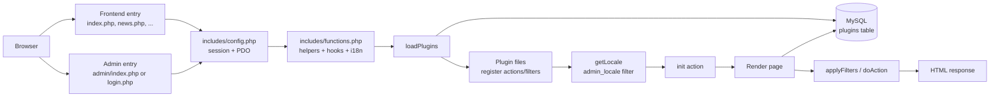
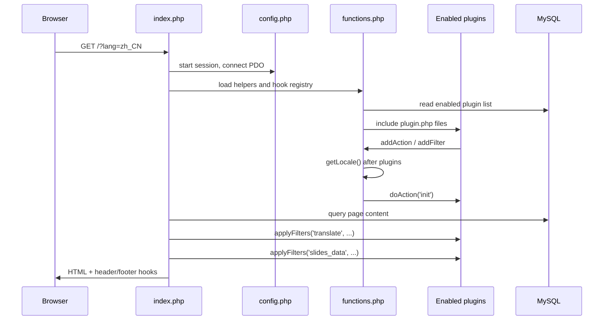
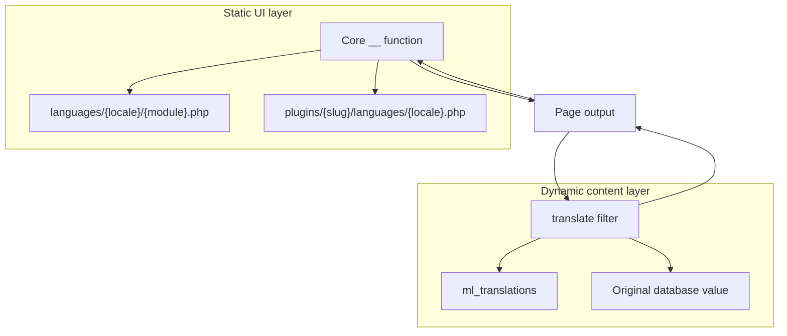

# LabPress Documentation Overview

Welcome to the LabPress documentation. This page is the technical and conceptual entry point for LabPress 1.1.1, an open-source academic content management system for research groups, university laboratories, and individual research teams.

The goal of this page is not to repeat installation steps. It explains what the system is, how a request moves through it, where the core/plugin/i18n boundaries sit, and which parts of the documentation you should read next. For hands-on setup, start with the [Installation Guide](installation.md); for a short first-run path, use [Quick Start](quick-start.md).

## 1. What LabPress Is

LabPress is a pure PHP + MySQL CMS with no framework, ORM, template engine, or Composer dependency. It ships with academic modules that a research site usually needs:

- publications;
- homepage slides;
- software and database tools, including tool details and version history;
- research projects with categories;
- research news with Markdown content;
- navigation menus and site settings;
- users, permissions, and password management.

The frontend is rendered by standalone PHP entry files at the project root. The admin panel is a separate entry area under `/admin/`. Shared behavior lives in `/includes/`; plugins extend both surfaces through actions and filters.

The two features that most strongly distinguish LabPress from a generic CMS are:

1. **A hook-driven plugin system.** Core output points are intentionally filterable, and plugins can register admin pages without editing core files.
2. **A deliberately split i18n model.** Static interface strings come from core language packs; database content is handled by the Dynamic Multi-Language plugin. Admin and frontend locales are separate concerns.

## 2. Design Principles

| Principle | Practical consequence |
| --- | --- |
| Academic first | Publications, projects, tools, versions, and research news are first-class data models, not generic “posts”. |
| Core stays plugin-agnostic | Removing every plugin still leaves a working site. Core only exposes hooks and safe fallbacks. |
| Explicit boundaries | Plugin language files do not merge into the core namespace. Plugin strings use `plugin:{slug}`. |
| Separate frontend and admin contexts | The public site and the admin panel have independent entry points, assets, permissions, and locale policies. |
| Low operational cost | A standard PHP/MySQL host is enough. There is no build step, queue, daemon, or external service requirement. |
| Content is editable without SQL | Site settings, navigation, slides, and academic modules all have admin views. |

## 3. Technology Stack

| Layer | Technology | Notes |
| --- | --- | --- |
| Runtime | PHP 7.4+ | No framework; PDO for database access. |
| Database | MySQL 5.7+ / MariaDB 10.3+ | UTF-8 (`utf8mb4`) tables. |
| Frontend | HTML5, CSS3, vanilla JavaScript | EasyMDE and Isotope are bundled; Font Awesome is served from the local `assets/fontawesome/` directory. |
| Admin UI | PHP views + CSS + vanilla JavaScript | Modal forms and table views; no React/Vue build. |
| Plugin API | `LabPress_Hooks` | WordPress-style actions and filters. |
| Markdown | Parsedown (bundled) | Used for news and project bodies. |
| Authentication | PHP sessions + bcrypt | `password_hash()` / `password_verify()`; permission checks in admin views and APIs. |
| i18n | Core language packs + `ml_translations` | Static UI strings and database content are separate layers. |

## 4. Architecture at a Glance

The important detail in 1.1.1 is boot order: plugins are loaded **before** the early locale resolution. That is what allows a plugin to answer the `admin_locale` filter on the very first request.



A request is therefore not a single “core render”. It is a small pipeline:

1. **Bootstrap.** The entry file requires `config.php` (session and PDO) and `functions.php` (helpers, hook registry, i18n).
2. **Plugin discovery.** `loadPlugins()` reads the enabled plugin list and includes each `plugin.php`.
3. **Registration.** Plugin files register filters and actions while they are included.
4. **Locale resolution.** `getLocale()` runs after plugin registration. In the admin context it applies `admin_locale`; in the frontend context it reads `lang`, then cookie, then site default.
5. **Init.** `LabPress_Hooks::doAction('init')` runs after locale setup.
6. **Render.** The page queries the database, applies filters at output points, and returns HTML.

A more concrete frontend request looks like this:



## 5. Core, Plugins, and i18n Boundaries

### 5.1 Core owns framework strings

The core language packs under `languages/{locale}/` contain only labels, buttons, validation messages, and default template text. In 1.1.1, `__()` no longer scans every active plugin and merges its language array into the core namespace.

### 5.2 Plugins own plugin strings

A plugin language file lives at:

```text
plugins/{plugin-slug}/languages/{locale}.php
```

It is loaded only when the caller names the plugin explicitly:

```php
__('ml_plugin_name', 'plugin:dynamic-multilang');
```

A plugin should also use a unique key prefix. Explicit loading prevents path collisions; the prefix prevents semantic collisions inside the plugin's own namespace.

### 5.3 Dynamic content is a separate layer

Database content (navigation titles, slide text, About Us, research directions, statistics labels) is translated by the Dynamic Multi-Language plugin. It is not stored in PHP language files and it is not merged into the core namespace.



The practical rule for developers is simple: if the string is written in PHP/HTML by the framework, use a core or plugin language pack. If the string is typed by an administrator into the database, use the Dynamic Multi-Language plugin.

### 5.4 Admin locale is plugin-owned

The core provides the `admin_locale` filter and a safe fallback to the site default. The Dynamic Multi-Language plugin implements the filter and stores the selection in `ml_admin_locale`. If the plugin is absent, the admin panel still works and simply follows the site default.

See [Internationalization Overview](../i18n/overview.md) and [Core Language Packs](../i18n/core-lang.md) for the full contracts.

## 6. Directory Map

The following map focuses on the files that matter when reading or extending the system. Generated uploads and documentation theme internals are omitted.

```text
LabPress/
├── admin/
│   ├── index.php                 # Admin entry, menu + view loader
│   ├── login.php                 # Login, redirect handling, locale switch hook
│   ├── logout.php
│   ├── includes/
│   │   ├── admin-header.php      # Sidebar + topbar
│   │   └── admin-footer.php
│   ├── views/                    # dashboard, publications, slides, tools, ...
│   └── assets/                   # admin CSS/JS, EasyMDE
├── api/
│   ├── data.php                  # read endpoint
│   ├── save.php                  # write endpoint
│   ├── upload.php                # image upload
│   ├── users.php                 # user management
│   ├── auth.php                  # login / check / logout
│   └── plugin-*.php              # plugin installation and uninstall
├── assets/
│   ├── css/                      # frontend styles
│   ├── js/                       # carousel, projects, etc.
│   └── fontawesome/              # local icon font + CSS
├── docs/                         # this MkDocs site
├── includes/
│   ├── config.php                # database + session (deployment-owned)
│   ├── config-sample.php
│   ├── functions.php             # helpers, plugin loader, i18n, locale resolution
│   ├── hooks.php                 # LabPress_Hooks
│   ├── labpress.php              # LabPress utility class
│   ├── header.php                # public nav, language switch, account entry
│   └── footer.php
├── languages/
│   ├── zh_CN/                    # core language pack
│   └── en_US/
├── plugins/
│   ├── dynamic-multilang/        # 2.0.2
│   ├── FooterInfo/
│   └── hello-word/
├── uploads/                      # runtime uploads
├── index.php                     # homepage, including the slide carousel
├── publications.php
├── tools.php
├── projects.php
├── news.php
├── category.php
└── labpressexample.sql
```

> The exact set of frontend entry files may grow as modules are added. The rule is stable: each public page is a standalone PHP entry file that includes shared config/helpers and calls the hook system at its output points.

## 7. Documentation Map

The MkDocs navigation mirrors the operational lifecycle of the project:

| Section | Read it when you need to… |
| --- | --- |
| [Getting Started](installation.md) | install, configure, or upgrade the system |
| [Setup](../setup/site-settings.md) | configure site identity, menus, plugins, and styling |
| [Content Management](../content/publications.md) | manage publications, slides, tools, projects, news, and users |
| [Internationalization](../i18n/overview.md) | understand the two translation layers and admin/frontend locale split |
| [Plugin Development](../plugins-dev/intro.md) | build, register, and ship a plugin |
| [Reference](../reference/api.md) | inspect endpoints, tables, and developer helpers |
| [Security](../security.md) | review deployment hardening and reporting boundaries |
| [Changelog](../changelog.md) | check version changes and upgrade notes |

The pages are intentionally cross-linked. A content page explains the admin workflow and then points to the relevant API/i18n reference; an i18n page explains the contract and then points to the exact plugin file. Use the table above as a map, not as a reading order.

## 8. Recommended Reading Paths

### For a site administrator

1. [Installation Guide](installation.md)
2. [Quick Start](quick-start.md)
3. [Site Settings](../setup/site-settings.md)
4. [Navigation Menus](../setup/navigation.md)
5. The content chapter for the module you are editing
6. [Security](../security.md)

### For a developer

1. This overview
2. [Plugin System Introduction](../plugins-dev/intro.md)
3. [Building a Plugin](../plugins-dev/develop.md)
4. [Hooks Reference](../plugins-dev/hooks-reference.md)
5. [Database Schema](../reference/database.md)
6. [API Reference](../reference/api.md)

### For a translator or multilingual site owner

1. [Internationalization Overview](../i18n/overview.md)
2. [Core Language Packs](../i18n/core-lang.md)
3. [Dynamic Multi-Language](../i18n/dynamic-multilang.md)
4. [Changelog 1.1.1](../changelog.md), especially the locale-order fix

## 9. What Changed in 1.1.1 That Affects Readers

- The admin language switch is now genuinely independent from the public `lang` cookie. Do not test it only by switching the frontend; test `/admin/login.php?lang=zh_CN` and reload the panel.
- Plugin language files must be requested with `plugin:{slug}`. If you are porting an older plugin that relied on automatic merging, move its strings into its own `languages/{locale}.php` and update every `__()` call.
- The public navigation account entry is rendered by `includes/header.php`. It is visible on every public page, not only the homepage.
- `admin/login.php` accepts `redirect=home`. The value is allow-listed; arbitrary URLs are ignored.

## 10. Next Steps

- New installation: [Installation Guide](installation.md).
- Existing 1.1.0 site: [Changelog → Upgrade Notes](../changelog.md#upgrade-notes).
- First plugin: [Plugin System Introduction](../plugins-dev/intro.md).
- Language boundary: [Core Language Packs](../i18n/core-lang.md).
