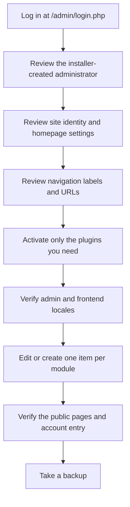
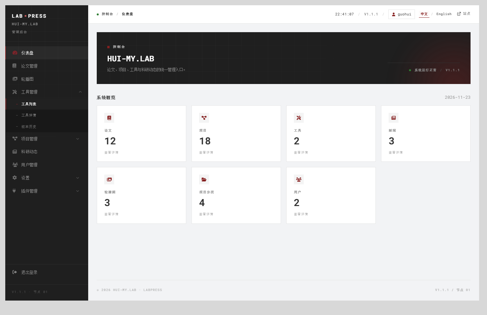
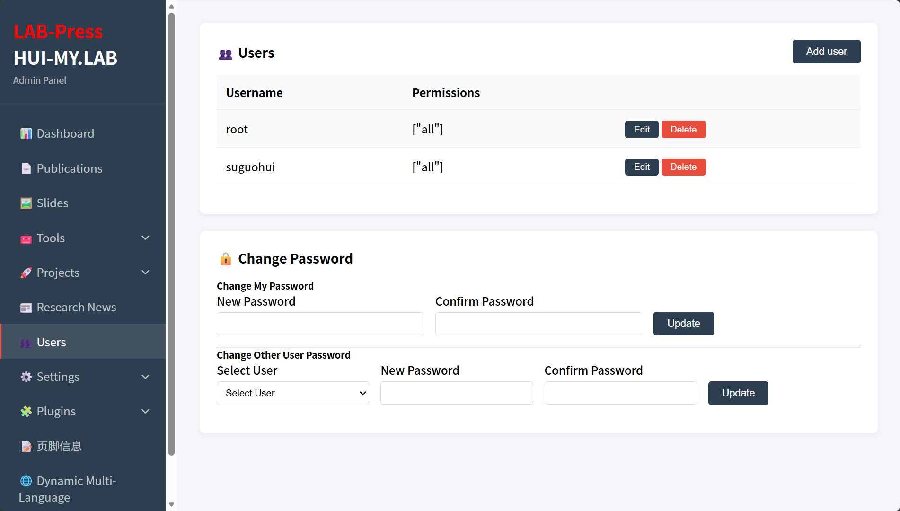
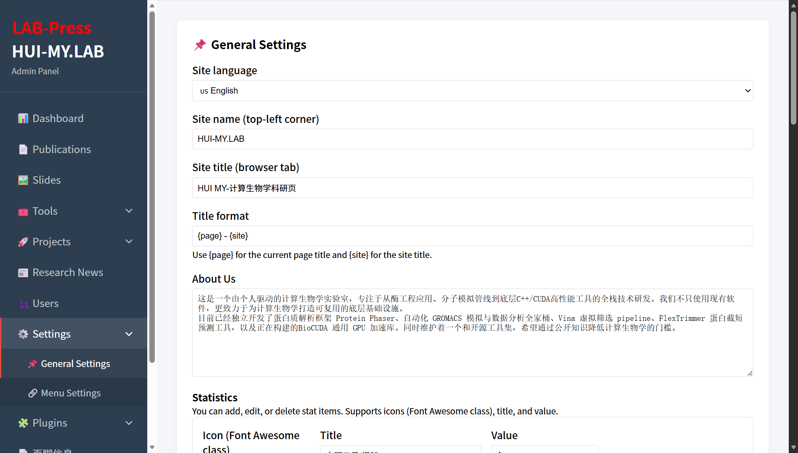
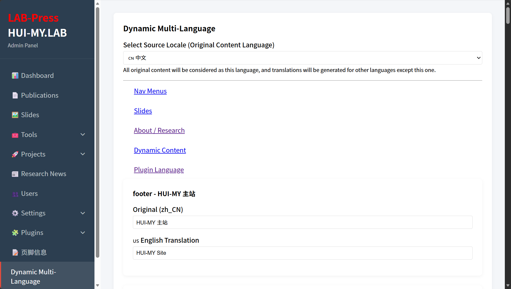

# Quick Start

This guide is for a LabPress that has already been installed by `install.php` or `bin/install.php`, with `storage/config/site.php` and `storage/install.lock` in place. It covers the minimum sequence needed to turn the installed site into a usable deployment.

Detailed module behavior lives in the chapter pages; this page focuses on order, verification, and the first-run decisions that are easy to postpone.



## 1. Log In to the Admin Panel

Open:

```text
https://your-domain/admin/login.php
```

Use the administrator account created in the installer. There is no built-in default username or password.

After login, the dashboard shows content counts plus the v1.2.0 ECharts overview: content mix, project categories, and the 14-day new-content trend. If you installed demo data, the site already contains six projects, four sample publications, three news posts and three tools; a blank install starts with only the administrator and base settings.


> The dashboard after the first login. v1.2.0 adds the data-overview charts below the existing content cards.

## 2. Secure the Installer Administrator

The installer account is the first administrator. If you used a temporary password, change it before doing anything else:

1. Open **Users** in the admin sidebar.
2. Use **Change My Password**.
3. Enter a strong password and confirm it.
4. Reload the page and confirm the installed account still has the permissions you expect.

For a production site, create a separate administrator account for daily editing. Keep the installer account as a break-glass account with a unique password.


> User management contains the self-service password form and the administrator password reset form.

See [Users Management](../content/users.md) for the permission model.

## 3. Review Site Settings

Open **Settings → Site Config**. Check:

- site name and browser title;
- default site language;
- About Us copy;
- statistics labels and values;
- research direction cards;
- footer text if Footer Info is active.

The sample values are placeholders. Replace them before inviting visitors, because the homepage and every page title inherit these settings.


> Site settings control the public identity of the site and several homepage sections.

See [Site Settings](../setup/site-settings.md) for field-by-field guidance.

## 4. Review Navigation Before Content

Open **Settings → Navigation Menus**. Confirm that each menu item points to the intended page or external URL.

A typical first-run menu:

| Label | URL | Target |
| --- | --- | --- |
| Home | `/index.php` | Same window |
| Publications | `/publications.php` | Same window |
| Tools | `/tools.php` | Same window |
| Projects | `/projects.php` | Same window |
| News | `/news.php` | Same window |
| Contact | External lab or university page | New window |

The navigation is stored in the database and rendered by `includes/header.php`. The header also renders the language switcher and the account entry; those are not separate menu records.

See [Navigation Menus](../setup/navigation.md) for CRUD and account-entry behavior.

## 5. Activate Only the Plugins You Need

Open **Plugins → Installed Plugins**.

LabPress ships with:

- **Footer Info** 3.0 — footer text and simple footer styling, managed by the Settings API.
- **Dynamic Multi-Language** 3.0 — database-content translation and the backend language switcher.
- **hello-word** — a development example, safe to leave inactive.

Activate Footer Info if you need editable footer content. Activate Dynamic Multi-Language only if the site actually serves more than one content language; otherwise it adds an admin page and translation tables that are not being used.

If a plugin directory exists but is not listed, use **Scan for new plugins** first. If activation fails, check the plugin header and the `plugins` table before uploading a new copy.

## 6. Verify Both Language Contexts

LabPress 1.1.1 separates the frontend language from the admin language. Test both, not just the public switcher.

### Frontend

1. Open the homepage.
2. Switch the language in the header.
3. Reload. The selected locale should persist in the `lang` cookie.
4. Check that database content (slide text, nav labels) changes only when Dynamic Multi-Language is active and translations exist.

### Admin

1. Open `/admin/login.php?lang=zh_CN`.
2. Confirm the login page renders Chinese text and `<html lang="zh-CN">`.
3. Log in and confirm the admin topbar remains Chinese.
4. Switch back to English from the admin topbar or login-page switcher.
5. Reload the page. The admin locale should persist independently of the frontend cookie.

If the admin language does not change, see the locale-order troubleshooting in [Core Language Packs](../i18n/core-lang.md).


> The Dynamic Multi-Language page is where database-content translations are edited.

For the architecture, see [Internationalization Overview](../i18n/overview.md).

## 7. Create or Edit One Item per Module

Do not start by bulk-importing production content. Exercise one item in each module first; this exposes field mapping, image upload, and permission issues while the sample data is still available.

Suggested order:

1. **Slides** — replace one homepage slide and confirm the carousel updates.
2. **Publications** — add one paper and check the public list.
3. **Projects** — create one category and one project; confirm filtering.
4. **Tools** — add one tool, its detail record, and one version.
5. **News** — publish one Markdown item with an image.
6. **Users** — create a non-admin editor with a limited permission set.

The module pages contain field tables and validation notes:

- [Publications](../content/publications.md)
- [Slides](../content/slides.md)
- [Tools](../content/tools.md)
- [Projects](../content/projects.md)
- [Research News](../content/news.md)
- [Users](../content/users.md)

## 8. Verify the Public Account Entry

The public navigation is shared by all frontend pages. In 1.1.1 it contains an account entry in `includes/header.php`.

1. Sign out of the admin panel.
2. Open the homepage. The nav bar should show **Sign in**, not a username.
3. Click **Sign in**. The link should include `redirect=home`.
4. Log in. The browser should return to `/index.php`, not `/admin/index.php`.
5. The nav bar should now show the username.
6. Hover over the username. The dropdown should show **Dashboard** and only the admin modules permitted for that account.
7. Click the username. It should open `/admin/index.php`.

If the username does not appear, check `$_SESSION['user']` and the cookie path. If the dropdown is empty, check the `permissions` array stored for the user.

## 9. Take a Baseline Backup

After the site identity, navigation, and one sample item per module are correct, export the database and archive `uploads/`. Store them outside the web root.

This baseline is useful for two reasons:

- it captures a known-good configuration before bulk content entry;
- it gives you a rollback point before plugin experiments or a future upgrade.

## 10. Next Steps

- Configure every field: [Site Settings](../setup/site-settings.md).
- Tune the menu and account entry: [Navigation Menus](../setup/navigation.md).
- Understand plugin safety: [Plugin Management](../setup/plugins.md).
- Read the release changes: [Changelog 1.1.1](../changelog.md).
- Harden the deployment: [Security](../security.md).
