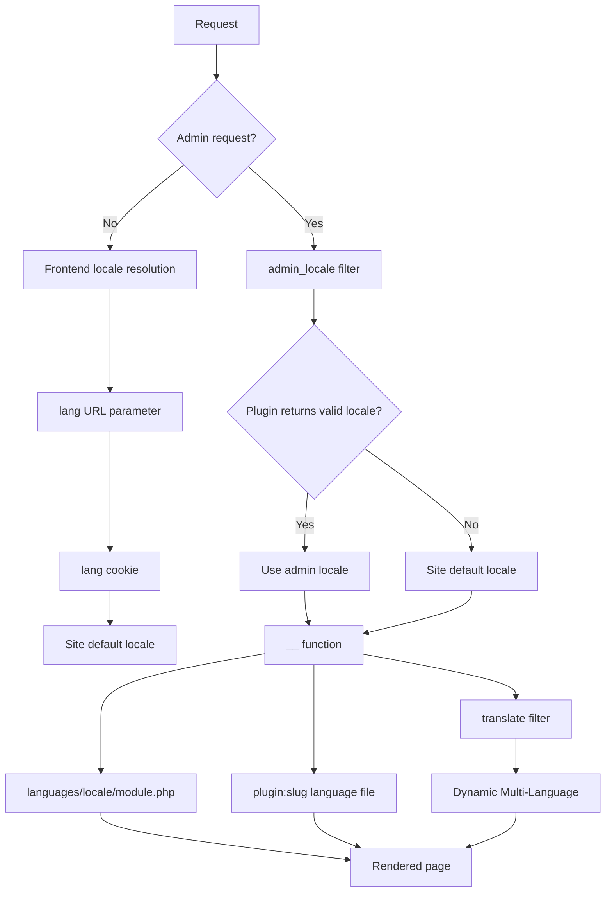
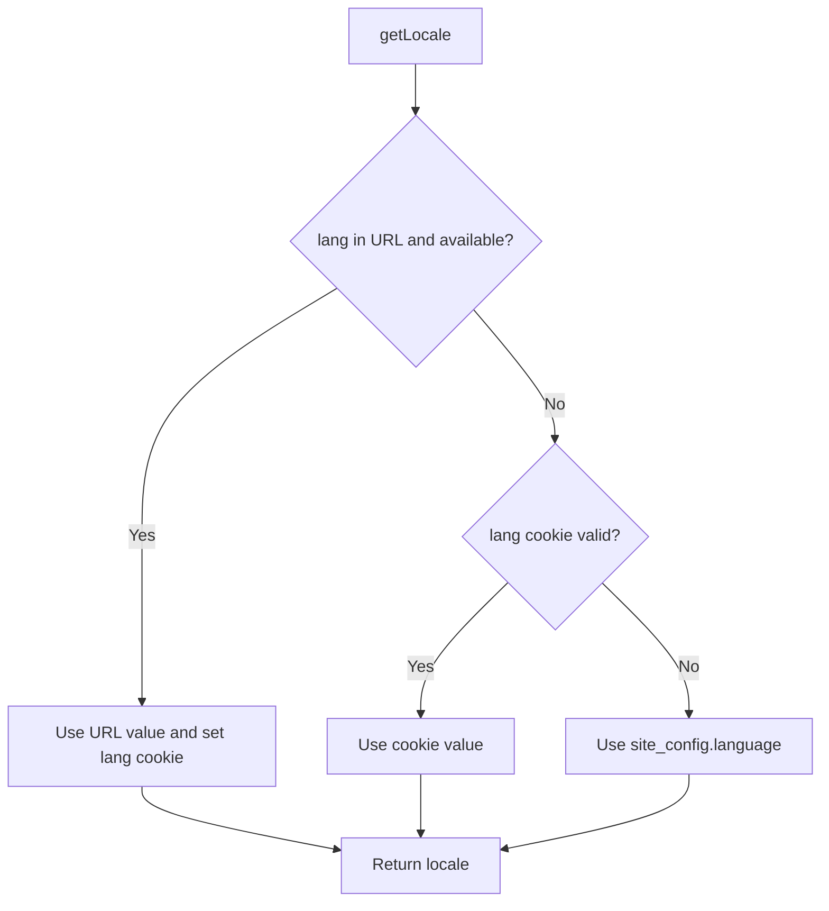
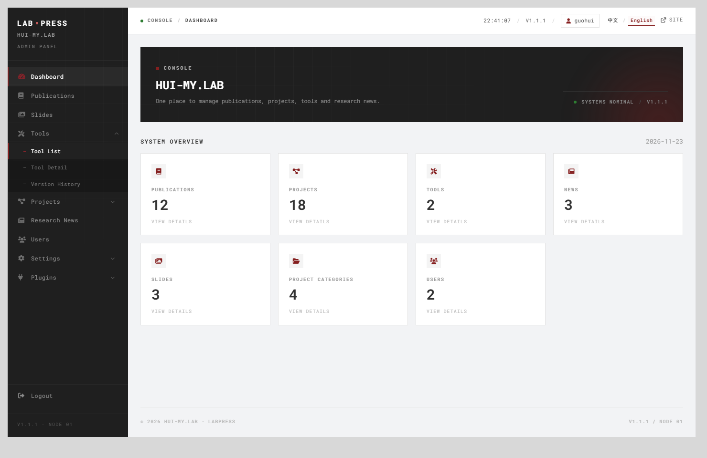
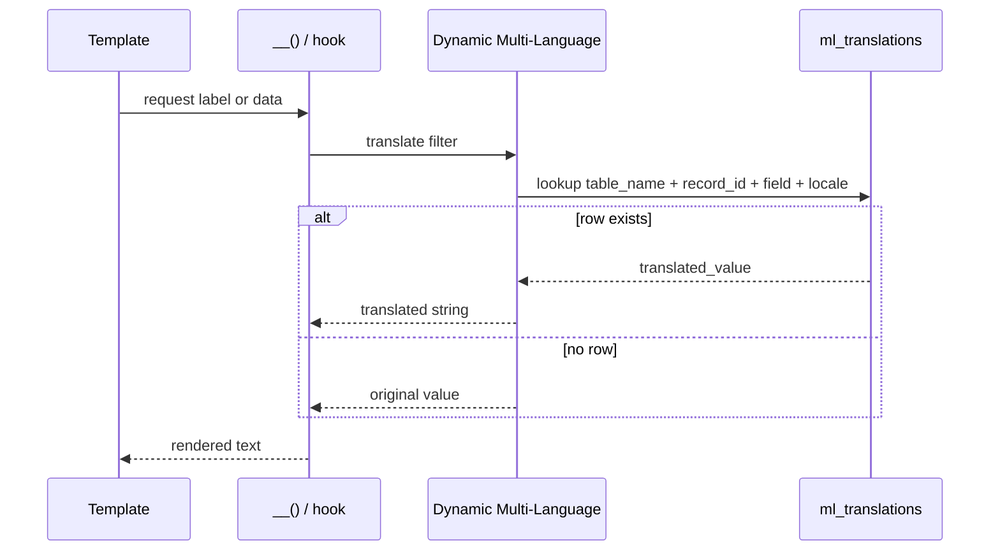
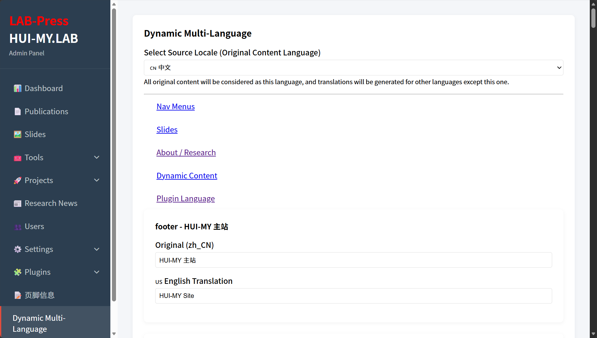

# Internationalization Overview

This chapter explains how LabPress separates interface translation from content translation, how the active locale is resolved for the frontend and the admin panel, and how the Dynamic Multi-Language plugin fits into that design.

The short version is: **core language packs translate code-level strings; Dynamic Multi-Language translates database content; the two layers meet at the `translate` filter.** In v1.1.1 the boundaries are stricter than in earlier releases, which matters when upgrading a plugin or a custom language pack.

## 1. Architecture at a glance

| Layer | Storage | What it translates | Who owns it |
|-------|---------|--------------------|-------------|
| Static interface | `languages/{locale}/*.php` | Labels, buttons, validation messages, default template text | Core |
| Dynamic content | `ml_translations` | Navigation titles, slide text, About Us, research fields, statistic labels | Dynamic Multi-Language |
| Plugin interface | `plugins/{slug}/languages/{locale}.php` | Strings owned by a plugin | The plugin itself |



Two independent things are being resolved here:

1. **Interface locale** — which language file supplies labels.
2. **Content locale** — which translation row is used for a database record.

They often share the same code, but they are not the same decision. A visitor can read a Chinese interface with English publication titles, and an administrator can edit English labels while the public site serves Chinese.

## 2. Static language packs

### 2.1 Directory layout

Each locale is a directory under `languages/`, and each module is a PHP file that returns an associative array:

```text
languages/
├── zh_CN/
│   ├── lang.config
│   ├── common.php
│   ├── index.php
│   ├── admin.php
│   ├── news.php
│   ├── projects.php
│   ├── tools.php
│   └── publications.php
└── en_US/
    ├── lang.config
    ├── common.php
    ├── index.php
    ├── admin.php
    ├── news.php
    ├── projects.php
    ├── tools.php
    └── publications.php
```

`lang.config` supplies the display metadata used by both language switchers:

```php
<?php
// languages/en_US/lang.config
return [
    'name'      => 'English',
    'locale'    => 'en_US',
    'flag'      => '🇺🇸',
    'direction' => 'ltr',
];
```

The directory name is authoritative: `getAvailableLanguages()` overwrites `locale` with the directory name. A mismatch between the directory and the `locale` field in `lang.config` will therefore not create a second locale, but it will confuse anyone reading the metadata.

Language files return arrays. Dot notation addresses nested keys; for example, `nav.home` means `['nav' => ['home' => ...]]`.

### 2.2 The `__()` function

```php
__($key, $module = 'common');
```

- `$key` is the lookup key.
- `$module` selects a core module file or an explicit plugin language file.

The function loads `common` first, then the requested core module on demand, and caches loaded modules for the request. Missing keys return the key itself, so a broken translation does not blank out the interface.

```php
echo __('about_us_title', 'index');
```

This reads `languages/{locale}/index.php`. For a plugin-owned string, the module must be `plugin:{slug}`:

```php
__('ml_plugin_name', 'plugin:dynamic-multilang');
```

The plugin branch reads `plugins/dynamic-multilang/languages/{locale}.php` directly and looks up the key inside that file. It does not merge the plugin array into the core namespace.

### 2.3 What changed in 1.1.1

Before 1.1.1, core `__()` merged active plugin language files into the core lookup. That made plugin strings appear to work without a module prefix, but it also created collisions and made deactivation behavior unpredictable.

In 1.1.1:

- core modules are loaded from `languages/{locale}/{module}.php`;
- plugin modules must use `plugin:{slug}`;
- only the requested plugin file is parsed;
- a missing plugin file returns the key and records the path in `$GLOBALS['lp_i18n_missing']` when `LABPRESS_DEBUG` is on.

If an upgrade suddenly shows raw keys such as `ml_plugin_name`, the first check is the second argument of `__()`. It is almost always missing the `plugin:` prefix.

## 3. Locale resolution

### 3.1 Frontend precedence

`getLocale()` resolves the frontend locale once per request and caches it in a static variable:



The URL value wins because it represents an explicit, immediate request. A valid `lang` parameter also writes a 30-day cookie, so the choice survives navigation. Invalid values are ignored rather than stored.

The frontend language switcher is rendered in `includes/header.php` when more than one locale is available. It changes the interface locale; it does not change stored content by itself.

### 3.2 Admin precedence

An admin request is detected by `IS_ADMIN` or by `/admin/` in the script path. The admin branch does not read the frontend `lang` cookie or URL parameter. It applies the `admin_locale` filter to the site default locale:

```php
$adminLocale = LabPress_Hooks::applyFilters('admin_locale', $defaultLocale, $availLocales);
```

The return value must be a string present in `$availLocales`; otherwise `getLocale()` falls back to the site default. This validation is the reason a plugin cannot accidentally force an unavailable locale.

The Dynamic Multi-Language plugin implements the filter with `ml_admin_locale`, backed by a session value and a dedicated cookie. The login page and admin topbar render the switcher. Deactivating the plugin removes the callback, and the admin panel returns to the site default without any core code change.


> **Figure 1.** The same v1.1.1 installation with the admin interface switched to English. The account chip and **中文 / English** switcher live in the topbar.

The order matters: `getLocale()` is called after `loadPlugins()` at the end of `includes/functions.php`, so plugin filters are registered before the first admin locale resolution.

### 3.3 Available languages

`getAvailableLanguages()` scans `languages/` and includes every subdirectory with a readable `lang.config`. The result feeds:

- the site language dropdown in **Settings → Site Config**;
- the frontend language switcher;
- the admin switcher, when the plugin is active;
- validation of URL and cookie locale values.

A locale directory without `lang.config` is invisible to all four. A locale with a config but missing module files is selectable, but missing keys fall back to the key name. This is why adding a language is a two-part job: register the metadata and translate the modules actually used by the site.

## 4. Dynamic content translation

### 4.1 Why a second layer exists

Core language files cannot translate text that an administrator types into the database. Navigation titles, slide captions, the About Us paragraph, statistic labels, and research card text are data, not code.

Dynamic Multi-Language stores translations in `ml_translations` and applies them at render time. The source record is not duplicated per language, which keeps editing and permissions simple.

### 4.2 Storage model

| Column | Meaning |
|--------|---------|
| `table_name` | Logical source: `nav_menu`, `slides`, `site_config`, or `__custom` |
| `record_id` | Source record identifier, or the original string for custom keys |
| `field_name` | Field within the record, such as `title` or `description` |
| `locale` | Target locale |
| `translated_value` | Translated text |

The unique constraint on `(table_name, record_id, field_name, locale)` prevents duplicate rows. A missing row means “no translation”, not “empty translation”; the plugin falls back to the source value.

### 4.3 Render pipeline



Structured values use dedicated filters instead of the generic `translate` filter:

- `nav_menu_item` for menu rows;
- `slides_data` for slide arrays;
- `stat_value` for statistic values;
- `page_title_full` for the final title.

The plugin also skips dynamic-content translation on admin requests. The editor therefore sees the source values it is editing, not the public translation.

### 4.4 Admin interface

The plugin adds a **Dynamic Multi-Language** page with tabs for navigation, slides, About/Research, dynamic content, and plugin interface strings. A source locale selector defines which language the stored values are written in.


> **Figure 2.** The translation workspace. The source locale is selected once; target locales are edited per field. This capture predates the v1.1.1 visual refresh; the stored workflow and tabs are unchanged.

## 5. Plugin interface translation

A plugin has two independent translation responsibilities:

1. Its **interface strings**, loaded through `plugin:{slug}`.
2. Its **content translations**, if it owns database fields, registered through the plugin's own filters or through Dynamic Multi-Language.

Keeping these separate avoids the common mistake of putting UI labels into `ml_translations`. UI labels belong in `plugins/{slug}/languages/{locale}.php`; content belongs in the database.

Plugin language files use the same array shape as core files, but they are not merged globally. A plugin should also namespace its keys (`ml_`, `fi_`, etc.) because two plugins could otherwise use the same key inside their own files without any warning.

## 6. Extending the system

### 6.1 Add a locale

1. Create `languages/{locale}/`.
2. Add `lang.config` with `name`, `locale`, `flag`, and `direction`.
3. Copy the core module files that the site actually uses.
4. Translate values, not keys.
5. Reload **Settings → Site Config** and confirm the locale appears.
6. If Dynamic Multi-Language is active, confirm the admin switcher lists it.

The locale appears in switchers automatically; no code registration is required.

### 6.2 Add a plugin string

1. Create `plugins/{slug}/languages/zh_CN.php` and `en_US.php`.
2. Return an array from each file.
3. Call `__('key', 'plugin:{slug}')`.
4. Confirm the raw key is not rendered when a translation is missing.

### 6.3 Hook reference

| Hook | Type | Use |
|------|------|-----|
| `translate` | Filter | Last chance to replace any translated string |
| `nav_menu_item` | Filter | Translate a menu row before rendering |
| `slides_data` | Filter | Translate slide arrays before output |
| `stat_value` | Filter | Translate statistic values |
| `page_title_full` | Filter | Adjust the final page title |
| `admin_locale` | Filter | Choose the admin interface locale |

## 7. Operational checks

- [ ] Switching the frontend language changes labels but not the admin language.
- [ ] `?lang=zh_CN` sets a cookie and survives the next request.
- [ ] The admin login page shows the language switcher only when the plugin is active.
- [ ] The admin URL and `<html lang>` agree after switching.
- [ ] Plugin strings use `plugin:{slug}` and disappear cleanly on deactivation.
- [ ] A missing translation returns readable source text, not a blank.
- [ ] `ml_translations` has no duplicate rows for the same field and locale.
- [ ] The source locale is set correctly before translators begin.

## 8. Next steps

- [Core Language Packs](core-lang.md) — file-level details and the `__()` contract.
- [Dynamic Multi-Language Plugin](dynamic-multilang.md) — translation workflow and database behavior.
- [Plugin Development](../plugins-dev/intro.md) — packaging and lifecycle.
- [Hooks Reference](../plugins-dev/hooks-reference.md) — complete filter and action list.
