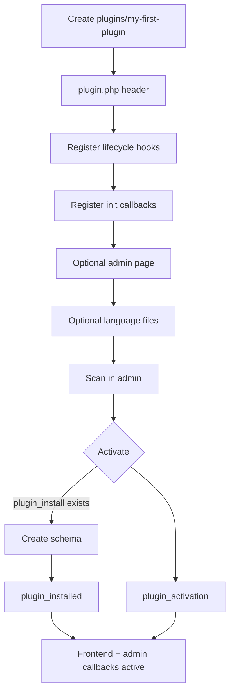

# Developing Your First Plugin

This chapter provides a step-by-step guide for creating a functional LabPress plugin from scratch. It explains the required plugin structure, the header comment format, how to register actions and filters, how to add an admin page, and how to handle activation and uninstallation.

The chapter assumes that you have read the [Plugin System Introduction](intro.md) and are familiar with the hook mechanism and plugin lifecycle. If you have not yet reviewed that material, it is recommended that you do so first.

## 1. Overview

Creating a LabPress plugin involves the following steps:

1. Create a plugin directory under `plugins/`.
2. Create a `plugin.php` file with a valid header comment.
3. Register callbacks on actions and filters.
4. Optionally register an admin page for configuration.
5. Optionally create plugin language files.
6. Scan, activate, and test the plugin from the admin panel.

This guide creates a simple plugin called **My First Plugin**. The plugin adds a custom message to the frontend footer, modifies news titles through a filter, and registers a basic admin page.



## 2. Directory and Plugin Header

Every plugin must reside in its own directory under `plugins/`. The directory name is the plugin slug and must be unique across the installation.

Create the following directory:

```
plugins/my-first-plugin/
```

Inside that directory, create a file named `plugin.php`. This is the main plugin file and must begin with a header comment that LabPress uses to identify the plugin.

The header comment contains the plugin name, description, version, and author.

Example header:

```php
<?php
/**
 * Plugin Name: My First Plugin
 * Description: Adds a custom footer message and modifies news titles.
 * Version: 1.0.0
 * Author: Your Name
 */
```

The plugin scanner parses these fields when the plugin is discovered through the admin panel. In v1.3.0 and later, add a `plugin.json` manifest as the primary contract; the header remains a compatibility fallback for legacy plugins. See [Plugin Manifest v2](plugin-manifest.md).

## 3. Registering Actions and Filters

All plugin callbacks should be registered on the `init` action hook. This ensures that core services are available when the callbacks are defined.

The following skeleton registers an action and a filter on `init`:

```php
<?php
/**
 * Plugin Name: My First Plugin
 * Description: Adds a custom footer message and modifies news titles.
 * Version: 1.0.0
 * Author: Your Name
 */

LabPress_Hooks::addAction('init', function() {

    // Add a custom message to the frontend footer.
    LabPress_Hooks::addAction('footer_scripts', function() {
        echo '<p style="text-align:center;">Powered by My First Plugin</p>';
    });

    // Modify all news titles.
    LabPress_Hooks::addFilter('news_list_title', function($title) {
        return '[My Plugin] ' . $title;
    });

});
```

Explanation:

- The outer `init` action is fired after all active plugins have been loaded.
- Inside the `init` callback, the plugin registers its own action and filter.
- The `footer_scripts` action is triggered by the core footer template.
- The `news_list_title` filter is applied to every news title rendered in the public news list.

## 4. Adding an Admin Page

Plugins can register their own admin page using `LabPress::registerAdminPage()`.

The method requires a page slug, title, callback, and permission. In this example, the plugin registers a page that displays a simple message.

Modify the plugin code as follows:

```php
<?php
/**
 * Plugin Name: My First Plugin
 * Description: Adds a custom footer message and modifies news titles.
 * Version: 1.0.0
 * Author: Your Name
 */

LabPress_Hooks::addAction('init', function() {

    LabPress_Hooks::addAction('footer_scripts', function() {
        echo '<p style="text-align:center;">Powered by My First Plugin</p>';
    });

    LabPress_Hooks::addFilter('news_list_title', function($title) {
        return '[My Plugin] ' . $title;
    });

    // Register an admin page.
    LabPress::registerAdminPage(
        'my-first-plugin',
        'My First Plugin',
        function() {
            echo '<div class="card">';
            echo '<h3>My First Plugin</h3>';
            echo '<p>This page is provided by the plugin.</p>';
            echo '</div>';
        },
        'all'
    );

});
```

The admin page appears in the sidebar under the title **My First Plugin**. Only users with the `all` permission can access it.


## 5. Handling Activation and Uninstallation

Plugins can use lifecycle hooks to create and remove database tables or other persistent data.

### 5.1 Which activation path runs

There are two related but distinct activation paths:

- If the plugin defines a function named `plugin_install()`, the core calls it once during activation and then fires `plugin_installed`.
- The core always fires `plugin_activation` after the status update.

Use `plugin_install()` for schema creation that should happen once, and `plugin_activation` for lightweight runtime registration that must also run on every activation. Both must be idempotent: a manual deactivate/reactivate cycle can call them again.

### 5.2 Activation Hook

The `plugin_activation` action is fired when the plugin is activated. The callback receives the plugin slug.

In the following example, the plugin creates a simple table for storing custom messages.

```php
LabPress_Hooks::addAction('plugin_activation', function($slug) {
    if ($slug !== 'my-first-plugin') return;

    $db = LabPress::db();
    $db->exec("CREATE TABLE IF NOT EXISTS `my_plugin_messages` (
        `id` INT AUTO_INCREMENT PRIMARY KEY,
        `message` TEXT NOT NULL,
        `created_at` TIMESTAMP DEFAULT CURRENT_TIMESTAMP
    ) ENGINE=InnoDB DEFAULT CHARSET=utf8mb4");
});
```

This hook should be registered outside the `init` callback so that it is available before plugin initialization when activation occurs. In this example, place it near the top of `plugin.php`, after the header comment.

### 5.3 Uninstall Hook

The `plugin_uninstalled` action is fired before the plugin directory is removed. It is also fired during deactivation if `plugin_uninstall()` exists. Treat it as potentially destructive and make it safe to run more than once.

```php
LabPress_Hooks::addAction('plugin_uninstalled', function($slug) {
    if ($slug !== 'my-first-plugin') return;

    $db = LabPress::db();
    $db->exec("DROP TABLE IF EXISTS `my_plugin_messages`");
});
```

As with the activation hook, this registration should occur outside the `init` callback.

## 6. Adding Plugin Language Files

Plugins can provide their own language files to translate interface strings.

Create the following file:

```
plugins/my-first-plugin/languages/zh_CN.php
```

with content:

```php
<?php
return [
    'plugin_title'       => '我的第一个插件',
    'plugin_description' => '在前台页脚显示自定义消息并修改新闻标题。',
];
```

And `en_US.php` with:

```php
<?php
return [
    'plugin_title'       => 'My First Plugin',
    'plugin_description' => 'Displays a custom footer message and modifies news titles.',
];
```

To load these strings inside the plugin, use explicit plugin language loading:

```php
echo __('plugin_title', 'plugin:my-first-plugin');
```

This approach prevents key conflicts with core language packs.

## 7. Complete Example Plugin

Below is a complete `plugin.php` for the example plugin, combining the components described above.

```php
<?php
/**
 * Plugin Name: My First Plugin
 * Description: Adds a custom footer message and modifies news titles.
 * Version: 1.0.0
 * Author: Your Name
 */

// Activation hook: create table.
LabPress_Hooks::addAction('plugin_activation', function($slug) {
    if ($slug !== 'my-first-plugin') return;

    $db = LabPress::db();
    $db->exec("CREATE TABLE IF NOT EXISTS `my_plugin_messages` (
        `id` INT AUTO_INCREMENT PRIMARY KEY,
        `message` TEXT NOT NULL,
        `created_at` TIMESTAMP DEFAULT CURRENT_TIMESTAMP
    ) ENGINE=InnoDB DEFAULT CHARSET=utf8mb4");
});

// Uninstall hook: drop table.
LabPress_Hooks::addAction('plugin_uninstalled', function($slug) {
    if ($slug !== 'my-first-plugin') return;

    $db = LabPress::db();
    $db->exec("DROP TABLE IF EXISTS `my_plugin_messages`");
});

// Register callbacks on init.
LabPress_Hooks::addAction('init', function() {

    LabPress_Hooks::addAction('footer_scripts', function() {
        echo '<p style="text-align:center;">Powered by My First Plugin</p>';
    });

    LabPress_Hooks::addFilter('news_list_title', function($title) {
        return '[My Plugin] ' . $title;
    });

    LabPress::registerAdminPage(
        'my-first-plugin',
        'My First Plugin',
        function() {
            echo '<div class="card">';
            echo '<h3>' . __('plugin_title', 'plugin:my-first-plugin') . '</h3>';
            echo '<p>' . __('plugin_description', 'plugin:my-first-plugin') . '</p>';
            echo '</div>';
        },
        'all'
    );

});
```

## 8. Installing and Activating the Plugin

After creating the plugin files, the plugin must be registered and activated through the admin panel.

1. Upload or place the plugin directory under `plugins/`.
2. Log in to the admin panel.
3. Go to **Plugins > Installed Plugins**.
4. Click **Scan for New Plugins**.
5. Locate **My First Plugin** in the plugin list.
6. Click **Activate**.

After activation:

- The footer will display the custom message on the frontend.
- News titles will include the `[My Plugin]` prefix.
- The **My First Plugin** page will appear in the admin sidebar.


## 9. Debugging Common Issues

### 9.1 Plugin Not Detected

If the plugin does not appear after scanning:

- Verify that the directory name is correct and matches the expected slug.
- Ensure that `plugin.php` exists in the directory.
- Check that the header comment is present and formatted correctly.

### 9.2 Activation Fails or No Effect

- Confirm that the plugin is active in the **Installed Plugins** list.
- Check that all callbacks are registered inside `init` for normal frontend hooks.
- Lifecycle hooks should be registered outside `init`.

### 9.3 Admin Page Missing

- Ensure that `LabPress::registerAdminPage()` is called inside the `init` callback.
- Verify that the current user has the required permission.

### 9.4 Translation Not Loading

- Ensure the plugin language file exists at `plugins/my-first-plugin/languages/{locale}.php`.
- Use `plugin:my-first-plugin` as the second parameter of `__()`.
- Check that the language keys in the plugin file match the keys used in the code.

### 9.5 Plugin Fails After Activation

- Check PHP error logs before assuming a hook problem.
- Confirm the plugin header parses and the slug is valid.
- Deactivate the plugin, then confirm the site recovers.
- If schema creation failed, inspect `plugin_install()` and the database user's DDL permissions.
- If strings are raw keys, confirm the plugin language file is readable and the locale directory exists.

## 10. Operational Checks

- [ ] The plugin header is the first PHP comment in `plugin.php`.
- [ ] The slug uses only letters, numbers, hyphens, and underscores.
- [ ] Runtime hooks are registered on `init`.
- [ ] Lifecycle hooks are registered at file scope.
- [ ] `plugin_install()` is idempotent and uses `CREATE TABLE IF NOT EXISTS`.
- [ ] `plugin_uninstalled` tolerates a missing table.
- [ ] The admin page permission matches the intended audience.
- [ ] A deactivate/reactivate cycle does not duplicate data or fatal.

## 11. Next Steps

After building your first plugin, consider exploring the following resources:

- [Hooks Reference](hooks-reference.md) – the full list of core actions and filters available to plugins.
- [Plugin Examples](examples.md) – real-world examples included with LabPress.
- [Plugin System Introduction](intro.md) – review the architecture and lifecycle in more detail.
- [Plugin Management](../setup/plugins.md) – understand how plugins are managed from the admin panel.
- [Core Language Packs](../i18n/core-lang.md) – learn how to structure and load plugin language files.
- [Dynamic Multi-Language Plugin](../i18n/dynamic-multilang.md) – study a complete plugin that uses filters and a database table.