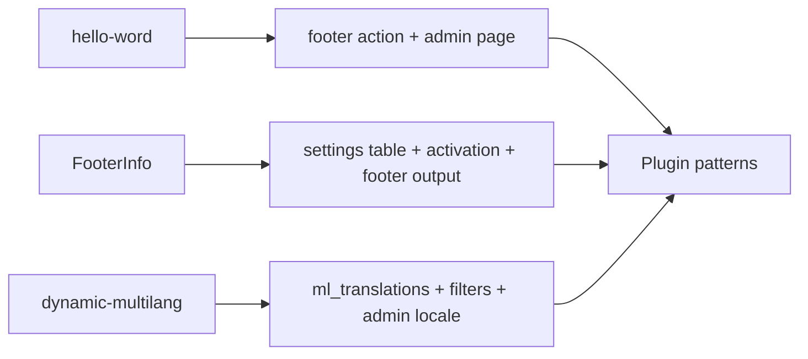

# Plugin Examples

This chapter examines the example plugins included with LabPress and explains how they use the plugin system to implement real functionality. The purpose is to give plugin developers concrete references for common patterns, including frontend output, data filtering, admin pages, database table management, and plugin language support.

The current default checkout ships two production plugins:

- `FooterInfo` – a plugin that adds configurable footer content.
- `dynamic-multilang` – a full-featured plugin that translates database-stored content.

The third example, `hello-word`, is a deliberately minimal teaching plugin used in this chapter to show the smallest possible structure. It is not present in the default `plugins/` directory; create it locally if you want to follow the walkthrough. All paths and slugs in this chapter reflect the default repository layout.



## 1. Overview of the Example Plugins

| Plugin Directory | Plugin Name | Main Features |
|------------------|-------------|---------------|
| `hello-word` | Hello World | Demonstrates a minimal plugin, frontend footer output, and an admin page. |
| `FooterInfo` | FooterInfo | Adds customizable footer text with placeholder support and style settings. |
| `dynamic-multilang` | Dynamic Multi-Language | Provides translation management for database-stored content, including menus, slides, site configuration, and plugin strings. |

These three plugins illustrate the core capabilities of the LabPress plugin system:

- Registering actions for frontend output.
- Registering filters to modify data.
- Adding admin pages.
- Using activation and uninstall hooks to manage database tables.
- Loading plugin-specific language files.

## 2. Hello World Plugin

The `hello-word` plugin is a minimal example that shows how to register a frontend action and an admin page.

### 2.1 Plugin File

The entire plugin is contained in `plugins/hello-word/plugin.php`.

Its header declares the plugin metadata:

```php
<?php
/**
 * Plugin Name: Hello World
 * Description: 在页面底部添加问候语，并修改新闻标题。
 * Version: 1.0.0
 * Author: LabPress
 */
```

### 2.2 Admin Page Registration

The plugin registers a custom admin page using `LabPress::registerAdminPage()`.

```php
LabPress::registerAdminPage('hello-settings', 'Hello 设置', function() {
    echo '<div class="card"><h3>Hello World 设置</h3><p>这是插件生成的自定义管理页面。</p></div>';
}, 'all');
```

The page slug is `hello-settings`. The title appears in the admin sidebar. The callback renders a simple card. Access is restricted to users with the `all` permission.

### 2.3 Frontend Footer Output

The plugin registers an action on `footer_scripts`:

```php
LabPress_Hooks::addAction('footer_scripts', function() {
    echo '<p style="text-align:center; color:#888; font-size:0.9rem;">Powered by LabPress + Hello World Plugin</p>';
});
```

When the frontend footer is rendered, the plugin injects a paragraph after the main footer content. This is the simplest possible way to add frontend output.

### 2.4 Key Takeaways

- A plugin can be a single PHP file.
- The `footer_scripts` action is a reliable place to inject frontend content.
- `LabPress::registerAdminPage()` provides a simple way to add admin pages.
- No database table or lifecycle hook is required for a basic plugin.

## 3. FooterInfo Plugin

The `FooterInfo` plugin demonstrates a more complete plugin that stores settings in a custom database table and renders configurable frontend content.

### 3.1 Overview

FooterInfo allows site administrators to define a custom footer text block. The plugin supports:

- Multi-line footer content.
- Placeholders `{year}` and `{site_name}`.
- Alignment, font size, text color, and padding.
- A dedicated admin page for editing these settings.
- A frontend output that replaces placeholders with actual values.

### 3.2 Plugin File

The main plugin file is `plugins/FooterInfo/plugin.php`.

The plugin header is:

```php
<?php
/**
 * Plugin Name: FooterInfo
 * Description: 可编辑页脚信息，支持多行文字、占位符、自定义样式（对齐、大小、颜色、边距）。
 * Version: 2.1.0
 * Author: LabPress Community
 */
```

### 3.3 Activation Hook and Table Creation

FooterInfo creates a custom table when the plugin is activated.

The activation hook is registered directly, outside the `init` action:

```php
LabPress_Hooks::addAction('plugin_activation', function($slug) {
    if (strtolower($slug) === strtolower('FooterInfo')) {
        $db = LabPress::db();
        $db->exec("CREATE TABLE IF NOT EXISTS `footer_info` (
            `id` INT AUTO_INCREMENT PRIMARY KEY,
            `content` TEXT NOT NULL,
            `align` VARCHAR(20) DEFAULT 'center',
            `font_size` VARCHAR(10) DEFAULT '0.9rem',
            `color` VARCHAR(20) DEFAULT '#666666',
            `padding` VARCHAR(20) DEFAULT '0 20px',
            `updated_at` TIMESTAMP DEFAULT CURRENT_TIMESTAMP ON UPDATE CURRENT_TIMESTAMP
        ) ENGINE=InnoDB DEFAULT CHARSET=utf8mb4");

        $stmt = $db->prepare("SELECT COUNT(*) FROM footer_info WHERE id = 1");
        $stmt->execute();
        if ($stmt->fetchColumn() == 0) {
            $default = "© {year} {site_name}. All rights reserved.\nPowered by LabPress\nContact: admin@example.com";
            $stmt = $db->prepare("INSERT INTO footer_info (id, content, align, font_size, color, padding) VALUES (1, ?, 'center', '0.9rem', '#666666', '0 20px')");
            $stmt->execute([$default]);
        }
    }
});
```

Key points:

- The callback receives the plugin slug and compares it with the expected slug. This prevents the hook from running for other plugins.
- The table is created only if it does not already exist.
- A default row is inserted if no row with `id = 1` is present.

### 3.4 Admin Page

FooterInfo registers an admin page with a callback that handles both display and saving.

The page slug is `footer-info-settings`, and the permission is `all`.

Inside the callback, the plugin:

1. Checks the current user permission.
2. Ensures the `footer_info` table exists.
3. Loads the row with `id = 1`.
4. If the request method is `POST`, updates the row.
5. Renders an HTML form with fields for content, alignment, font size, color, and padding.

This pattern is typical for plugins that need a settings page.

### 3.5 Frontend Output

FooterInfo registers an action on `footer_scripts`:

```php
LabPress_Hooks::addAction('footer_scripts', function() {
    $db = LabPress::db();
    $row = $db->query("SELECT content, align, font_size, color, padding FROM footer_info WHERE id = 1")->fetch();
    if (empty($row) || empty($row['content'])) return;

    $content = $row['content'];
    $year = date('Y');
    $siteName = LabPress::config('site_name', 'LabPress');
    $content = str_replace(['{year}', '{site_name}'], [$year, $siteName], $content);

    $lines = explode("\n", $content);
    $output = '<div style="text-align:' . htmlspecialchars($row['align']) . '; ' .
              'font-size:' . htmlspecialchars($row['font_size']) . '; ' .
              'color:' . htmlspecialchars($row['color']) . '; ' .
              'padding:' . htmlspecialchars($row['padding']) . '; margin-top:20px;">';
    foreach ($lines as $line) {
        $line = trim($line);
        if ($line !== '') {
            $output .= '<div>' . $line . '</div>';
        }
    }
    $output .= '</div>';
    echo $output;
});
```

The plugin reads its settings from the custom table, replaces placeholders, and outputs a styled block.

### 3.6 Key Takeaways

- Custom database tables can be created during activation.
- Admin settings pages can be built with plain PHP forms.
- The `footer_scripts` action is used to inject the final HTML.
- Placeholders are replaced at render time, not stored in the database.
- The plugin uses `LabPress::config()` to access site settings such as `site_name`.

## 4. Dynamic Multi-Language Plugin

The Dynamic Multi-Language plugin is the most complex included plugin. It demonstrates how to translate database-stored content using filters and a dedicated translation table.

### 4.1 Overview

The plugin allows translation of:

- Navigation menu titles.
- Slide titles and descriptions.
- Site configuration fields such as About Us, research title, and research subtitle.
- Custom dynamic strings such as statistics labels and research card text.
- The plugin’s own interface strings.

It does not modify the original content. Instead, it stores translations in the `ml_translations` table and replaces output through filters.

### 4.2 Plugin File

The main plugin file is `plugins/dynamic-multilang/plugin.php`.

The header is:

```php
<?php
/**
 * Plugin Name: Dynamic Multi-Language
 * Description: 为导航菜单、页脚链接、轮播图、关于我们、研究方向提供动态多语言翻译管理。
 * Version: 2.0.0
 * Author: LabPress Community
 */
```

### 4.3 Activation and Uninstall Hooks

The plugin creates the `ml_translations` table on activation and drops it on uninstall.

```php
LabPress_Hooks::addAction('plugin_activation', function($slug) {
    if ($slug === 'dynamic-multilang') {
        $db = LabPress::db();
        $db->exec("CREATE TABLE IF NOT EXISTS `ml_translations` (...)");
    }
});

LabPress_Hooks::addAction('plugin_uninstalled', function($slug) {
    if ($slug === 'dynamic-multilang') {
        $db = LabPress::db();
        $db->exec("DROP TABLE IF EXISTS `ml_translations`");
    }
});
```

This is the standard pattern for plugins that need persistent storage and clean removal.

### 4.4 Source Locale Functions

The plugin defines utility functions for managing the source locale:

```php
function ml_get_source_locale() {
    return LabPress::config('ml_source_locale', LabPress::config('language', 'zh_CN'));
}

function ml_set_source_locale($locale) {
    LabPress::setConfig('ml_source_locale', $locale);
}
```

The source locale is stored in `site_config`. It represents the language of the original content.

### 4.5 Translation Helpers

Two helper functions handle translation storage.

```php
function ml_get_translation($table, $recordId, $field, $locale = null) {
    if ($locale === null) $locale = getLocale();
    if ($locale === ml_get_source_locale()) return null;
    $db = LabPress::db();
    $stmt = $db->prepare("SELECT translated_value FROM ml_translations WHERE table_name=? AND record_id=? AND field_name=? AND locale=? LIMIT 1");
    $stmt->execute([$table, $recordId, $field, $locale]);
    $val = $stmt->fetchColumn();
    return $val !== false ? $val : null;
}

function ml_set_translation($table, $recordId, $field, $locale, $value) {
    $db = LabPress::db();
    if (empty($value)) {
        $stmt = $db->prepare("DELETE FROM ml_translations WHERE table_name=? AND record_id=? AND field_name=? AND locale=?");
        $stmt->execute([$table, $recordId, $field, $locale]);
    } else {
        $stmt = $db->prepare("INSERT INTO ml_translations (table_name, record_id, field_name, locale, translated_value) VALUES (?, ?, ?, ?, ?) ON DUPLICATE KEY UPDATE translated_value = VALUES(translated_value)");
        $stmt->execute([$table, $recordId, $field, $locale, $value]);
    }
}
```

These functions are used throughout the plugin.

### 4.6 Filters Registered on `init`

The plugin registers all frontend filters inside the `init` action.

The navigation menu filter:

```php
LabPress_Hooks::addFilter('nav_menu_item', function($html, $menu) {
    $id = $menu['id'] ?? null;
    if (!$id) return $html;
    $newTitle = ml_get_translation('nav_menu', $id, 'title');
    if ($newTitle === null) return $html;
    return sprintf('<a href="%s">%s</a>', htmlspecialchars($menu['url']), htmlspecialchars($newTitle));
}, 10, 2);
```

The slides filter:

```php
LabPress_Hooks::addFilter('slides_data', function($slides) {
    foreach ($slides as &$slide) {
        $id = $slide['id'] ?? null;
        if ($id) {
            $title = ml_get_translation('slides', $id, 'title');
            $desc = ml_get_translation('slides', $id, 'description');
            if ($title) $slide['title'] = $title;
            if ($desc) $slide['description'] = $desc;
        }
    }
    return $slides;
});
```

The `translate` filters:

```php
LabPress_Hooks::addFilter('translate', function($value, $key) {
    if (defined('IS_ADMIN') || strpos($_SERVER['SCRIPT_NAME'], '/admin/') !== false) {
        return $value;
    }

    $trans = ml_get_translation('__custom', $key, 'text');
    if ($trans) return $trans;

    $siteMap = [
        'about_us'          => 'about_us',
        'about_us_content'  => 'about_us',
        'research_title'    => 'research_title',
        'research_heading'  => 'research_title',
        'research_subtitle' => 'research_subtitle',
        'research_subheading'=> 'research_subtitle',
    ];

    if (isset($siteMap[$key])) {
        $trans = ml_get_translation('site_config', $siteMap[$key], 'config_value');
        if ($trans) return $trans;
    }

    return $value;
}, 10, 2);
```

This filter is the core mechanism for translating dynamic content. It skips admin requests, checks custom strings first, then checks mapped site configuration fields.

A second `translate` filter handles the plugin’s own interface strings.

### 4.7 Admin Page

The plugin registers an admin page:

```php
LabPress::registerAdminPage('dynamic-multilang', '🌐 Dynamic Multi-Language', function() {
    require_once __DIR__ . '/admin-page.php';
});
```

The page content is implemented in `admin-page.php`. It includes a source locale selector and tabs for translating different content groups.

### 4.8 Plugin Language Files

The plugin includes language files in:

```
plugins/dynamic-multilang/languages/
├── zh_CN.php
└── en_US.php
```

These files use the `ml_` key prefix to avoid collisions with core language keys.

The plugin loads its own strings using explicit plugin loading:

```php
__('ml_plugin_name', 'plugin:dynamic-multilang')
```

This is the recommended approach for plugins that define keys that might conflict with core strings, such as `plugin_name`, `about_us`, or `research_title`.

### 4.9 Key Takeaways

- Use `plugin_activation` and `plugin_uninstalled` to manage persistent tables.
- Use filters to modify content rather than changing the source data.
- The `translate` filter is the central point for dynamic translation.
- Admin pages can be separated into their own PHP file and loaded from the plugin callback.
- Plugin language keys should be prefixed and loaded explicitly with `plugin:slug`.

## 5. Patterns for Plugin Development

The example plugins illustrate several reusable patterns.

### 5.1 Frontend Output

Use `footer_scripts` for footer content and `before_head_end` for head content. For more targeted output, use section hooks such as `before_about_section` or `after_hero_slider`.

### 5.2 Data Modification

Use filters such as `nav_menu_item`, `slides_data`, `news_list_title`, or `project_list_title` to modify content before it is rendered.

### 5.3 Admin Pages

Use `LabPress::registerAdminPage()` to add a menu item. The callback can render a simple card or include a separate PHP file for a more complex form.

### 5.4 Persistent Storage

For settings that must survive across requests, create a custom table during activation. Use `LabPress::db()` to access the PDO instance. Drop the table during uninstall when the plugin is removed.

### 5.5 Plugin Language Support

Place language files in the plugin’s `languages/` directory. Use unique key prefixes and load them with `__('key', 'plugin:plugin-slug')`.

### 5.6 Permission Checks

Always verify permissions in admin callbacks and before performing privileged operations. The core permission function is `hasPermission()`.

## 6. Notes on Slugs and Directory Names

Plugin slugs must match the plugin directory name exactly because the scanner and loader use the slug as the directory name.

For example:

- `FooterInfo` plugin is located in `plugins/FooterInfo/`.
- `dynamic-multilang` plugin is located in `plugins/dynamic-multilang/`.
- `hello-word` plugin is located in `plugins/hello-word/`.

If you rename a plugin directory, update the slug in the `plugins` table accordingly. The admin scanner will treat the new directory as a new plugin if the old record is not removed.

## 7. Operational Checks

- [ ] `hello-word` is treated as a teaching example, not a shipped plugin.
- [ ] FooterInfo's activation hook compares the slug case-insensitively.
- [ ] FooterInfo's admin page checks permissions before writing.
- [ ] Dynamic Multi-Language's filters are registered on `init`.
- [ ] Example table names do not collide with core tables.
- [ ] Every example cleans up on uninstall or explicitly documents why it does not.

## 8. Next Steps

After studying the example plugins, you may want to:

- [Develop Your First Plugin](develop.md) – build a plugin step by step.
- [Hooks Reference](hooks-reference.md) – look up the available hooks.
- [Plugin System Introduction](intro.md) – review the architecture and lifecycle.
- [Plugin Management](../setup/plugins.md) – learn how to manage plugins from the admin panel.
- [Dynamic Multi-Language Plugin](../i18n/dynamic-multilang.md) – understand the translation plugin in depth.
- [Core Language Packs](../i18n/core-lang.md) – learn how plugin language files are loaded.e