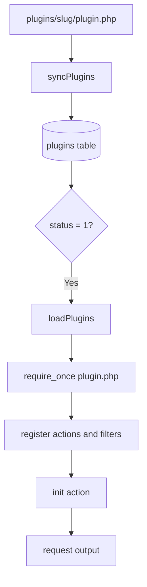
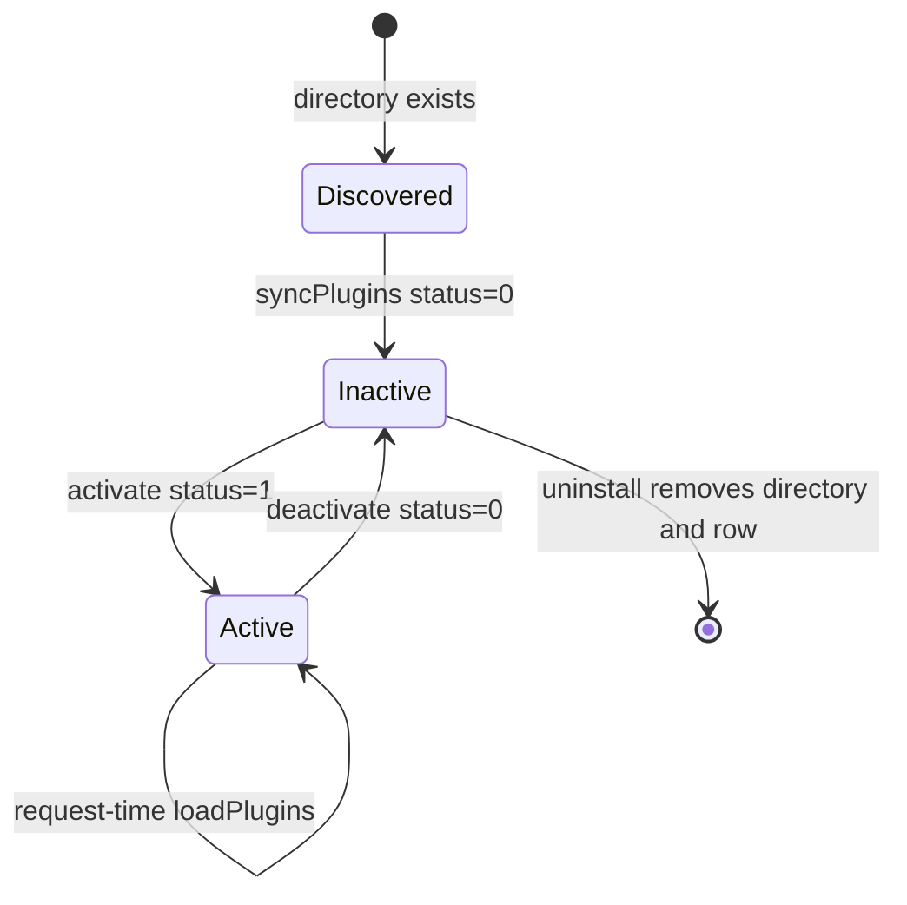

# Plugin System Introduction

This chapter introduces the LabPress plugin system. It describes the architectural principles, the hook mechanism, the plugin structure, the lifecycle, and how plugins integrate with the core without modifying it. The information is intended for developers who want to understand the plugin system before creating their own extensions.

For hands-on instructions on building a plugin, refer to [Developing Your First Plugin](develop.md). For a detailed list of available hooks, see [Hooks Reference](hooks-reference.md).

## 1. Overview

LabPress includes a lightweight plugin system inspired by the WordPress hook model. It allows developers to add new functionality or modify existing behavior without changing any core file.

Plugins are self-contained directories inside the `plugins/` folder. Each plugin contains a `plugin.php` file that describes the plugin and registers callbacks on actions and filters. The core loads active plugins during initialization and provides them with access to the LabPress hook system, configuration, database, and translation functions.

The plugin system is designed around four principles:

- **Isolation** – Plugins live in separate directories and do not modify core files.
- **Extensibility** – All core output can be modified through hooks.
- **Lifecycle awareness** – Plugins can run setup and cleanup tasks through lifecycle hooks.
- **Dynamic discovery** – Plugins can be registered, activated, deactivated, and uninstalled through the admin panel.



Loading is request-scoped. A plugin is not a persistent daemon: every request re-includes its `plugin.php` and re-registers its callbacks. That is why callbacks must be idempotent and cheap to register, and why activation-time setup should live in `plugin_install()`, not at file scope.

## 2. Core Components

The plugin system consists of the following components.

### 2.1 `LabPress_Hooks` Class

The `LabPress_Hooks` class is the foundation of the plugin system. It provides static methods for registering and triggering actions and filters.

Actions are executed at specific points during the request lifecycle. Filters modify data and return the modified value.

The class is defined in `includes/hooks.php` and maintains two static arrays:

- `$actions` – stores action callbacks by hook name and priority.
- `$filters` – stores filter callbacks by hook name and priority.

Callbacks registered with higher priority values are executed later. All callbacks for the same priority are executed in the order they were registered.

### 2.2 `plugins` Directory

All plugin files are stored under:

```
plugins/
```

Each plugin occupies its own directory. The directory name is the plugin slug and must be unique. For example:

```
plugins/
├── FooterInfo/
│   └── plugin.php
├── dynamic-multilang/
│   ├── plugin.php
│   └── admin-page.php
└── hello-word/
    └── plugin.php
```

The plugin slug must match the directory name exactly because the database registration and the plugin loading process both rely on this value.

### 2.3 `plugins` Database Table

The core maintains a `plugins` table that tracks plugin metadata and activation status.

| Column | Description |
|--------|-------------|
| `slug` | Plugin directory name, unique |
| `name` | Human-readable plugin name from the plugin header |
| `description` | Short description from the plugin header |
| `version` | Plugin version |
| `author` | Plugin author |
| `status` | `1` for active, `0` for inactive |

The admin plugin manager uses this table to display plugin information and to control activation and deactivation.

## 3. Hook System

The hook system is the primary extension mechanism in LabPress. It provides two types of hooks.

### 3.1 Actions

Actions allow plugins to execute code at specific points in the request.

Registering an action:

```php
LabPress_Hooks::addAction($hook, $callback, $priority = 10);
```

Triggering an action:

```php
LabPress_Hooks::doAction($hook, ...$args);
```

When `doAction()` is called, all callbacks registered for that hook are executed in priority order. The function supports passing additional arguments to callbacks.

Example:

```php
LabPress_Hooks::addAction('footer_scripts', function() {
    echo '<p>Powered by My Plugin</p>';
});
```

The core triggers `footer_scripts` before the closing body tag on the frontend, so this callback will output text in the footer.

### 3.2 Filters

Filters allow plugins to modify data before it is returned or output.

Registering a filter:

```php
LabPress_Hooks::addFilter($hook, $callback, $priority = 10);
```

Applying a filter:

```php
$value = LabPress_Hooks::applyFilters($hook, $value, ...$args);
```

The first argument to `applyFilters()` is the value to modify. Each registered callback receives the current value as its first parameter and must return the modified value.

Example:

```php
LabPress_Hooks::addFilter('news_title', function($title) {
    return '[LabPress] ' . $title;
});
```

When the core applies the `news_title` filter, all news titles will be prefixed with `[LabPress]`.

### 3.3 Hook Naming Conventions

Core hooks use descriptive names that indicate their location or purpose. Examples include:

- `init` – fired after all plugins are loaded.
- `before_head_end` – fired in the frontend `<head>`.
- `footer_scripts` – fired in the frontend footer.
- `admin_before_head_end` – fired in the admin `<head>`.
- `admin_topbar_actions` – fired inside the admin topbar after the user chip.
- `nav_menu_item` – filter applied to each menu item.
- `translate` – filter applied to translated strings.
- `admin_locale` – filter applied to the backend default locale.
- `slides_data` – filter applied to slide data.

Plugins can define their own custom hooks, but they are not required to do so. A full list of core hooks is available in [Hooks Reference](hooks-reference.md).

## 4. Plugin Structure

A minimal plugin consists of a single `plugin.php` file inside a directory under `plugins/`. The file must contain a header comment that provides metadata about the plugin.

Example minimal plugin:

```php
<?php
/**
 * Plugin Name: Hello World
 * Description: Adds a greeting to the footer.
 * Version: 1.0.0
 * Author: LabPress
 */

LabPress_Hooks::addAction('footer_scripts', function() {
    echo '<p>Hello World!</p>';
});
```

The header comment is parsed by the plugin scanner to populate the `plugins` table.

In addition to `plugin.php`, a plugin may include:

- `admin-page.php` – a callback for a custom admin page.
- `languages/` – plugin language files.
- `assets/` – CSS and JavaScript files.
- Other PHP files or classes needed by the plugin.

Plugins do not need to use a special class or base class. They can be written as plain procedural PHP with closures, or they can use classes and namespaces.

## 5. Plugin Loading

Active plugins are loaded during the initialization phase of every request.

The loading process is implemented in `includes/functions.php` through the `loadPlugins()` function. The function:

1. Retrieves all active plugin slugs from the `plugins` table using `getActivePlugins()`.
2. Sanitizes each slug to allow only letters, numbers, underscores, and hyphens.
3. For each active plugin, builds the path:

```
plugins/{slug}/plugin.php
```

4. If the file exists, it is included using `require_once`.

After all active plugins are loaded, the core fires the `init` action hook. Plugins should register their own actions and filters on `init` to ensure that all core functions and the database connection are available.

## 6. Plugin Lifecycle

The plugin lifecycle consists of four main stages: discovery, activation, deactivation, and uninstallation.



A plugin can move back and forth between **Active** and **Inactive** without losing its directory. Uninstallation is the destructive step. In the current implementation, deactivation also attempts to call `plugin_uninstall()` if that function exists, so a plugin that drops tables in `plugin_uninstall()` must treat deactivation as destructive. The safe pattern is to make cleanup idempotent and to keep destructive schema changes behind an explicit uninstall path.

### 6.1 Discovery

Plugins that exist in the `plugins/` directory are not automatically registered in the database. The **Scan for New Plugins** button in the admin panel triggers the `syncPlugins()` function, which scans the directory and inserts any new plugin directories into the `plugins` table with a status of `0`.

### 6.2 Activation

Activation updates the plugin status to `1` and includes the plugin file. The core fires the `plugin_activation` action hook after updating the status.

If the plugin file defines a function named `plugin_install()`, that function is called during activation. After that, the `plugin_installed` action hook is fired.

Plugins use activation to create custom database tables, register default options, or perform other setup tasks.

### 6.3 Deactivation

Deactivation updates the plugin status to `0`. The core fires the `plugin_deactivation` action hook.

The current implementation also attempts to call `plugin_uninstall()` if the function exists, and fires the `plugin_uninstalled` action. This behavior may be refined in future versions. Developers should ensure that any cleanup logic is safe to run during deactivation or should only place destructive cleanup in the uninstall hook.

### 6.4 Uninstallation

Uninstallation is available only for inactive plugins. The process:

1. Fires the `plugin_uninstalled` action.
2. Deletes the plugin directory from `plugins/`.
3. Removes the plugin record from the `plugins` table.

Plugins use the `plugin_uninstalled` hook to drop database tables, delete options, or remove other data before their files are deleted.

## 7. Admin Pages

Plugins can register custom admin pages using the `LabPress::registerAdminPage()` method.

```php
LabPress::registerAdminPage($slug, $title, $callback, $permission = 'all');
```

The method accepts:

- `$slug` – the page identifier, used in the `?view=` query parameter.
- `$title` – the title shown in the admin sidebar.
- `$callback` – a callable that renders the page content.
- `$permission` – the permission required to view the page.

Registered pages are merged into the admin menu during the admin panel initialization. The menu item appears in the sidebar, and the page content is rendered when the corresponding view is requested.

## 8. Plugin Language Support

Plugins can provide their own language files under a `languages/` directory inside the plugin folder.

The core uses **explicit loading** only:

- **Explicit loading** – The plugin calls `__('key', 'plugin:plugin-slug')` to load translations only from that plugin. This avoids conflicts and is required for plugin interface strings.

Plugin language files are never merged into the global core language array. If a plugin is deactivated or removed, its language callback disappears and core strings keep loading from the root `languages/` packs.

Plugin language keys should use a unique prefix even when using explicit loading, to avoid confusion and to make the translation files easier to maintain.

For more details, see [Core Language Packs](../i18n/core-lang.md).

## 9. Accessing Core Services

Plugins can access core services through static methods and global functions provided by LabPress.

Commonly used services include:

- `LabPress::db()` – returns the global PDO instance for database access.
- `LabPress::config($key, $default)` – returns a site configuration value.
- `LabPress::setConfig($key, $value)` – sets a site configuration value.
- `LabPress::enqueueStyle($url)` – registers a stylesheet to be loaded on the frontend.
- `LabPress::enqueueScript($url)` – registers a script to be loaded in the frontend footer.
- `__($key, $module)` – returns a translated string.
- `getLocale()` – returns the current locale.

Plugins can also use global functions such as `getNavMenus()`, `getSlides()`, and `getActivePlugins()` when needed. However, using the public API methods is preferred for compatibility.

## 10. Decoupling from Core

A key design goal of the plugin system is zero coupling. The core never references plugin functions directly. Instead, plugins observe and modify core behavior through hooks.

Examples:

- The Dynamic Multi-Language plugin translates dynamic content using the `translate` filter. The core template only calls `__()`. It has no knowledge of the plugin.
- The FooterInfo plugin adds footer text using the `footer_scripts` action. The footer template only fires the hook.
- Menu items are translated through the `nav_menu_item` filter. The header and footer templates apply this filter without knowing which plugins are active.

This design means that disabling or uninstalling all plugins leaves a fully functional core site that simply loses the extra plugin-provided features.

## 11. Security Considerations

Plugins can execute arbitrary PHP code. Therefore, only trusted plugins should be installed and activated on a production site.

The admin plugin manager is restricted to users with the `all` permission. The upload installer performs basic checks, such as verifying that the uploaded file is a ZIP archive and contains a `plugin.php` file, but it does not inspect the code for malicious behavior.

Administrators should:

- Install plugins only from trusted sources.
- Review plugin code before activation.
- Keep the `plugins/` directory protected from direct public access.
- Back up the site before installing untested plugins.

## 12. Operational Checks

- [ ] The directory name and the `plugins.slug` value match exactly.
- [ ] The plugin header contains name, description, version, and author.
- [ ] Activation status is `1` after reload, not merely present in the directory.
- [ ] `init` is used for runtime hooks; file-scope code only declares functions.
- [ ] Deactivation leaves the site usable and does not delete source content unexpectedly.
- [ ] The plugin's language strings resolve through `plugin:{slug}`.
- [ ] Uninstallation is tested on staging with a database backup.

If a plugin is active in the table but its hooks do not run, check the slug sanitization and the file path. If its admin page is missing, check `registerAdminPage()` and the permission argument. If its strings are raw keys, check the module prefix before editing any language file.

## 13. Next Steps

After reading this introduction, continue with:

- [Developing Your First Plugin](develop.md) – a practical guide to building a plugin.
- [Hooks Reference](hooks-reference.md) – the complete list of core actions and filters.
- [Plugin Examples](examples.md) – working examples of plugins included with LabPress.
- [Plugin Management](../setup/plugins.md) – how to manage plugins from the admin panel.
- [Core Language Packs](../i18n/core-lang.md) – how plugin language files are loaded and used.