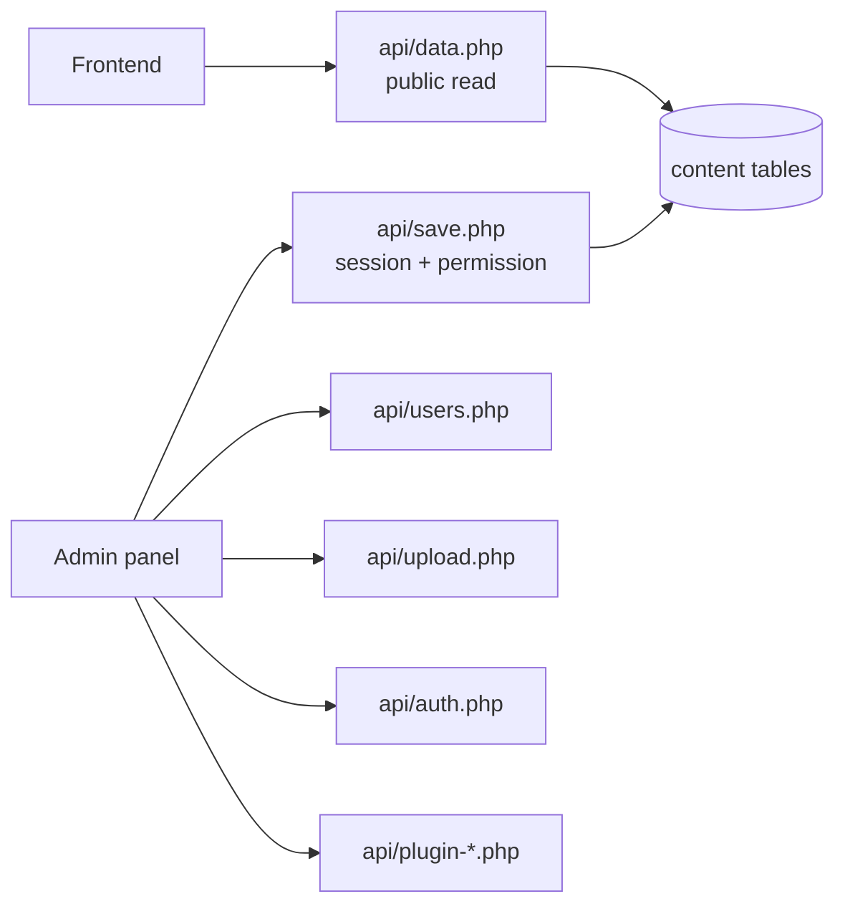
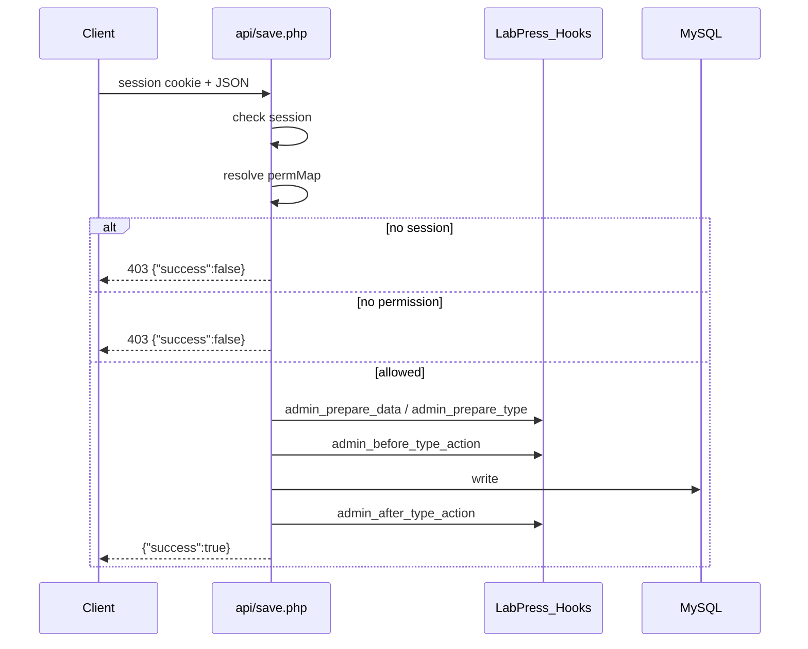

# API Reference

This chapter provides a technical reference for the HTTP API endpoints exposed by LabPress. These endpoints are used internally by the frontend and admin panel to read and write data. Plugin developers may also use them to interact with the system programmatically.

All API endpoints are located in the `api/` directory at the project root. The endpoints return JSON responses unless otherwise noted.

The reference is based on the current LabPress source code. Some endpoints may accept additional parameters or may be extended in future releases. Always verify against the actual source files if you are developing against a specific version.



The API is intentionally thin: it is a transport layer over the same database tables and hooks used by the admin views. It is not a separate REST service with its own schema.

---

## 1. General Conventions

### 1.1 Request and Response Format

Most endpoints accept and return JSON.

- **Content-Type**: `application/json` for request bodies when needed.
- **Response**: All responses are JSON objects. Successful operations usually include a `success` field set to `true`. Errors include `success` set to `false` and an `error` field with a human-readable message.

### 1.2 Authentication

Most write endpoints require an active admin session. The session is established through the admin login form or the `api/auth.php?action=login` endpoint.

Write endpoints verify that the current session belongs to an authenticated user. If the session is invalid or missing, the endpoint returns HTTP `403` and a JSON error object.

Read endpoints such as `api/data.php` are publicly accessible because the frontend needs to load public content without authentication.

### 1.3 Permission Checks

Write endpoints also verify user permissions according to the content type. The required permission is mapped in `api/save.php` using the `$permMap` array.

| Content Type | Required Permission |
|--------------|---------------------|
| `publications` | `publications` |
| `slides` | `slides` |
| `tools` | `tools` |
| `tool-detail` | `tools` |
| `tool-versions` | `tools` |
| `projects` | `tools` |
| `project-categories` | `tools` |
| `news` | `publications` |
| `users` | `users` |
| `site-config` | `all` |
| `nav-menus` | `all` |
| `plugins` | `all` |

If the current user does not have the required permission, the endpoint returns HTTP `403` and a JSON error object.

### 1.4 Error Responses

Typical error response:

```json
{
  "success": false,
  "error": "No permission"
}
```

The HTTP status code is usually set to `403` for permission errors, `400` for invalid requests, and `500` for server errors.

Additional security considerations are described in the [Security](../security.md) chapter.



The session check happens before `permMap`; a missing session returns `403` with `未登录`, while a session without the required permission returns `403` with `无权限`. Both are intentionally the same HTTP status.

---

## 2. Data Read Endpoint: `api/data.php`

This endpoint is a unified data reader. It returns content based on a `type` query parameter.

### 2.1 Request

- **URL**: `api/data.php`
- **Method**: `GET`
- **Authentication**: Not required for public content.

Query parameters depend on the requested type.

### 2.2 Supported Types

The following types are currently supported:

| Type | Additional Parameters | Description |
|------|----------------------|-------------|
| `slides` | None | Returns all slides ordered by `sort_order` |
| `publications` | None | Returns all publications ordered by `sort_order` |
| `tools` | None | Returns all tools ordered by `sort_order` |
| `tool-detail` | `name` (required) | Returns detailed information for a specific tool |
| `tool-versions` | `name` (required) | Returns version history for a specific tool |
| `news-detail` | `id` (required) | Returns a single news item by ID |
| `project-detail` | `id` (required) | Returns a single project by ID |

### 2.3 Response Examples

#### Slides

Request:

```
GET /api/data.php?type=slides
```

Response:

```json
[
  {
    "id": 1,
    "image": "images/slide1.jpg",
    "title": "Structural Biology",
    "description": "Deciphering structural information"
  }
]
```

#### Tool Detail

Request:

```
GET /api/data.php?type=tool-detail&name=ProteinTrim
```

Response:

```json
{
  "tool_name": "ProteinTrim",
  "short_description": "...",
  "detailed_description": "...",
  "version": "2.5.1",
  "language": "Python / C++",
  "license": "GPL-3.0",
  "update_date": "2023-10-05",
  "github": "https://github.com/...",
  "document": "https://...",
  "homepage": "https://...",
  "image": "/images/proteintrim-logo.png",
  "screenshot": "/images/proteintrim-screenshot.jpg",
  "citation": {
    "title": "ProteinTrim: ...",
    "url": "https://doi.org/..."
  }
}
```

#### News Detail

Request:

```
GET /api/data.php?type=news-detail&id=1
```

Response:

```json
{
  "id": 1,
  "title": "News Title",
  "summary": "Short summary",
  "content": "Full content",
  "image": "uploads/news/...",
  "author": "Author",
  "date": "2024-03-15",
  "link": "..."
}
```

### 2.4 Hooks

The `slides` type applies the `slides_data` filter before returning data. This allows plugins such as Dynamic Multi-Language to translate slide titles and descriptions.

---

## 3. Data Save Endpoint: `api/save.php`

This endpoint is a unified data writer. It handles create, update, and delete operations for multiple content types.

### 3.1 Request

- **URL**: `api/save.php`
- **Method**: `POST`
- **Content-Type**: `application/json`
- **Authentication**: Required
- **Permissions**: Depends on content type

The request body is a JSON object with the following structure:

```json
{
  "type": "content-type",
  "action": "save or delete",
  "data": {
    "field": "value"
  }
}
```

### 3.2 Supported Content Types

| Type | Description | Delete Action Supported |
|------|-------------|--------------------------|
| `publications` | Create or update publications | Yes |
| `slides` | Create or update slides | Yes |
| `tools` | Create or update tool list entries | Yes |
| `tool-detail` | Create or update tool detail | Yes |
| `tool-versions` | Create or update tool versions | Yes |
| `news` | Create or update news | Yes |
| `site-config` | Update site configuration | No |
| `nav-menus` | Create or update navigation menus | Yes |
| `project-categories` | Create or update project categories | Yes |
| `projects` | Create or update projects | Yes |
| `plugins` | Plugin activation, deactivation, sync | No |

### 3.3 Response

Successful save:

```json
{
  "success": true
}
```

Error:

```json
{
  "success": false,
  "error": "Error message"
}
```

### 3.4 Field Mappings

The `data` object fields for each type correspond to the database columns. Please refer to the source code for the exact field names, as the API does not perform extensive validation.

Important: `site-config` type expects the entire `data` object to contain key-value pairs that are written directly to the `site_config` table. `stat_items` and `research_cards` must be JSON-encoded strings.

### 3.5 Plugin Actions

When `type` is `plugins`, the `action` field may be one of:

- `sync` – scan for new plugins.
- `activate` – activate a plugin. The `data` object must contain `slug`.
- `deactivate` – deactivate a plugin. The `data` object must contain `slug`.

The plugin actions fire additional hooks such as `plugin_activation`, `plugin_deactivation`, `plugin_installed`, and `plugin_uninstalled`.

---

## 4. Image Upload Endpoint: `api/upload.php`

This endpoint handles image file uploads from the admin panel.

### 4.1 Request

- **URL**: `api/upload.php`
- **Method**: `POST`
- **Content-Type**: `multipart/form-data`
- **Authentication**: Required

Form fields:

- `image` – the image file.
- `type` – the upload subdirectory, such as `slides`, `news`, `projects`, or `general`.

### 4.2 Allowed File Types

The endpoint accepts common image formats, including JPEG, PNG, GIF, and WebP.

### 4.3 Response

Success:

```json
{
  "success": true,
  "url": "uploads/slides/slide-1234567890.png"
}
```

The `url` is a relative path from the web root.

### 4.4 Storage

Uploaded images are stored in:

```
uploads/{type}/
```

The file name is generated using the type and a timestamp.

---

## 5. User Management Endpoint: `api/users.php`

This endpoint handles CRUD operations for admin users.

### 5.1 Authentication and Permissions

All operations require the `users` permission, except the current user can change their own password via the `PUT` method.

### 5.2 Supported Methods

| Method | Description | Request Body |
|--------|-------------|--------------|
| `GET` | Returns a list of users | None |
| `POST` | Creates a new user | `{ "username": "...", "password": "...", "permissions": [...] }` |
| `PUT` | Updates a user or changes password | `{ "username": "...", "new_username": "...", "permissions": [...], "password": "..." }` |
| `DELETE` | Deletes a user | `{ "username": "..." }` |

### 5.3 Response Examples

#### Get Users

Request:

```
GET /api/users.php
```

Response:

```json
{
  "success": true,
  "users": [
    {
      "id": 1,
      "username": "root",
      "permissions": ["all"],
      "created_at": "2026-08-11 09:06:48"
    }
  ]
}
```

#### Create User

Request:

```json
{
  "username": "editor",
  "password": "secret123",
  "permissions": ["publications", "slides"]
}
```

Response:

```json
{
  "success": true
}
```

#### Change Password

Request:

```json
{
  "username": "root",
  "password": "newpassword"
}
```

Response:

```json
{
  "success": true
}
```

### 5.4 Permission Rules

- A user can change their own password without the `users` permission.
- Only users with `all` permission can create, delete, or modify other users.
- Only users with `all` permission can change another user’s password.

---

## 6. Authentication Endpoint: `api/auth.php`

This endpoint handles admin authentication.

### 6.1 Request

- **URL**: `api/auth.php`
- **Method**: `GET` for `check`, `POST` for `login` and `logout`. The action is specified by the `action` query parameter.
- **Content-Type**: `application/json` for login.

Supported actions:

| Action | Method | Description |
|--------|--------|-------------|
| `check` | GET | Checks whether the current session is logged in |
| `login` | POST | Authenticates a user and creates a session |
| `logout` | GET | Destroys the current session |

### 6.2 Login

Request body for login:

```json
{
  "username": "root",
  "password": "lab123456"
}
```

Response on success:

```json
{
  "success": true,
  "permissions": ["all"]
}
```

Response on failure:

```json
{
  "success": false,
  "error": "用户名或密码错误"
}
```

### 6.3 Check

Response when logged in:

```json
{
  "logged_in": true,
  "user": "root",
  "permissions": ["all"]
}
```

Response when not logged in:

```json
{
  "logged_in": false,
  "user": null,
  "permissions": []
}
```

---

## 7. Plugin Installation Endpoints

LabPress includes three endpoints for plugin management.

### 7.1 `api/plugin-install.php`

- **Method**: `POST`
- **Content-Type**: `multipart/form-data`
- **Authentication**: Required
- **Permission**: `all`

Form field:

- `zip` – the plugin ZIP file.

The endpoint extracts the ZIP to the `plugins/` directory, checks for `plugin.php`, parses the plugin header, and returns the plugin information.

Success response:

```json
{
  "success": true,
  "plugin_info": {
    "name": "My Plugin",
    "description": "Description",
    "version": "1.0.0",
    "author": "Author"
  }
}
```

### 7.2 `api/plugin-install-from-url.php`

- **Method**: `POST`
- **Content-Type**: `application/json`
- **Authentication**: Required
- **Permission**: `all`

Request body:

```json
{
  "download_url": "https://example.com/plugin.zip"
}
```

The endpoint downloads the ZIP from the given URL, extracts it, and verifies `plugin.php`. It is used by the plugin marketplace placeholder.

Success response:

```json
{
  "success": true,
  "message": "安装成功"
}
```

### 7.3 `api/plugin-uninstall.php`

- **Method**: `POST`
- **Content-Type**: `application/json`
- **Authentication**: Required
- **Permission**: `all`

Request body:

```json
{
  "slug": "plugin-directory-name"
}
```

The endpoint checks that the plugin is inactive, fires `plugin_uninstalled`, deletes the plugin directory, and removes the database record.

Success response:

```json
{
  "success": true,
  "message": "插件已卸载"
}
```

---

## 8. Notes for Plugin Developers

- Use the public API endpoints when integrating external services.
- Respect the authentication and permission model.
- The `translate` filter may alter API responses if dynamic translations are active, particularly for `slides` data.
- The `data.php` endpoint is not authenticated and should not expose sensitive information.
- For custom content types, it is recommended to create a dedicated API endpoint or extend the existing `data.php` and `save.php` with new cases.

## 9. Operational Checks

- [ ] The endpoint path and method match the source, not an older route.
- [ ] A write request includes a valid session cookie.
- [ ] The required permission is present in `permMap`.
- [ ] `Content-Type: application/json` is sent for JSON bodies.
- [ ] `site-config` receives key-value pairs, with JSON-encoded `stat_items` and `research_cards`.
- [ ] The response is checked for both HTTP status and the JSON `success` field.
- [ ] Upload paths are relative to the web root and writable.
- [ ] Plugin ZIPs are trusted before an install endpoint is called.

## 10. Next Steps

After reviewing the API reference, you may want to continue with:

- [Database Schema](database.md) – understand the underlying data structure.
- [Plugin Development](../plugins-dev/intro.md) – learn how to use these APIs in your own plugins.
- [Hooks Reference](../plugins-dev/hooks-reference.md) – see how hooks interact with the data layer.
- [Content Management](../content/publications.md) – operational guides for each content type.