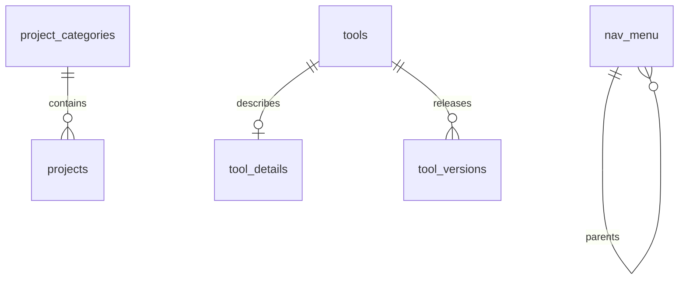

# Database Schema

This chapter provides a technical reference for the MySQL database structure used by LabPress. It describes the tables created by the v1.2.0 installer, the purpose of each table, its columns, indexes, and relationships.

The reference follows `install/Schema.php`. Fresh installations build this schema directly; existing sites receive incremental changes through `migrations/`. Both use `utf8mb4` and `utf8mb4_unicode_ci` for MariaDB and MySQL compatibility.

---

## 1. Overview

LabPress uses a single MySQL database to store all dynamic content, configuration, plugin metadata, and translations. The database name is chosen during installation, and the installer creates all core tables.

The database contains the following tables:

| Table | Purpose |
|-------|---------|
| `site_config` | Stores key-value pairs for global site settings. |
| `users` | Stores administrator accounts and their permissions. |
| `publications` | Stores academic publications or research outputs. |
| `slides` | Stores homepage carousel slides. |
| `tools` | Stores basic information for tools and software. |
| `tool_details` | Stores extended details for tools. |
| `tool_versions` | Stores version history and download links for tools. |
| `news` | Stores research news and announcements. |
| `projects` | Stores research projects. |
| `project_categories` | Stores project categories. |
| `nav_menu` | Stores header and footer navigation menu items. |
| `plugins` | Stores plugin registration metadata and activation status. |
| `schema_version` | Stores applied migration versions. |
| `footer_info` | Stores configuration for the FooterInfo plugin. |
| `ml_translations` | Stores dynamic translations used by the Dynamic Multi-Language plugin. |

The diagram shows logical relationships between content tables. The v1.2.0 installer intentionally omits database-level foreign keys for shared-host compatibility; the table sections below are authoritative for column types.

---

## 2. Conventions

- All tables use the InnoDB storage engine.
- The default character set is `utf8mb4`.
- The default collation is `utf8mb4_unicode_ci`, used by both the installer schema and migrations.
- Primary keys are auto-incrementing integers except where a natural key is used, such as `slug` in `project_categories` and `config_key` in `site_config`.
- Timestamps use MySQL `TIMESTAMP` or `DATETIME` types. New tables use `TIMESTAMP` for created and updated fields where applicable.
- JSON fields are stored in MySQL `JSON` columns or as text containing JSON-encoded strings depending on the table.

---

## 3. Table Details

### 3.1 `site_config`

Stores global site settings as key-value pairs.

| Column | Type | Description |
|--------|------|-------------|
| `config_key` | `varchar(100)` | Primary key. Configuration key name. |
| `config_value` | `text` | Configuration value. May contain HTML or JSON. |
| `updated_at` | `timestamp` | Last update time. Defaults to current timestamp and updates automatically. |

Indexes:

- Primary key on `config_key`.

Common keys include `site_name`, `site_title`, `title_format`, `language`, `about_us`, `research_title`, `research_subtitle`, `research_cards`, `stat_items`, and `ml_source_locale`.

---

### 3.2 `users`

Stores administrator accounts.

| Column | Type | Description |
|--------|------|-------------|
| `id` | `int unsigned` | Primary key, auto-increment. |
| `username` | `varchar(50)` | Unique username. |
| `password_hash` | `varchar(255)` | Bcrypt password hash. |
| `permissions` | `json` | JSON array of permission strings. |
| `created_at` | `timestamp` | Account creation time. |

Indexes:

- Primary key on `id`.
- Unique key on `username`.

Permission values include `all`, `publications`, `slides`, `tools`, and `users`.

---

### 3.3 `publications`

Stores publication entries displayed on the publications page and homepage.

| Column | Type | Description |
|--------|------|-------------|
| `id` | `int unsigned` | Primary key, auto-increment. |
| `title` | `varchar(500)` | Publication title. |
| `authors` | `text` | Author list, typically comma-separated. |
| `journal` | `varchar(300)` | Journal or publication venue. |
| `link` | `varchar(500)` | External link, such as a DOI. |
| `sort_order` | `int` | Display order. Lower values appear first. |

Indexes:

- Primary key on `id`.

---

### 3.4 `slides`

Stores homepage carousel slides.

| Column | Type | Description |
|--------|------|-------------|
| `id` | `int unsigned` | Primary key, auto-increment. |
| `image` | `varchar(255)` | Image path or URL. |
| `title` | `varchar(300)` | Slide title. |
| `description` | `text` | Slide description. |
| `sort_order` | `int` | Display order. |

Indexes:

- Primary key on `id`.

---

### 3.5 `tools`

Stores basic tool information shown in the tools listing.

| Column | Type | Description |
|--------|------|-------------|
| `id` | `int unsigned` | Primary key, auto-increment. |
| `name` | `varchar(100)` | Unique tool name. |
| `type` | `varchar(20)` | Tool type, such as `软件` or `数据库`. |
| `icon` | `varchar(100)` | Font Awesome icon class. |
| `description` | `text` | Short description. |
| `features` | `text` | Key features or capabilities. |
| `github` | `varchar(255)` | GitHub URL. |
| `website` | `varchar(255)` | Official website URL. |
| `detail_link` | `varchar(255)` | Link to the tool detail page. |
| `sort_order` | `int` | Display order. |

Indexes:

- Primary key on `id`.
- Unique key on `name`.

---

### 3.6 `tool_details`

Stores extended details for a tool.

| Column | Type | Description |
|--------|------|-------------|
| `id` | `int unsigned` | Primary key, auto-increment. |
| `tool_name` | `varchar(100)` | Foreign key to `tools.name`. Unique. |
| `short_description` | `text` | Short summary. |
| `detailed_description` | `text` | Detailed HTML or text description. |
| `version` | `varchar(30)` | Current version. |
| `language` | `varchar(50)` | Programming language or platform. |
| `license` | `varchar(50)` | Software license. |
| `update_date` | `date` | Last update date. |
| `github` | `varchar(255)` | GitHub URL. |
| `document` | `varchar(255)` | Documentation URL. |
| `homepage` | `varchar(255)` | Homepage URL. |
| `image` | `varchar(255)` | Logo or image path. |
| `screenshot` | `varchar(255)` | Screenshot path. |
| `citation_title` | `varchar(500)` | Citation title. |
| `citation_url` | `varchar(500)` | Citation URL or DOI. |

Indexes:

- Primary key on `id`.
- Unique key on `tool_name`.

Foreign keys:

- `tool_name` references `tools.name` with `ON DELETE CASCADE` and `ON UPDATE CASCADE`.

---

### 3.7 `tool_versions`

Stores version history and download links for tools.

| Column | Type | Description |
|--------|------|-------------|
| `id` | `int unsigned` | Primary key, auto-increment. |
| `tool_name` | `varchar(100)` | Foreign key to `tools.name`. |
| `version` | `varchar(30)` | Version number. |
| `date` | `date` | Release date. |
| `changes` | `json` | JSON array of change descriptions. |
| `downloads` | `json` | JSON array of download objects with `name`, `url`, and `icon`. |

Indexes:

- Primary key on `id`.
- Key on `tool_name`.

Foreign keys:

- `tool_name` references `tools.name` with `ON DELETE CASCADE` and `ON UPDATE CASCADE`.

---

### 3.8 `news`

Stores research news and announcements.

| Column | Type | Description |
|--------|------|-------------|
| `id` | `int unsigned` | Primary key, auto-increment. |
| `title` | `varchar(300)` | News title. |
| `summary` | `text` | Short summary. |
| `content` | `text` | Full content, can contain HTML. |
| `image` | `varchar(255)` | Image path. |
| `author` | `varchar(100)` | Author name. |
| `date` | `date` | Publication date. |
| `link` | `varchar(500)` | Optional external link. |
| `sort_order` | `int` | Display order. |

Indexes:

- Primary key on `id`.

---

### 3.9 `projects`

Stores research projects.

| Column | Type | Description |
|--------|------|-------------|
| `id` | `int unsigned` | Primary key, auto-increment. |
| `title` | `varchar(255)` | Project title. |
| `summary` | `text` | Short description for cards. |
| `content` | `text` | Markdown content for the detail page. |
| `image` | `varchar(255)` | Display image path. |
| `category_slug` | `varchar(50)` | Foreign key to `project_categories.slug`. |
| `featured` | `tinyint(1)` | Whether the project appears on the homepage. |
| `github_url` | `varchar(255)` | GitHub URL. |
| `doc_url` | `varchar(255)` | Documentation URL. |
| `external_url` | `varchar(255)` | External project URL. |
| `sort_order` | `int` | Display order. |
| `created_at` | `timestamp` | Creation time. |

Indexes:

- Primary key on `id`.
- Key on `category_slug`.

Foreign keys:

- `category_slug` references `project_categories.slug` with `ON DELETE RESTRICT` and `ON UPDATE CASCADE`.

---

### 3.10 `project_categories`

Stores project categories.

| Column | Type | Description |
|--------|------|-------------|
| `slug` | `varchar(50)` | Primary key. Unique category identifier. |
| `name` | `varchar(100)` | Display name. |
| `description` | `text` | Category description. |
| `sort_order` | `int` | Display order. |

Indexes:

- Primary key on `slug`.

---

### 3.11 `categories_legacy` (existing sites only)

Fresh v1.2.0 installs do not create this table. Existing sites may have `categories_legacy` after migration `20261125_0003`; it is not referenced by current code. Do not create it on a new database.

| Column | Type | Description |
|--------|------|-------------|
| `slug` | `varchar(50)` | Primary key. Unique identifier. |
| `name` | `varchar(100)` | Display name. |
| `description` | `text` | Category description. |
| `sort_order` | `int` | Display order. |

Indexes:

- Primary key on `slug`.

---

### 3.12 `nav_menu`

Stores navigation menu items for the header and footer.

| Column | Type | Description |
|--------|------|-------------|
| `id` | `int unsigned` | Primary key, auto-increment. |
| `title` | `varchar(100)` | Display text. |
| `url` | `varchar(500)` | Link target. |
| `target` | `varchar(20)` | `_self` or `_blank`. |
| `sort_order` | `int` | Display order. |
| `is_active` | `tinyint(1)` | Whether the item is visible. |
| `location` | `varchar(20)` | `header` or `footer`. |
| `parent_id` | `int unsigned` | Optional parent item for hierarchical menus. |

Indexes:

- Primary key on `id`.
- Key on `parent_id`.

Foreign keys:

- `parent_id` references `nav_menu.id` with `ON DELETE SET NULL` and `ON UPDATE CASCADE`.

---

### 3.13 `plugins`

Stores plugin registration metadata and status.

| Column | Type | Description |
|--------|------|-------------|
| `id` | `int unsigned` | Primary key, auto-increment. |
| `slug` | `varchar(100)` | Plugin directory name. Unique. |
| `name` | `varchar(255)` | Plugin display name. |
| `description` | `text` | Plugin description. |
| `version` | `varchar(50)` | Plugin version. |
| `author` | `varchar(255)` | Plugin author. |
| `status` | `tinyint(1)` | `1` for active, `0` for inactive. |
| `priority` | `smallint` | Boot order; lower values load first. |
| `requires_core` | `varchar(50)` | Legacy mirror of `requires.core` from the manifest. |
| `settings_json` | `json` | Values saved by the plugin Settings API. |
| `manifest_json` | `json` | Cached Manifest v2 metadata. |
| `data_policy` | `varchar(20)` | Reserved data-retention policy marker. |
| `last_synced_at` | `datetime` | Last time `Manager::discover()` synchronized metadata. |
| `installed_at` | `timestamp` | Registration time. |
| `updated_at` | `timestamp` | Last update time. |

Indexes:

- Primary key on `id`.
- Unique key on `slug`.

---

### 3.14 `footer_info`

Stores settings for the FooterInfo plugin.

| Column | Type | Description |
|--------|------|-------------|
| `id` | `int` | Primary key, auto-increment. |
| `content` | `text` | Footer text content. |
| `align` | `varchar(20)` | Text alignment: `left`, `center`, or `right`. |
| `font_size` | `varchar(10)` | Font size, for example `0.9rem`. |
| `color` | `varchar(20)` | Text color. |
| `padding` | `varchar(20)` | CSS padding value. |
| `updated_at` | `timestamp` | Last update time. |

Indexes:

- Primary key on `id`.

---

### 3.15 `ml_translations`

Stores dynamic translations used by the Dynamic Multi-Language plugin.

| Column | Type | Description |
|--------|------|-------------|
| `id` | `int` | Primary key, auto-increment. |
| `table_name` | `varchar(50)` | Logical source of the original string. |
| `record_id` | `varchar(100)` | Original record ID or the original string itself. |
| `field_name` | `varchar(100)` | Field within the record. |
| `locale` | `varchar(10)` | Target language code. |
| `translated_value` | `text` | Translated text. |

Indexes:

- Primary key on `id`.
- Unique key on (`table_name`, `record_id`, `field_name`, `locale`).

---

## 4. Relationships

The core schema keeps these relationships at the application level and does not add database foreign keys:

- `tool_details.tool_name` → `tools.name`
- `tool_versions.tool_name` → `tools.name`
- `projects.category_slug` → `project_categories.slug`
- `nav_menu.parent_id` → `nav_menu.id`

Application code must keep these values consistent. Plugins that add their own tables may choose to declare foreign keys if the target host supports them.

---

## 5. Notes for Developers

- Fresh installs do not create the legacy `categories` table; `project_categories` is the active table. Existing sites may retain `categories_legacy` after migration `20261125_0003`.
- JSON fields such as `permissions`, `changes`, `downloads`, `research_cards`, and `stat_items` require proper encoding and decoding in PHP. The application uses `json_encode()` and `json_decode()` for this purpose.
- The `site_config` table is a key-value store. Do not rely on a fixed set of rows; plugins may add their own configuration keys.
- The `parent_id` column in `nav_menu` is reserved for future hierarchical menu support and is not currently used in rendering.
- The `ml_translations` table is managed exclusively by the Dynamic Multi-Language plugin. Dropping the table while the plugin is active will break dynamic translations until the plugin is deactivated and reactivated, or the table is recreated manually.
- The `footer_info` table is managed by the FooterInfo plugin. It contains a single row with `id = 1` used by the plugin.

## 6. Operational Checks

- [ ] The installer completed without schema errors and `storage/install.lock` exists.
- [ ] `site_config` contains `language`, `site_name`, and `title_format` after installation.
- [ ] `tools.name` is unique before inserting `tool_details` or `tool_versions`.
- [ ] Project category references are valid (the schema intentionally avoids database foreign keys for shared-host compatibility).
- [ ] `nav_menu.parent_id` is null for the current flat menus.
- [ ] `ml_translations` has the unique key before bulk-importing translations.
- [ ] Plugin tables are backed up before deactivation or uninstallation.
- [ ] The unused `categories` table is not mistaken for `project_categories`.

## 7. Next Steps

After reviewing the database schema, you may want to continue with:

- [API Reference](api.md) – understand how the database is accessed through API endpoints.
- [Plugin Development](../plugins-dev/intro.md) – learn how to create tables and interact with the database.
- [Dynamic Multi-Language Plugin](../i18n/dynamic-multilang.md) – understand how the `ml_translations` table is used.
- [Site Settings](../setup/site-settings.md) – see how `site_config` keys are managed from the admin panel.
- [Content Management](../content/publications.md) – operational guides for each content type.