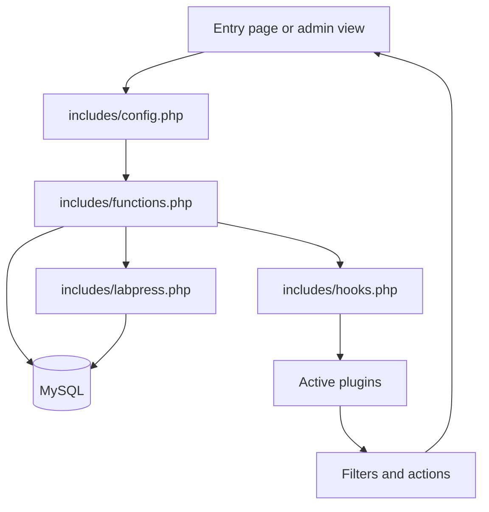

# Developer Resources

This chapter provides a consolidated reference for developers who want to understand the LabPress codebase, set up a local development environment, follow coding conventions, and contribute effectively.

The page is intended as a starting point rather than a replacement for the more detailed chapters in this documentation. Use it to locate the key files, functions, and resources that are relevant for development and maintenance work.

## 1. Overview

LabPress is written in plain PHP and MySQL, with no external PHP framework or dependency manager. Development follows a simple flat-file structure, and the system can be run locally with only a web server, PHP, and MySQL installed.



The following resources are most relevant to developers:

- Source code on GitHub
- Core functions in `includes/functions.php`
- Hook system in `includes/hooks.php`
- Configuration helper in `includes/labpress.php`
- Frontend templates in the project root
- Admin views in `admin/views/`
- API endpoints in `api/`
- Plugin examples in `plugins/`
- Language packs in `languages/`
- Database schema described in the `labpressexample.sql` file

## 2. Repository and Source Code

The official source code is hosted in the LabPress GitHub repository:

```
https://github.com/GuiHui-huimy/LabPress
```

The repository contains the full application source, example plugins, language files, and the sample database dump used for installation.

To clone the repository for development:

```bash
git clone https://github.com/GuiHui-huimy/LabPress.git
cd LabPress
```

It is recommended to create a dedicated branch for changes and to submit contributions through pull requests.


## 3. Local Development Environment

LabPress has minimal server requirements. A local development environment can be set up quickly using the PHP built-in web server.

### 3.1 Requirements

Ensure the following are available:

- PHP 7.4 or higher
- MySQL 5.7+ or MariaDB 10.3+
- PHP extensions: `pdo`, `pdo_mysql`, `json`, `mbstring`, `session`, `fileinfo`, `zip`

### 3.2 Create the Configuration File

Copy the sample configuration to the active configuration path:

```bash
cp includes/config-sample.php includes/config.php
```

Then update `includes/config.php` with the local database credentials. `includes/config.php` is environment-specific and should not be committed when it contains real passwords. Keep `includes/config-sample.php` as the shareable template.

### 3.3 Import the Sample Database

Create a local database and import the sample SQL file.

```bash
mysql -u root -p -e "CREATE DATABASE labpress CHARACTER SET utf8mb4 COLLATE utf8mb4_general_ci;"
mysql -u root -p labpress < labpressexample.sql
```

### 3.4 Start the Built-in PHP Server

From the project root, run:

```bash
php -S 127.0.0.1:8080
```

Then open:

```
http://127.0.0.1:8080
```

The admin panel is available at:

```
http://127.0.0.1:8080/admin
```

The default administrator credentials in the sample database are:

- **Username**: `root`
- **Password**: `lab123456`

Change this password immediately after logging in.

## 4. Project Architecture Summary

LabPress follows a pragmatic flat-file structure rather than a strict MVC pattern.

### 4.1 Frontend

Frontend pages are standalone PHP files in the project root:

- `index.php` – homepage
- `tools.php` / `tool-detail.php` – tool listing and detail
- `projects.php` / `project-detail.php` – project listing and detail
- `news.php` / `news-detail.php` – news listing and detail
- `publications.php` – publications listing
- `category.php` – category-filtered project listing

Each page loads `includes/config.php` and `includes/functions.php`, reads the required data from the database, and renders its own HTML.

### 4.2 Admin Panel

The admin panel is contained in the `admin/` directory.

Entry points:

- `admin/index.php` – main admin dashboard and view loader
- `admin/login.php` – login form
- `admin/logout.php` – logout handler

Admin views are stored in `admin/views/`. Each view file handles its own data retrieval, POST processing, and HTML rendering. The views are loaded based on the `?view=` query parameter.

Admin assets are stored in `admin/assets/`.

### 4.3 API Layer

The `api/` directory contains JSON endpoints used by the frontend and admin JavaScript.

Important endpoints:

- `api/data.php` – unified data reader
- `api/save.php` – unified data writer
- `api/upload.php` – image upload handler
- `api/users.php` – user CRUD
- `api/auth.php` – authentication and session check
- `api/plugin-install.php`, `api/plugin-install-from-url.php`, `api/plugin-uninstall.php` – plugin installation and removal

### 4.4 Core Includes

The `includes/` directory contains shared functions and core classes:

- `config.php` – environment and database configuration
- `functions.php` – core helper functions, translation, data access, and plugin loading
- `hooks.php` – `LabPress_Hooks` class implementing actions and filters
- `labpress.php` – `LabPress` static utility class
- `header.php` / `footer.php` – frontend layout fragments

## 5. Core Functions and Classes

### 5.1 Global Helper Functions

The file `includes/functions.php` defines the main helper functions used across the application.

Key functions include:

| Function | Purpose |
|----------|---------|
| `getSlides()` | Returns all slides ordered by `sort_order` |
| `getPublications()` | Returns all publications ordered by `sort_order` |
| `getTools()` | Returns all tools ordered by `sort_order` |
| `getToolDetail($name)` | Returns extended details for a tool |
| `getToolVersions($name)` | Returns version history for a tool |
| `getNews()` / `getNewsById($id)` | Returns news list or a single news item |
| `getProjects()` / `getProjectById($id)` | Returns projects or a single project |
| `getCategories()` | Returns project categories |
| `getNavMenus($location)` | Returns active navigation menus for a location |
| `getSiteConfig()` | Returns the full site configuration as an array |
| `getActivePlugins()` | Returns active plugin slugs |
| `syncPlugins()` | Scans the `plugins/` directory and registers new plugins |
| `loadPlugins()` | Includes active plugin files |
| `getFullTitle()` | Generates a complete page title |
| `getLocale()` | Returns the current locale |
| `__()` / `_e()` | Translation functions |
| `getAvailableLanguages()` | Returns available language metadata |
| `hasPermission($perm)` | Checks whether the current user has a permission |
| `isUsingDefaultPassword($username)` | Checks whether the user still uses the default password |
| `markdownToHtml($text)` | Converts Markdown to HTML using Parsedown |

### 5.2 `LabPress_Hooks` Class

Defined in `includes/hooks.php`, this class provides the plugin extension system.

Static methods:

- `addAction($hook, $callback, $priority = 10)`
- `doAction($hook, ...$args)`
- `addFilter($hook, $callback, $priority = 10)`
- `applyFilters($hook, $value, ...$args)`

The complete hook list is documented in [Hooks Reference](../plugins-dev/hooks-reference.md).

### 5.3 `LabPress` Static Utility Class

Defined in `includes/labpress.php`, this class provides configuration and plugin-related helpers.

Static methods:

- `db()` – returns the global PDO instance
- `config($key, $default = '')` – reads a configuration value from `site_config`
- `setConfig($key, $value)` – writes a configuration value
- `registerAdminPage($slug, $title, $callback, $permission = 'all')` – registers a plugin admin page
- `getAdminPages()` – returns registered plugin admin pages
- `enqueueStyle($url)` – registers a frontend stylesheet
- `enqueueScript($url)` – registers a frontend script

## 6. Debugging and Logging

### 6.1 PHP Error Display

During development, it is recommended to enable detailed error reporting temporarily in `config.php` or through the PHP environment.

```php
ini_set('display_errors', 1);
error_reporting(E_ALL);
```

In production, `display_errors` should be disabled, and errors should be written to a log using `log_errors = On`.

### 6.2 Database Errors

The current database connection layer uses PDO exceptions. When a query fails, the exception message can help identify the problem. However, do not expose detailed error messages in a production environment.

### 6.3 Debug Output in Templates

The core templates include several action hooks that can be used to inject temporary debugging output. For example, the `footer_scripts` action can be used in a test plugin to print variables.

```php
LabPress_Hooks::addAction('footer_scripts', function() {
    echo '<pre>' . print_r(get_defined_vars(), true) . '</pre>';
});
```

This should be removed before production use.

## 7. Coding Standards and Style

LabPress does not currently enforce a formal code style through automated tools. However, the codebase follows several conventions.

### 7.1 PHP

- Use PHP tags with `<?php` and `?>` only when necessary. Pure PHP files should omit the closing `?>` tag when possible.
- Use prepared statements for all database queries.
- Escape output with `htmlspecialchars()` where user-visible data is rendered.
- Use `define()` for environment constants in `config.php`.
- Use arrays with the short syntax `[]`.

### 7.2 JavaScript

- Admin JavaScript files are located in `admin/assets/js/`.
- Frontend JavaScript files are located in `assets/js/`.
- Use plain JavaScript without framework dependencies.
- Follow the naming pattern `{module}.js` for admin modules.

### 7.3 CSS

- Admin styles are centralized in `admin/assets/css/admin.css`.
- Frontend styles are split by page, for example `index.css`, `tools.css`, `news.css`.
- Use CSS variables defined in each stylesheet for consistent theming.

## 8. Testing and Versioning

### 8.1 PHP Syntax Checks

Before committing changes, run a syntax check on modified PHP files:

```bash
php -l includes/functions.php
php -l api/save.php
```

To check all PHP files:

```bash
find . -name "*.php" -exec php -l {} \;
```

### 8.2 Manual Testing

Because the project currently does not include an automated test suite, manual testing is required for changes. Typical test areas include:

- Login and permission enforcement
- Content creation and editing for each module
- Image uploads
- Plugin activation, deactivation, and uninstallation
- Frontend language switching
- Dynamic translations

### 8.3 Version Control

Use meaningful commit messages and keep unrelated changes in separate commits. For larger changes, create a feature branch and open a pull request against the main branch.

## 9. Repository Maintenance

When contributing to the repository, keep the following points in mind:

- Do not commit `config.php` if it contains real credentials.
- Do not commit uploaded images from local testing unless they are intended as sample content.
- Ensure that new plugins have a valid header comment.
- Keep language files up to date when new interface strings are added.
- Update `README.md` or the documentation when introducing user-facing changes.

## 10. Reporting Issues and Security

For general bugs and feature requests, use the GitHub issue tracker.

For security vulnerabilities, follow the process described in `SECURITY.md`. Do not disclose security issues publicly before they have been addressed.

## 11. Operational Checks

- [ ] `includes/config-sample.php` exists and `includes/config.php` is local-only.
- [ ] The PHP extensions listed in section 3.1 are enabled.
- [ ] The sample dump imports without a collation error.
- [ ] The default password is changed before any non-local exposure.
- [ ] `php -l` passes on every modified PHP file.
- [ ] Login, permissions, uploads, plugins, and language switching are tested manually.
- [ ] Debug output is removed before commit.
- [ ] The documentation is updated when a user-facing behavior changes.

## 12. Next Steps

After reviewing the developer resources, you may want to continue with:

- [Plugin Development](../plugins-dev/intro.md) – understand how to extend LabPress.
- [Hooks Reference](../plugins-dev/hooks-reference.md) – look up available actions and filters.
- [API Reference](api.md) – explore the data endpoints.
- [Database Schema](database.md) – understand the underlying data structure.
- [Core Language Packs](../i18n/core-lang.md) – learn how to add or modify language files.
- [Plugin Examples](../plugins-dev/examples.md) – study real-world plugin implementations.