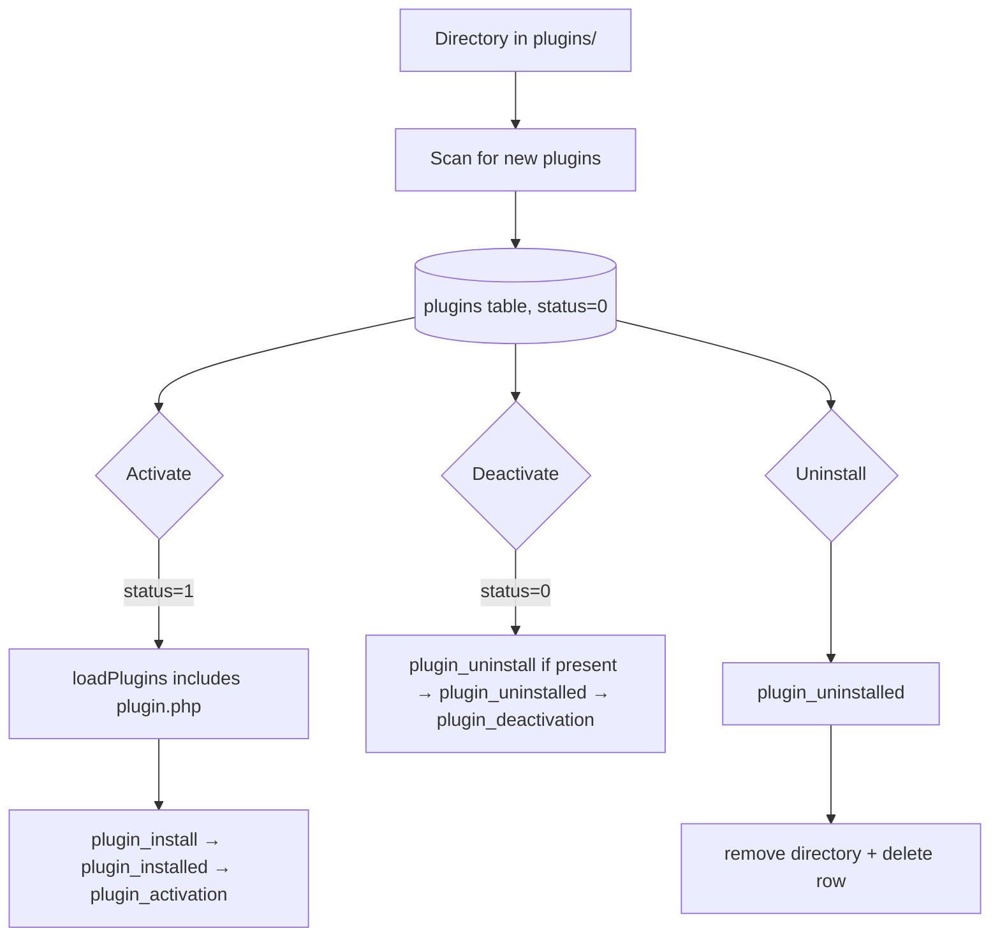

# Plugin Management

This chapter describes the plugin management interface in the LabPress administration panel. It explains how plugins are stored, discovered, activated, deactivated, installed, and uninstalled, as well as how the plugin lifecycle is integrated with the LabPress hook system.

The chapter is intended for site administrators who need to manage the functionality of a LabPress site. For information on developing new plugins, refer to the [Plugin Development](../plugins-dev/intro.md) section.

## 1. Overview

LabPress uses a lightweight plugin system that allows additional functionality to be added without modifying the core code. Plugins are stored as self-contained directories inside the `plugins/` folder. Each plugin contains a `plugin.php` file with a standardized header comment and optional supporting files such as language packs, admin pages, and assets.

The administration panel provides a complete interface for managing plugins. From the **Plugins** menu, administrators can view installed plugins, activate or deactivate them, scan for newly added plugin directories, install plugins from ZIP archives, and uninstall plugins that are no longer needed.

### 1.1 Plugin lifecycle



The key operational rule is that a plugin directory is not active merely because it exists. It must be registered in the `plugins` table and have `status = 1`. A plugin can also be disabled without being deleted, which is the safe default when troubleshooting.

## 2. Plugin Storage and Registration

Plugins are registered in the `plugins` table. This table stores metadata about each plugin and tracks whether it is currently active.

The table structure is as follows:

| Column | Type | Description |
|--------|------|-------------|
| `id` | `int unsigned` | Primary key, auto-increment |
| `slug` | `varchar(100)` | Plugin directory name; must be unique |
| `name` | `varchar(255)` | Human-readable plugin name parsed from the plugin header |
| `description` | `text` | Short description parsed from the plugin header |
| `version` | `varchar(50)` | Plugin version |
| `author` | `varchar(255)` | Plugin author |
| `status` | `tinyint(1)` | `1` for active, `0` for inactive |
| `installed_at` | `timestamp` | Time when the plugin was registered |
| `updated_at` | `timestamp` | Time when the plugin record was last updated |

The `slug` field is the critical identifier. It must exactly match the name of the plugin directory inside `plugins/`. New manifests use lowercase, hyphenated slugs, for example `plugins/footer-info/plugin.json` with `"slug": "footer-info"`. Legacy directories such as `FooterInfo` remain readable until migrated.

## 3. Plugin Manifest and Header Format

v1.3.0 prefers `plugin.json` (Manifest v2). See [plugin-manifest.md](../plugins-dev/plugin-manifest.md) for the full schema. `plugin.php` must still exist and remain the executable entry point.

A minimal legacy header is kept for compatibility:

```php
<?php
/**
 * Plugin Name: Footer Info
 * Description: Customizable footer information with placeholder support.
 * Version: 3.0.0
 * Author: LabPress Community
 * Requires LabPress: >=1.3.0
 */
```

`plugin.json` values take precedence over the header. `Manager::discover()` caches the normalized manifest in `plugins.manifest_json`.

## 4. Access and Permissions

All plugin management actions require the `all` permission. The admin pages for plugin listing, installation, and market access include the following permission check:

```php
if (!hasPermission('all')) {
    echo '<div class="card"><p>' . __('no_permission', 'admin') . '</p></div>';
    return;
}
```

Similarly, the API endpoints used for plugin activation, installation, and uninstallation enforce the same permission. Any request from a user without the `all` permission is rejected with a `403` status and a JSON error response.

## 5. Installed Plugins Page

The **Plugins > Installed Plugins** page displays a table of all plugins registered in the `plugins` table. Each row shows:

- Plugin name and slug
- Description
- Version
- Status (Activated or Deactivated)
- Action buttons

The data is loaded directly from the `plugins` table and rendered in the admin view.

The action buttons depend on the current status:

- For inactive plugins, an **Activate** button is shown.
- For active plugins, a **Deactivate** button is shown.

There is also a **Scan for New Plugins** button at the top of the page. This button triggers the plugin synchronization process described in the next section.

## 6. Scanning for New Plugins

If a plugin directory has been added manually to the `plugins/` folder, it will not automatically appear in the admin list until it has been scanned.

The **Scan for New Plugins** button sends a request to `api/save.php` with `type` set to `plugins` and `action` set to `sync`.

The server-side `syncPlugins()` function performs the following operations:

1. Reads all directories inside `plugins/`.
2. Checks whether each directory contains a `plugin.php` file.
3. Compares the directory name against the slugs already present in the `plugins` table.
4. For new directories, parses the plugin header and inserts a new record with `status = 0`.

The relevant SQL operation is:

```php
$stmt = $pdo->prepare("INSERT INTO plugins (slug, name, description, version, author, status) VALUES (?,?,?,?,?,0)");
$stmt->execute([$info['slug'], $info['name'], $info['description'], $info['version'], $info['author']]);
```

After scanning, the page reloads and the newly discovered plugins are shown in the inactive list.

## 7. Activating and Deactivating Plugins

Activation and deactivation are performed through the plugin list page.

### 7.1 Activation

When the **Activate** button is clicked, a JSON request is sent to `api/save.php` with `type = plugins` and `action = activate`. The request includes the plugin slug in the `data` object.

The server updates the plugin status to `1`:

```php
$stmt = $pdo->prepare("UPDATE plugins SET status = 1 WHERE slug = ?");
$stmt->execute([$slug]);
```

After updating the database, the server includes the plugin file and attempts to call a `plugin_install()` function if one exists:

```php
$pluginFile = __DIR__ . '/../plugins/' . $slug . '/plugin.php';
if (file_exists($pluginFile)) {
    require_once $pluginFile;
    if (function_exists('plugin_install')) {
        plugin_install();
        LabPress_Hooks::doAction('plugin_installed', $slug);
    }
}
LabPress_Hooks::doAction('plugin_activation', $slug);
```

The `plugin_activation` action hook is fired for all activations, allowing plugins to register additional behaviors or create database tables.

### 7.2 Deactivation

Deactivation uses a similar request with `action = deactivate`. The server updates the status to `0`:

```php
$stmt = $pdo->prepare("UPDATE plugins SET status = 0 WHERE slug = ?");
$stmt->execute([$slug]);
```

The server also attempts to call a `plugin_uninstall()` function if defined:

```php
if (function_exists('plugin_uninstall')) {
    plugin_uninstall();
    LabPress_Hooks::doAction('plugin_uninstalled', $slug);
}
LabPress_Hooks::doAction('plugin_deactivation', $slug);
```

Note: The current implementation calls `plugin_uninstall()` during deactivation, which may not be desirable for all plugins. This behavior may be refined in future releases. Plugin developers should be aware that any cleanup logic should be placed in the `plugin_uninstalled` hook or in the plugin’s own deactivation handler if available.

Plugin developers should also make cleanup idempotent: an activation hook may run again after a manual reactivation, and an uninstall hook must tolerate partially removed tables or directories.

## 8. Installing Plugins via ZIP Upload

LabPress supports installing new plugins by uploading a ZIP archive through the admin panel.

The installation page is available under **Plugins > Install Plugin**. It contains an upload form and a system environment check panel.

### 8.1 System Environment Check

Before uploading a plugin, the installation page displays the current server environment status:

- PHP version (required: 8.1 or higher)
- ZipArchive extension (required)
- `plugins/` directory writable status
- `upload_max_filesize`
- `post_max_size`

If the ZipArchive extension is missing or the plugin directory is not writable, the page displays warning messages.

### 8.2 Installation Process

The installation workflow is implemented in `api/plugin-install.php`.

The process performs the following steps:

1. Verifies that a `zip` file was uploaded and has the `.zip` extension.
2. Opens the ZIP archive using the `ZipArchive` class.
3. Determines the root folder name from the first entry in the archive.
4. Checks whether a directory with the same name already exists in `plugins/`. If it does, the installation is rejected.
5. Extracts the archive to the `plugins/` directory.
6. Checks that the extracted folder contains a `plugin.php` file. If not, the extracted directory is removed.
7. Parses the plugin header to extract plugin name, description, version, and author.
8. Returns the plugin information as a JSON response.

The JavaScript on the installation page shows a simulated progress bar during the upload process and displays the plugin information after a successful installation.

After installation, the plugin is not activated automatically. The administrator must go to **Plugins > Installed Plugins** and activate it manually.

## 9. Uninstalling Plugins

Plugins can only be uninstalled when they are inactive. The **Installed Plugins** page hides the uninstall button for active plugins.

The uninstall operation is handled by `api/plugin-uninstall.php`. The process includes the following steps:

1. Verifies that the user has the `all` permission.
2. Validates the plugin slug and ensures the plugin is not active.
3. Fires the `plugin_uninstalled` action hook with the plugin slug.
4. Recursively deletes the plugin directory from `plugins/`.
5. Deletes the corresponding record from the `plugins` table.

The relevant code for the cleanup is:

```php
LabPress_Hooks::doAction('plugin_uninstalled', $slug);

$pluginDir = __DIR__ . '/../plugins/' . $slug;
if (is_dir($pluginDir)) {
    removeDir($pluginDir);
}

$stmt = $pdo->prepare("DELETE FROM plugins WHERE slug = ?");
$stmt->execute([$slug]);
```

The `plugin_uninstalled` hook is important because it gives plugins the opportunity to delete their own database tables or clean up other data before the plugin directory is removed.

## 10. Plugin Marketplace

The **Plugins > Plugin Market** page is a placeholder for a future official plugin marketplace. The current implementation includes a frontend view that loads a remote API endpoint and displays available plugins.

The marketplace page uses the JavaScript file `admin/assets/js/plugins-market.js`. It attempts to fetch a list of plugins from a remote URL. If the marketplace API is unavailable, the page shows a message indicating that the market cannot be accessed.

The remote installation endpoint `api/plugin-install-from-url.php` is available but disabled by default. Enable it explicitly and restrict the hosts that may serve packages:

```php
LabPress::setConfig('plugin_remote_install_enabled', '1');
LabPress::setConfig('plugin_remote_install_hosts', 'plugins.example.com,*.cdn.example.com');
```

The request must include both `download_url` (HTTPS, port 443) and a 64-character `sha256`. The endpoint validates every redirect hop, rejects private/reserved IPs and hosts outside the allowlist, and aborts downloads above 20MB. MarketplaceCore remains a read-only reference for package inspection; LabPress does not modify its logic.


## 11. Plugin Lifecycle Hooks

The plugin system uses the `LabPress_Hooks` class to trigger events during the plugin lifecycle. The following hooks are relevant to plugin management:

| Hook | Type | Description |
|------|------|-------------|
| `plugin_activation` | Action | Fired when a plugin is activated. Receives the plugin slug. |
| `plugin_deactivation` | Action | Fired when a plugin is deactivated. Receives the plugin slug. |
| `plugin_uninstalled` | Action | Fired before a plugin directory is removed. Receives the plugin slug. |
| `plugin_installed` | Action | Fired after a plugin’s `plugin_install()` function has been called during activation. Receives the plugin slug. |
| `admin_before_plugins_activate` | Action | Fired before a plugin is activated. |
| `admin_after_plugins_activate` | Action | Fired after a plugin is activated. |
| `admin_before_plugins_deactivate` | Action | Fired before a plugin is deactivated. |
| `admin_after_plugins_deactivate` | Action | Fired after a plugin is deactivated. |

Plugin developers can use these hooks to perform custom setup and cleanup tasks. For example, a plugin can create a database table when activated and drop it when uninstalled.

### 11.1 Plugin language files

A plugin's own interface strings must be loaded explicitly:

```php
__('ml_plugin_name', 'plugin:dynamic-multilang');
```

The preferred language file lives at `plugins/{slug}/languages/{locale}/plugin.php`; legacy `plugins/{slug}/languages/{locale}.php` files still load through the Translator fallback. The core no longer merges every active plugin language file into the core namespace, so moving plugin strings into `languages/` is not a supported shortcut. When a plugin is deactivated, its language callback disappears; core strings remain intact.

This boundary is separate from database-content translation. Dynamic Multi-Language still uses `ml_translations` for navigation titles, slide text, and site settings.

A full reference of all hooks is available in the [Hooks Reference](../plugins-dev/hooks-reference.md) chapter.

## 12. Security Considerations

Because plugins can execute arbitrary PHP code, plugin management is restricted to administrators with the `all` permission. Only trusted plugins should be installed and activated.

The plugin upload installer performs basic checks to ensure that the uploaded file is a ZIP archive and that it contains a `plugin.php` file. However, these checks do not replace a full code review. Administrators should verify the source and contents of any plugin before installing it on a production site.

The `plugins/` directory must not be directly accessible by visitors. Web server configuration should prevent public access to PHP files inside `plugins/` except through the normal plugin loading process.

When uninstalling a plugin, its directory is permanently deleted. Ensure that any data or database tables created by the plugin are no longer needed or have been backed up before performing the uninstall.

## 13. Operational Checks

- [ ] The plugin directory name matches the `slug` in the `plugins` table.
- [ ] `plugin.php` has a complete header: name, description, version, author.
- [ ] `plugin.json` exists and passes `php tools/lint-plugin.php --strict-version-sync --strict-php-header` when the plugin is distributed.
- [ ] `version`, `requires.core`, and the PHP header agree with `true_version` and the current kernel version.
- [ ] Activation succeeds and the plugin appears as **Active** after reload.
- [ ] Deactivation does not remove data unless the plugin explicitly intends to.
- [ ] The plugin uses `plugin:{slug}` for its own language strings.
- [ ] A ZIP install is tested on staging before production.
- [ ] A backup exists before uninstalling a plugin that owns custom tables.

If a plugin activates but its menu item is missing, check that it registers an admin page on `init` and that the current user has the page's permission. If its strings are missing, check the language file path and the `plugin:` module name before editing core language packs.

## 14. Next Steps

After managing plugins, you may want to continue with:

- [Plugin Development](../plugins-dev/intro.md) – learn how to create custom plugins.
- [Hooks Reference](../plugins-dev/hooks-reference.md) – explore the full list of available hooks.
- [Site Settings](site-settings.md) – configure the general site identity and homepage content.
- [Navigation Menus](navigation.md) – manage header and footer menu items.
- [Content Management](../content/publications.md) – create and manage publications, slides, tools, projects, and news.
- [Internationalization](../i18n/overview.md) – understand how plugins interact with the multilingual system.