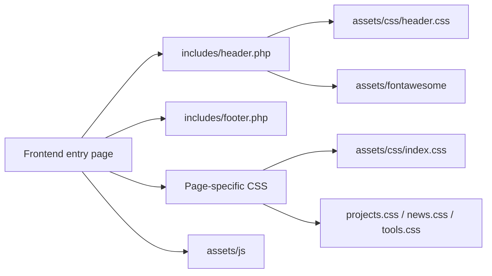

# Theme and Styling

This page describes how LabPress handles its frontend presentation, where the stylesheets live, and what to keep in mind when adapting the look of a site.

## 1. Design Approach

LabPress does not ship a theme engine. The frontend is rendered by nine standalone PHP entry files in the project root, and each page links the stylesheets it needs directly in its `<head>`.

The visual language is defined through CSS custom properties (`--background`, `--text`, `--accent-teal`, and similar variables) declared per stylesheet, so a site-wide restyle can usually be done by adjusting those variables rather than rewriting selectors.

## 2. Stylesheet Layout

| File | Used by |
|------|---------|
| `assets/css/header.css` | Every page with the shared site header |
| `assets/css/index.css` | Homepage, publications, category and project list pages |
| `assets/css/projects.css` | Project list page and category page |
| `assets/css/project-detail.css` | Project detail page |
| `assets/css/news.css` | News list page |
| `assets/css/news-detail.css` | News detail page |
| `assets/css/tools.css` | Tools list page |
| `assets/css/tool_detail.css` | Tool detail page |
| `admin/assets/css/admin.css` | All admin views |
| `admin/assets/css/easymde.min.css` | Markdown editor in admin views |

## 3. Layout Fragments

Shared markup lives in two includes:

- `includes/header.php` – site header, navigation menu, language switcher
- `includes/footer.php` – footer links, `footer_scripts` action, plugin output

Everything else (hero slider, about section, project list, publication list) is written inline in the page that renders it. Changing a section's markup means editing the corresponding page file.

## 4. Icons and Fonts

Font Awesome 6 is served locally from `assets/fontawesome/`: the CSS is `assets/fontawesome/css/all.min.css` and the webfonts live under `assets/fontawesome/webfonts/`. This keeps the frontend independent of a CDN and makes offline deployments possible.

The public header also contains the account entry and its caret/user icons; those icons use the same Font Awesome set. If icons render as empty boxes, check the CSS/font paths before changing the header markup.

## 5. Customising a Site

1. Start with the CSS variables in `assets/css/index.css` – most colour and spacing changes live there.
2. Override component styles in a separate stylesheet and enqueue it through the `before_head_end` action from a small plugin, instead of editing core files.
3. Keep template edits out of core files if the change should survive upgrades; a plugin that hooks into the relevant action or filter is the supported way to customise output.

## 6. Known Limitations

- There is no build step, no CSS minification, and no asset version query string yet.
- Stylesheets are loaded per page, so a shared base stylesheet is not guaranteed.
- The `<html>` element's `lang` attribute follows the active locale, but no `hreflang` alternates are emitted yet.

## Next Steps

- Review [Plugin Development](../plugins-dev/intro.md) to learn how to adjust output without editing core files.
- See [Site Settings](site-settings.md) for configuration keys that affect the frontend.
